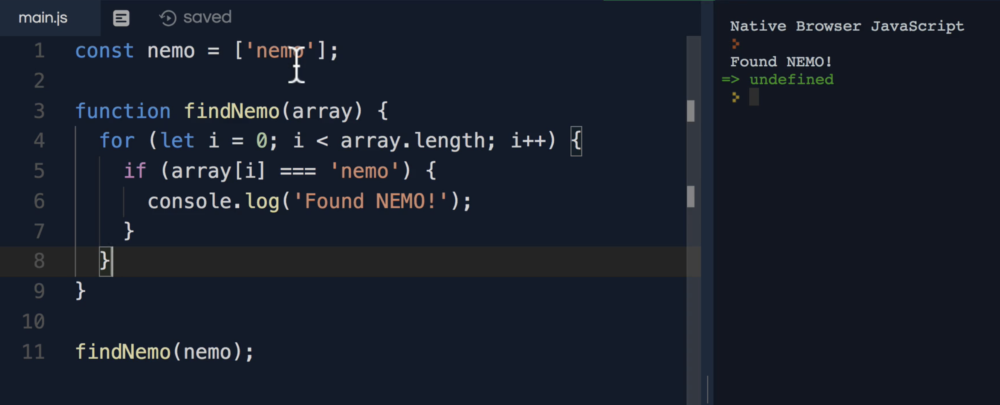
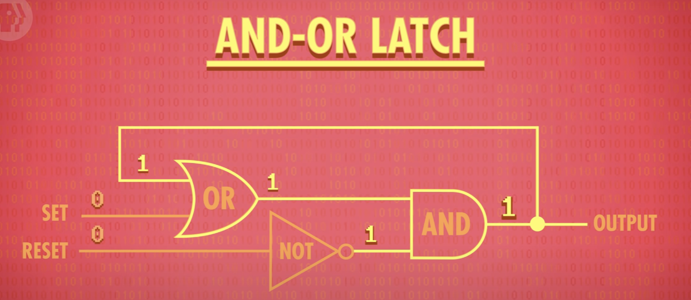
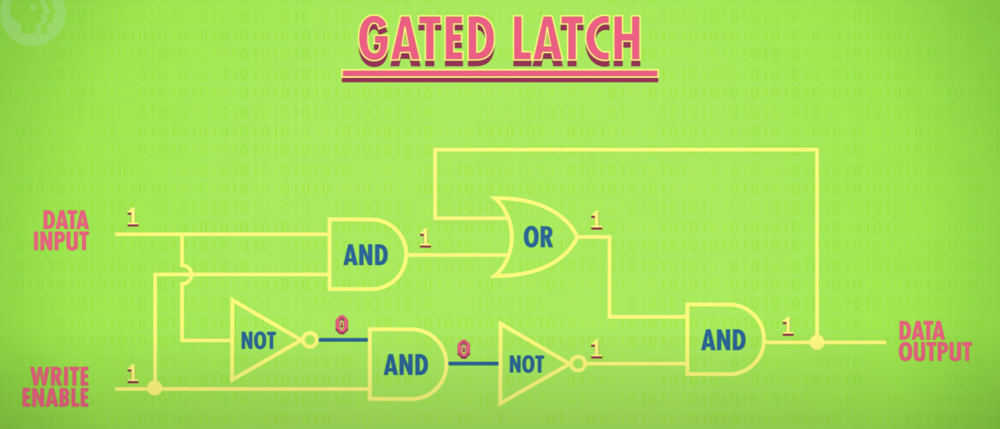
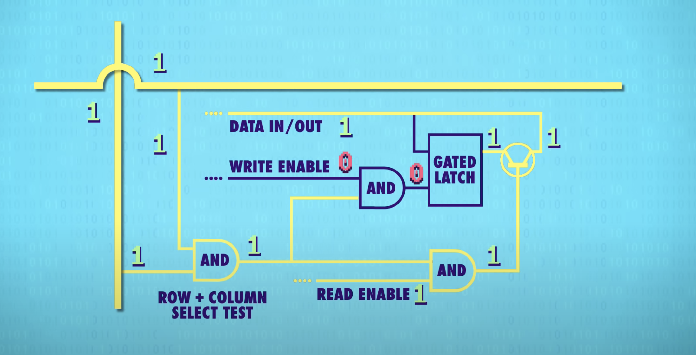
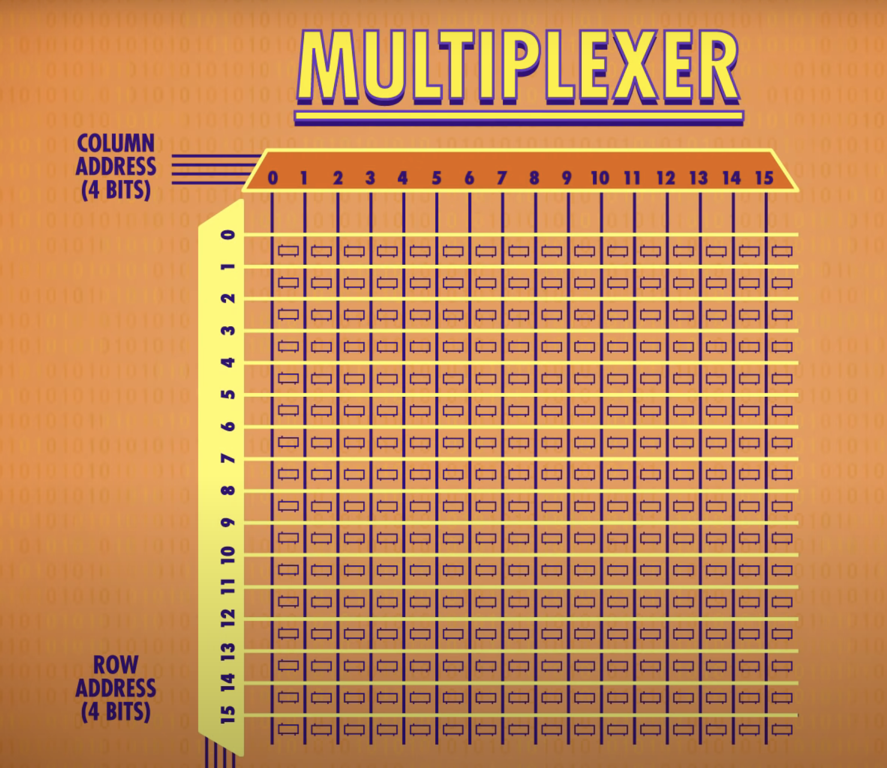
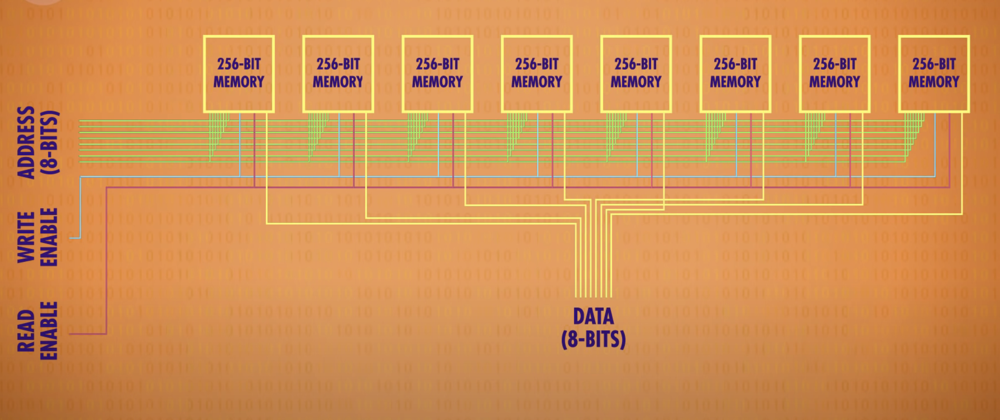

# Algo Experts

<details open>
  <summary> AlgoExperts DS Crash Course </summary>


- problem solving ability
- not much theoretical knowledge is required for coding interviews

<br/>
<br/>


- coding fundamentals
- foundational data structures

<br/>
<br/>

- coding is manipulating data
- strcuture, organize, manage data 
- data structure is a collection of data values, the relationships among them, and the functions or operations that can be applied to data

<br/>
<br/>

- complexity analysis 
- single problem can have multiple solutions. some are better than others. some are lot better than others.
- time complexity and space complexity

<br/>
<br/>

- Memory
- memory is finite
- 0 and 1 --- bits
- 8 bits = 1 byte
- endianness -- ordering of bytes 
- ASCII or Unicode encoding
- memory address
- pointers
- Random Access Memory : RAM

<br/>
<br/>


- Big O Notation


<br/>
<br/>

- Logarithm
- log x base b = y iff b ^ y = x
- In computer science, we assume base is 2; Binary Logarithm
- In math, if we don't specify base, we assume base is 10
- log(1) = 0
- 2 ^ ? = N ; in here, as N doubles, the ?, log(N) only increases by one 


<br/>
<br/>

- Arrays

<br/>
<br/>


- LinkedLists
- get -- O(i) T
- set -- O(i) T
- init -- O(n) ST
- copy -- O(n) ST
- Traverse -- O(n) T
- Insertion -- O(1) or O(i)
- Singly Linked List -- one link between two nodes; next pointer
- Doubly linked list -- two links between two nodes; next, prev pointers
- 

<br/>
<br/>


- Hash Tables
- Java Script Object or Python Dictionary
- Key Value store
- every key maps to a value; keys need not be integers. 
- insertion, deletion, searching for value given key -- O(1) on average (Amortized time); O(n) in worst case;
- HashTables are built on top of arrays and linkedlists. 
- Hash Function is used to transform the key into Index -- integer in a range. 
- x mod n gives values between 0 and n-1
- hash collisions -- hash function generates same hash value for different keys
- resizeable hash tables; -- similar to dynamic arrays
- O(n) space;

<br/>
<br/>

- Stacks and Queues
- inserting and deleting only from one end -- O(1) time
- Stacks -- LIFO
- Queue -- FIFO
- enqueue, dequeue -- can be O(1) using linked lists
- push, pop -- can be O(1) using arrays | linkedlists
- priority queue
- max stack
- min stack
- peek or top of stack 

<br/>
<br/>


- Strings
- ASCII -- one byte for character
- traverse -- O(n)
- copy -- O(n)
- get -- O(1)
- strings are mutable in c++ but not in most other languages (python, java, javascript...)

<br/>
<br/>


- Graphs
- collection of nodes that may or may not be connected to each other
- node is vertex
- connection is edges
- virtices and edges
- connected graph -- starting from any node, you can reacn any other node. some connection between any two nodes
- directional graphs -- directed graph; say flights 
- no directions between connected nodes -- undirected graph; say friendships ( hope so )
- cyclic graphs
- acyclic graphs
- cycle -- 3 or more nodes that go in infinite loop; say if you start at a node, and then reach the same node through any path, then there is a cycle. 
- can mark the visited nodes as visited to keep track of the visited nodes and not visit them again 
- adjacency list -- (say something like all the nodes are keys and for each key you have a list of nodes that you can reach from that particular key or node)
- storing a graph -- O(v + e)
- Traversing graph -- breadth-first | depth-first -- O(v + e)

<br/>
<br/>

- Trees 
- Are also a type of graph
- Cannot be disconnected; Cannot be cyclic; Must have some root node. Each node can have multiple children; Each child can have only one parent; Must be directed -- usually downwards
- k-ary trees -- every node can have atmost k childs
- Binary Search Trees -- special type of binary trees
- Min Heap -- special type of binary trees
- Max Heap -- special type of binary trees
- Tries -- typically stores characters in a string
- Storing tree -- O(n)
- Traverse -- O(n) or O(height of the tree)
- Balanced Binary Tree 
- Skewed or Imbalanced Trees
- Balanced Binary -- If it roughly maintains O(log(n)) TC for traversal when we are eliminating subtree at each step
- Red Black Trees or AVL Trees can restructure themselves to maintain above balance. Maintaining O(log(n)) TC is important
- Branch -- any path that strats at root and ends at leaf
- Bottom nodes -- leaf nodes
- levels
- complete -- every level is filled up except the final level which may or may not be filled up but is filled up from left to right if there any nodes
- full -- every node has exactly k children or no children
- perfect -- all leaf nodes have same depth

</details>

-----

# ZTM

<details open>
  <summary> DSA </summary>

## Introduction

- Getting the Interview
- Non Technical Interview Questions
- Offer + Negotiation
- Technical Interviews
- Practice Questions

<br/><br/>

- Discord
- Deliberate Practice
- Take Breaks
- Complete


## Getting More Interviews

- [interview-mind-map](https://coggle.it/diagram/W5u8QkZs6r4sZM3J/t/master-the-interview)
- [technical-interview-mind-map](https://coggle.it/diagram/W5E5tqYlrXvFJPsq/t/master-the-interview-click-here-for-course-link)

<br/><br/>

- Increase the odds of getting an interview -- percentage
- Interviewing is a numbers game

<br/><br/>

- Resume [resumemaker](https://www.resumemaker.online/) | [checklist](https://github.com/aneagoie/resume-checklist)
- decide if you are worth talking to for a potential interview 
- a way to get an interview
- spend no longer than a day
- see that your employers names are on the resume 
- keywords and job descriptions
- One page -- clean and simple
- relevant skills - that make you stand out; why, how, and what were the results
- personalized -- instead of using same resume everywhere
- online link 
- checklist
- use a pre-designed resume template
- one page resume
- include words from job description
- include company name you are applying to 
- does your first item on resume reflect what company is looking for
- experience titles should demonstrate value
- do you have an online link
- remove the word I 
  - Get to the point right away
- No buzzwords dscribing how great you are 
  - don't tell the recruiter what to think about you
- are you using action words
  - show results, quantifiable results
  - impact on business
- measuure everything in terms of impact, don't just describe your responsibilities
- technical knowledge/skills should include what they are looking for. Only show years if it is impressive
- Include only sections/items that are impressive: experience, projects, education, technical skills
- No typos or bad grammar
- be honest with your resume
- [jobscan](jobscan.com)
- [resume article](https://stackoverflow.blog/2020/11/25/how-to-write-an-effective-developer-resume-advice-from-a-hiring-manager/)
- [samples](https://www.cakeresume.com/Engineering-resume-samples)
- [thisresumedoesnotexist](https://thisresumedoesnotexist.com/)
- [rxresume](https://docs.rxresu.me/tutorial/create-a-new-resume)
- [open-resume](https://www.open-resume.com/)
- [ats-compliant-resumes](https://www.jobscan.co/blog/ats-resume/)
- [ats-compliant-templates](https://www.jobscan.co/resume-templates)

<br/><br/>

- experiecne 
- github
- website
- creative tim
-  mashup-template
-  kk.org kevin kelly
- 1-2 big projects
- blog -- medium, hackernoon, ...
- contribute to open-source projects
- partcipate in hackathons
- any skill that gets the job done -- people management skills, decision making.
- [git-history](https://github.com/gelstudios/gitfiti)
- [gitify-alternative](https://github.com/ZachSaucier/github-calendar-customizer)
- [git-readme-appealing](https://www.youtube.com/watch?v=ktN5tDfQ_g8)

<br/><br/>

- Linkedin
- complete your profile
- Skills and Endorsements
- Include keywords that recruiters might be looking for
- Get referrals
- Strategic and Efficient
- Keep changing your profile just so your profile is active in recently updated.
- [community](https://zerotomastery.io/community/?utm_source=academy&utm_medium=MCI)
- [ztm](https://www.youtube.com/watch?v=D48ER-3dlFI)

- Portfolio
- Email

## Solutions

- [Python solutions 1](https://github.com/theja-m/Data-Structures-and-Algorithms)
- [Python solutions 2](https://github.com/VicodinAbuser/ZTM-DS-and-Algo-Python)
- [C/C++ solutions](https://github.com/shree1999/Data-Structures-and-Algorithms)
- [GO Lang Solutions](https://github.com/punitpandey/DS-Algo)
- [Swift Solutions](https://github.com/preetamjadakar/datastructures-swift)
- [Java Solutions 1](https://github.com/nimrod46/Data-Structures-and-Algorithms)
- [Java Solutions 2](https://github.com/satya-verma/Data-Structures-and-Algorithms--using-JAVA)
- [C# Solutions](https://github.com/anirban-s/data-structures-and-algorithms)
- [TypeScript Solutions](https://github.com/CoffeelessProgrammer/Data-Structures-and-Algorithms-TS)
- [Kotlin Solutions](https://github.com/abdurakhmonoff/data-structures-and-algorithms-kotlin)
- [Perl Solutions](https://github.com/KrisMatrix/DS_Algo)
- [Scala Solutions](https://github.com/beneyal/ztm-dsa-scala)
- [Rust Solutions](https://github.com/sethderrick/Data-Structures-and-Algorithms)

<br/>

- [replit](https://repl.it)
- [glot.io](https://glot.io)

<br/>

- resources 
- [github link for replit code](https://github.com/aneagoie/ztm-master-the-coding-interview-ds-algo)

## Big O

- good code
  - readable
  - scalable
  - recipe/instructions --> meal/output
  - 
  - 

## How to solve coding problems


## DS: Introduction

- DS : Collection of values; think of containers -- food storage, water bottle, backpack, locker -- organize data; put in and take 
  - Arrangement of data
  - Operations you can do on it
- Algorithms : Processes manipulating DS
- DS + Algo = Programs
- good code
  - readable
  - memory
  - speed
- ds
  - how to build 
  - how to use
- Computer
  - CPU -- 
    - Memory Controller
    - Cache -- say LRU
  - RAM -- volatile
    - Address
      - 8 Bits -- Byte 
    - [Memory](https://www.youtube.com/watch?v=fpnE6UAfbtU)
      - [reading 1](http://statmath.wu.ac.at/courses/data-analysis/itdtHTML/node55.html)
      - Latch -- holds one bit of information. A circuit of logic gates used to store information and remember the last input value: latch onto it. 
      - 
        - if set and reset are both zero, the circuit outputs the last input value -- memory
      - gated latch
        - 
      - A group of latches, say 8 latches = register. 
      - Number of bits in a register = width
      - 256 bits -- 16 x 16 matrix of wires.  
        - 
        - we only need 35 wires -- 1 data wire, 1 write enable wire, 1 read enable wire, 16 rows, 16 cols
        - we store the address as two 4bit numbers
        - 11001000 -- 12 row 8 col
        - address --> Multiplexer --> 
           - 
           - one multiplexer to handle rows and other to handle columns
        - 
        - 32 bits = 4 bytes = 1 word
        - each octal digit is equivalent to 3 binary digits -- 0 to 7 -- octal -- prefixed by 0
        - hexadecimal -- each digit represents 0 to 16 -- >= 9 replaced by a to f; each hexadecimal is 4 bits -- prefixed by 0x or #
        - hexadecimals as pairs of digits -- each pair represents a byte of information
        - `0  :  6a 75 73 74 20 74 65 73 74 69 6e 67  |  just testing` -- block of memory
           - offset -- which byte is shown first | actual contents | interpretation of memory contents
        - k bits represent 0 to 2^k - 1 values
        - real numbers -- there is a limit to the precision that we can achieve. 
           - real numbers are stored as floating point number
           - mantissa m, exponentt e --> m.2^e = 
        - endianness -- byte ordering not bit ordering; comes into picture only when considering multi-byte values
           - big endian
              - most significant digit is on the left most; left to right; natural way of writing numbers. 
              - most significant digit -- digit with most weight
              - all fields in network headers -- big endian -- RFC 793 
           - little endian
         - text
           - char --> number --> binary : encoding
           - encoding
             - ASCII -- uses 7 bits
             - UNICODE -- first two bytes represent endianness -- Byte Order Mark BOM
             - UTF-8 -- first three bytes represent BOM
          - datetimes
           - current standard uses Gregorian Calender
           - Time Zones
           - January 1 1970
         - color
           - 4 bytes
           - transluency red green blue intensities
  - Storage -- persistent; slow; 
- `Math.pow(6, 1000)` -- infinity. Can't be stored in RAM
- DS
  - Arrays, LinkedLists
  - Stacks, Queues
  - Trees. Tries, Graphs
  - Hash Tables
- Algo
  - Sorting
  - Dynamic Programming
  - BFS DFS Searching 
  - Sorting
- Operations
  - Insertion
  - Deletion
  - Traversal
  - Searching
  - Sorting
  - Access


## DS: Arrays


## DS: Hash Tables


## DS: Linked Lists


## DS: Stacks + Queues


## DS: Trees


## DS:Graphs


## Algorithms : Recursion


## Algorithms : Sorting


## Algorithms : Searching + BFS + DFS


## Algorithms : Dynamic Programming 


## Non Technical Interviews


## Offer + Negotiation


## Extra Questions


## Bonus : Extra Bits

</details>

-----

# Programming Pathshala


<details open>
  <summary> DSA </summary>

## Module 1 : Begin with Programming


## Module 2 : Gearing Up 7w

### Arrays and Dynamic Arrays

- Fundamentals
  - collection of elements of same data type
  - fixed size | static arrays
  - contiguous memory
  - dynamic arrays
    - amortized time complexity
  - pass by reference (default) -- pointer or address is passed
    - `fun (vector<int> &v)` | `fun(arr, size) & fun(arr int[], size)`
  - pass by value -- new copy
- 


### Mathematics

### Time and Space Complexities


### Recursion


### Backtracking


## Module 3 : Fundamental Algorithms 4w


## Module 4 : Fundamental Data Structure 6w


## Module 5 : Advanced DSA 1  4w


## Module 6 : Advanced DSA 2  4w


## Module 7 : CS Fundamentals 4w


## Module 8 : Low Level Design 3w


## Module 9 : High Level Design 4w


</details>

-----


# NEETCODE 

<details open>
  <summary> DSA Begineers </summary>

## Arrays


## Linked Lists


## Recursion 


## Sorting 


## Binary Search 


## Trees


## Backtracking


## Heap Priority Queue


## Hashing 


## Graphs 


## Dynamic Programming 


## Bit Manipulation 

</details>


<details open>
  <summary> DSA Advanced </summary>

## Arrays

### Kadane's Algorithm

- Q: Find a non-empty sub array with the largest sum
- 

## Linked Lists


## Tries


## Heaps


## Backtracking 


## Graphs 


## Dynamic Programming


</details>


-----

# InterviewCake


<details open>
  <summary> DSA </summary>

- Arrays 
  - index based
  - ordered
  - array slicing
  - in-place destructive; out-of-place safe 
  - dynamic array
    - array size is not constant anymore
  - adv 
    - fast lookups / appends
    - variable size 
    - cache friendly -- place items together in memory
  - dis adv
    - slow worst-case appends
    - costly inserts and deletes -- scooting over of elements is required
  - dynamic array size vs dynamic array capacity
  - amortized cost
    - Amortize is a fancy verb used in finance that refers to paying off the cost of something gradually. 
    - With dynamic arrays, every expensive append where we have to grow the array "buys" us many cheap appends in the future. 
    - Conceptually, we can spread the cost of the expensive append over all those cheap appends.
    - O(m) + O(2m) for doubling along the way of adding m elements
  - Python lists
    - Ordered, 0-indexed, list.append()

  - Python tuples 
    - ordered, indexed
    - immutable

  - Q1 : 
    - ```python
      def merge_ranges(meetings):

      # Merge meeting ranges
      
      sorted_meetings = sorted(meetings)
      merged_meetings = [sorted_meetings[0]]
      
      for current_meeting_start, current_meeting_end in sorted_meetings[1:]:
          last_merged_meeting_start, last_merged_meeting_end = merged_meetings[-1]
          
          if (current_meeting_start <= last_merged_meeting_end):
              merged_meetings[-1] = (last_merged_meeting_start, max(last_merged_meeting_end, 
              current_meeting_end))
          else:
              merged_meetings.append((current_meeting_start, current_meeting_end))
      
      return merged_meetings
      ```
  - Q2:
    - ```python
      
      ```


<br/>


</details>

-----


