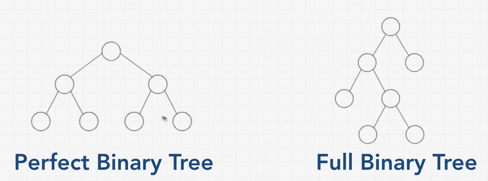
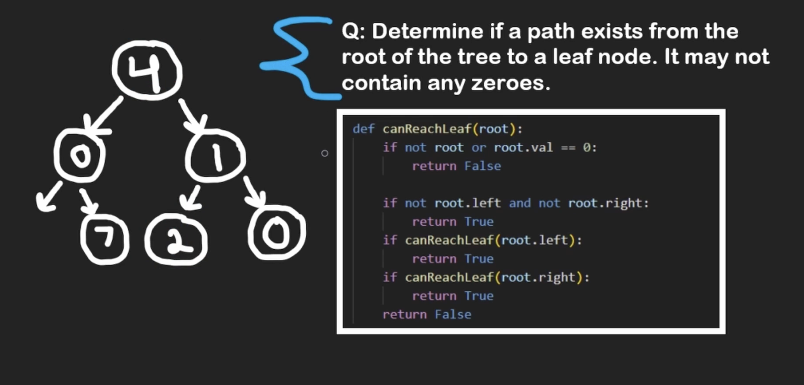
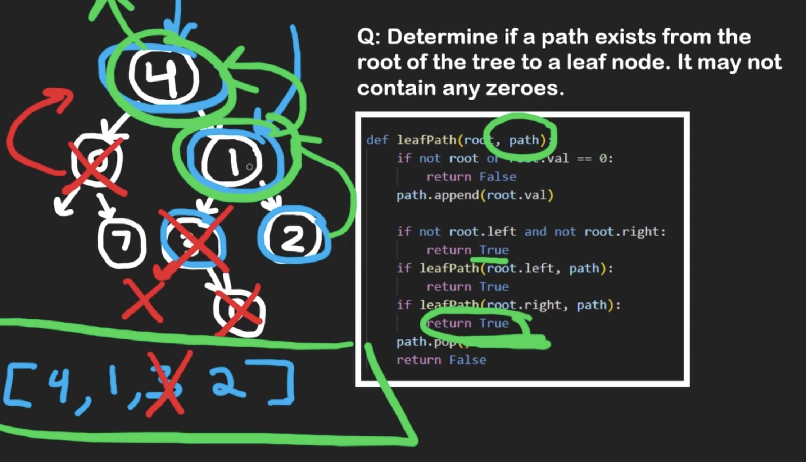
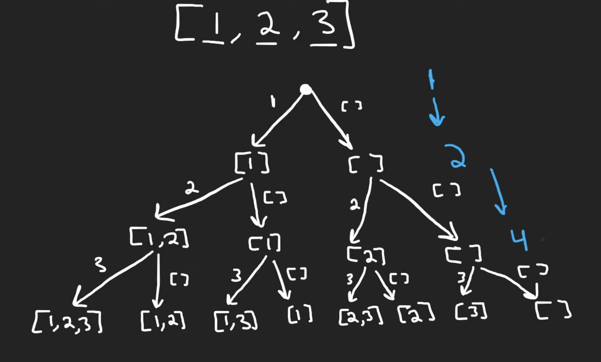
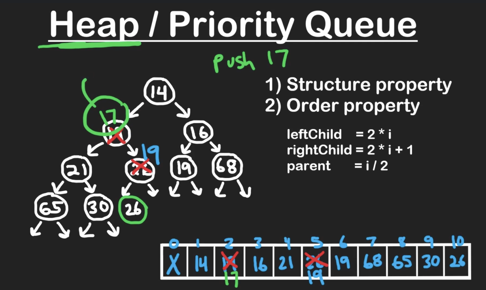
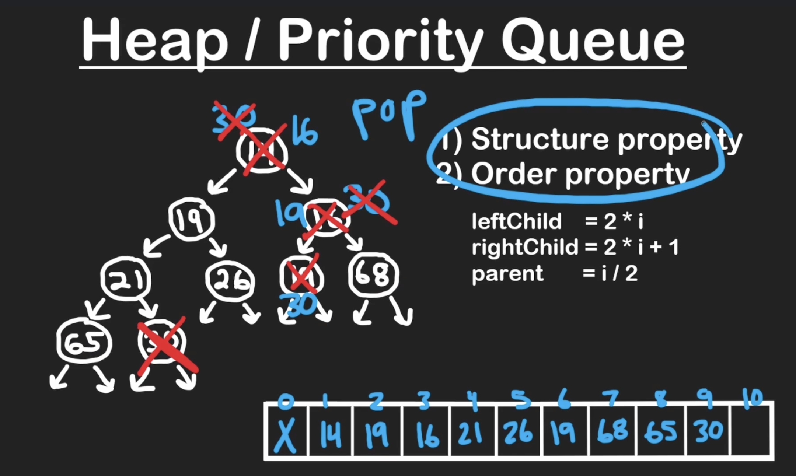
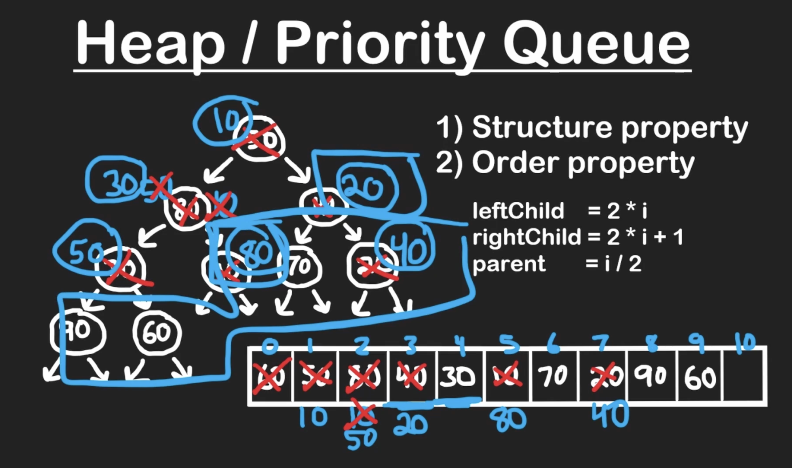
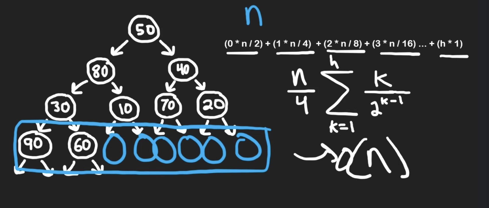

# Algo Experts

<details open>
  <summary> AlgoExperts DS Crash Course </summary>


- problem solving ability
- not much theoretical knowledge is required for coding interviews

<br/>
<br/>


- coding fundamentals
- foundational data structures

<br/>
<br/>

- coding is manipulating data
- strcuture, organize, manage data 
- data structure is a collection of data values, the relationships among them, and the functions or operations that can be applied to data

<br/>
<br/>

- complexity analysis 
- single problem can have multiple solutions. some are better than others. some are lot better than others.
- time complexity and space complexity

<br/>
<br/>

- Memory
- memory is finite
- 0 and 1 --- bits
- 8 bits = 1 byte
- endianness -- ordering of bytes 
- ASCII or Unicode encoding
- memory address
- pointers
- Random Access Memory : RAM

<br/>
<br/>


- Big O Notation


<br/>
<br/>

- Logarithm
- log x base b = y iff b ^ y = x
- In computer science, we assume base is 2; Binary Logarithm
- In math, if we don't specify base, we assume base is 10
- log(1) = 0
- 2 ^ ? = N ; in here, as N doubles, the ?, log(N) only increases by one 


<br/>
<br/>

- Arrays

<br/>
<br/>


- LinkedLists
- get -- O(i) T
- set -- O(i) T
- init -- O(n) ST
- copy -- O(n) ST
- Traverse -- O(n) T
- Insertion -- O(1) or O(i)
- Singly Linked List -- one link between two nodes; next pointer
- Doubly linked list -- two links between two nodes; next, prev pointers
- 

<br/>
<br/>


- Hash Tables
- Java Script Object or Python Dictionary
- Key Value store
- every key maps to a value; keys need not be integers. 
- insertion, deletion, searching for value given key -- O(1) on average (Amortized time); O(n) in worst case;
- HashTables are built on top of arrays and linkedlists. 
- Hash Function is used to transform the key into Index -- integer in a range. 
- x mod n gives values between 0 and n-1
- hash collisions -- hash function generates same hash value for different keys
- resizeable hash tables; -- similar to dynamic arrays
- O(n) space;

<br/>
<br/>

- Stacks and Queues
- inserting and deleting only from one end -- O(1) time
- Stacks -- LIFO
- Queue -- FIFO
- enqueue, dequeue -- can be O(1) using linked lists
- push, pop -- can be O(1) using arrays | linkedlists
- priority queue
- max stack
- min stack
- peek or top of stack 

<br/>
<br/>


- Strings
- ASCII -- one byte for character
- traverse -- O(n)
- copy -- O(n)
- get -- O(1)
- strings are mutable in c++ but not in most other languages (python, java, javascript...)

<br/>
<br/>


- Graphs
- collection of nodes that may or may not be connected to each other
- node is vertex
- connection is edges
- virtices and edges
- connected graph -- starting from any node, you can reacn any other node. some connection between any two nodes
- directional graphs -- directed graph; say flights 
- no directions between connected nodes -- undirected graph; say friendships ( hope so )
- cyclic graphs
- acyclic graphs
- cycle -- 3 or more nodes that go in infinite loop; say if you start at a node, and then reach the same node through any path, then there is a cycle. 
- can mark the visited nodes as visited to keep track of the visited nodes and not visit them again 
- adjacency list -- (say something like all the nodes are keys and for each key you have a list of nodes that you can reach from that particular key or node)
- storing a graph -- O(v + e)
- Traversing graph -- breadth-first | depth-first -- O(v + e)

<br/>
<br/>

- Trees 
- Are also a type of graph
- Cannot be disconnected; Cannot be cyclic; Must have some root node. Each node can have multiple children; Each child can have only one parent; Must be directed -- usually downwards
- k-ary trees -- every node can have atmost k childs
- Binary Search Trees -- special type of binary trees
- Min Heap -- special type of binary trees
- Max Heap -- special type of binary trees
- Tries -- typically stores characters in a string
- Storing tree -- O(n)
- Traverse -- O(n) or O(height of the tree)
- Balanced Binary Tree 
- Skewed or Imbalanced Trees
- Balanced Binary -- If it roughly maintains O(log(n)) TC for traversal when we are eliminating subtree at each step
- Red Black Trees or AVL Trees can restructure themselves to maintain above balance. Maintaining O(log(n)) TC is important
- Branch -- any path that strats at root and ends at leaf
- Bottom nodes -- leaf nodes
- levels
- complete -- every level is filled up except the final level which may or may not be filled up but is filled up from left to right if there any nodes
- full -- every node has exactly k children or no children
- perfect -- all leaf nodes have same depth

</details>

-----

# ZTM

<details open>
  <summary> DSA </summary>

## Introduction

- Getting the Interview
- Non Technical Interview Questions
- Offer + Negotiation
- Technical Interviews
- Practice Questions

<br/><br/>

- Discord
- Deliberate Practice
- Take Breaks
- Complete


## Getting More Interviews

- [interview-mind-map](https://coggle.it/diagram/W5u8QkZs6r4sZM3J/t/master-the-interview)
- [technical-interview-mind-map](https://coggle.it/diagram/W5E5tqYlrXvFJPsq/t/master-the-interview-click-here-for-course-link)

<br/><br/>

- Increase the odds of getting an interview -- percentage
- Interviewing is a numbers game

<br/><br/>

- Resume [resumemaker](https://www.resumemaker.online/) | [checklist](https://github.com/aneagoie/resume-checklist)
- decide if you are worth talking to for a potential interview 
- a way to get an interview
- spend no longer than a day
- see that your employers names are on the resume 
- keywords and job descriptions
- One page -- clean and simple
- relevant skills - that make you stand out; why, how, and what were the results
- personalized -- instead of using same resume everywhere
- online link 
- checklist
- use a pre-designed resume template
- one page resume
- include words from job description
- include company name you are applying to 
- does your first item on resume reflect what company is looking for
- experience titles should demonstrate value
- do you have an online link
- remove the word I 
  - Get to the point right away
- No buzzwords dscribing how great you are 
  - don't tell the recruiter what to think about you
- are you using action words
  - show results, quantifiable results
  - impact on business
- measuure everything in terms of impact, don't just describe your responsibilities
- technical knowledge/skills should include what they are looking for. Only show years if it is impressive
- Include only sections/items that are impressive: experience, projects, education, technical skills
- No typos or bad grammar
- be honest with your resume
- [jobscan](jobscan.com)
- [resume article](https://stackoverflow.blog/2020/11/25/how-to-write-an-effective-developer-resume-advice-from-a-hiring-manager/)
- [samples](https://www.cakeresume.com/Engineering-resume-samples)
- [thisresumedoesnotexist](https://thisresumedoesnotexist.com/)
- [rxresume](https://docs.rxresu.me/tutorial/create-a-new-resume)
- [open-resume](https://www.open-resume.com/)
- [ats-compliant-resumes](https://www.jobscan.co/blog/ats-resume/)
- [ats-compliant-templates](https://www.jobscan.co/resume-templates)

<br/><br/>

- experiecne 
- github
- website
- creative tim
-  mashup-template
-  kk.org kevin kelly
- 1-2 big projects
- blog -- medium, hackernoon, ...
- contribute to open-source projects
- partcipate in hackathons
- any skill that gets the job done -- people management skills, decision making.
- [git-history](https://github.com/gelstudios/gitfiti)
- [gitify-alternative](https://github.com/ZachSaucier/github-calendar-customizer)
- [git-readme-appealing](https://www.youtube.com/watch?v=ktN5tDfQ_g8)

<br/><br/>

- Linkedin
- complete your profile
- Skills and Endorsements
- Include keywords that recruiters might be looking for
- Get referrals
- Strategic and Efficient
- Keep changing your profile just so your profile is active in recently updated.
- [community](https://zerotomastery.io/community/?utm_source=academy&utm_medium=MCI)
- [ztm](https://www.youtube.com/watch?v=D48ER-3dlFI)

- Portfolio
- Email

## Solutions

- [Python solutions 1](https://github.com/theja-m/Data-Structures-and-Algorithms)
- [Python solutions 2](https://github.com/VicodinAbuser/ZTM-DS-and-Algo-Python)
- [C/C++ solutions](https://github.com/shree1999/Data-Structures-and-Algorithms)
- [GO Lang Solutions](https://github.com/punitpandey/DS-Algo)
- [Swift Solutions](https://github.com/preetamjadakar/datastructures-swift)
- [Java Solutions 1](https://github.com/nimrod46/Data-Structures-and-Algorithms)
- [Java Solutions 2](https://github.com/satya-verma/Data-Structures-and-Algorithms--using-JAVA)
- [C# Solutions](https://github.com/anirban-s/data-structures-and-algorithms)
- [TypeScript Solutions](https://github.com/CoffeelessProgrammer/Data-Structures-and-Algorithms-TS)
- [Kotlin Solutions](https://github.com/abdurakhmonoff/data-structures-and-algorithms-kotlin)
- [Perl Solutions](https://github.com/KrisMatrix/DS_Algo)
- [Scala Solutions](https://github.com/beneyal/ztm-dsa-scala)
- [Rust Solutions](https://github.com/sethderrick/Data-Structures-and-Algorithms)

<br/>

- [replit](https://repl.it)
- [glot.io](https://glot.io)

<br/>

- resources 
- [github link for replit code](https://github.com/aneagoie/ztm-master-the-coding-interview-ds-algo)

## Big O

- good code
  - readable
  - scalable
  - recipe/instructions --> meal/output
  - 
  - 

## How to solve coding problems

- can you solve the companies problems?
- genius, but can't talk to others?
- thought process? tradeoffs?
- foundation: big o


<br/><br/>

- analytic skills
- coding skills
- technical skills
- communication skills


<br/><br/>

- existence, how to look for answers
- why why why

1. write key points at top. make sure you have all the questions. show how organized you are 
2. double check: inputs and outputs
3. most important value of the problem: time, space, and memory. what's main goal?
4. don't be annoying 
5. naive or bruteforce approach. shows you are able to think well and critically
6. tell why this is not the best approach
7. walk through your solution, comment things, see where you can break things. repetition, bottlenecks, unnecessary works? did you use all the information interviewer gave you?
8. before writing code, walk through your code and write down steps to follow
9. modularize your code from beginning
10. never start a whiteboard interview not being sure of how things are going to work out. break things up in functions. start with easy part
11. think of error checks breaking code. never make assumptions about input. check for false inputs. comment in code the checks you want to do, write function, write tests that make function fail
12. write code that reads well. no confusing names like i, j
13. test code: no params, 0, undefined, null, massive arrays, async code, ... ask if you can make assumptions about code, can you make answer return error. are you repeating yourself?
14. talk about where you would improve code, how it works, different approaches, readable, what would you google to improve, performance, ask interesting solutions interviewer has seen to the problem
15. extension questions, too large to fit in memory, input arriving as stream, -- scale. divide and conquer approach - distributed processing of data and only read certain chunks of input, write output back to disk, and combine later


<br/><br/>

1. it works
2. good use of data structures
3. code re-use; do not repeat yourself
4. modular code -- readable, maintainable, testable
5. avoid O(n^2)
6. low space complexity -- avoding recursion (stack overflow), copying large arrays (memory)


<br/><br/>

1. hashmaps for improving time complexity
2. sorted, binary tree O(logn); divide and conquer
3. try sorting input
4. hashtables (precomputed information -- sorted) -- optimize code
5. time vs space tradeoff
6. follow advice/tips/hints
7. space time tradeoffs: hashtables -- takes space but saves time


<br/><br/>

- given 2 arrays, create a fucntion that let's users know if it contains any common elementes
- 2 parameters - arrays - no size limit 
- return true or false 
- nested loops -- O(n^2)
```js
const a1 = ['a', 'b', 'c', 'x'];
const a2 = ['z', 'x', 'y'];

function containsCommonItem(a1, a2){
  for (let i=0; i < a1.length; i++ ){
    for (let j = 0; j < a2.lenght; j++){
      if (a1[i] === a2[j]){
        return true;
      }
    }
  }

  return false;
}

containsCommonItem(a1, a2);
```

- say a1 is converted to object,{a: true, b:true, ... }; check a2[ index ] === obj.properties
```js
function containsCommonItem2(a1, a2){
  // loop through first array and create object where properties === items in array
  // loop through second array and chekc if item in second exists in first 

  let map = {};
  for (let i = 0; i< a1.length; i++){
    if (!map[a[i]]){
      const item = a1[i];
      map[item] = true;
    }
  }

  console.log(map)

  for(let i=0; i< a2.length; i++){
    if(map[a2[i]]) {
      return true
    }
  }

  return false
}
```

- how can i break this. make error free functions; can we assume always inputs are provided correctly (number and format)
- are inputs always provided in the expected format
- language specific optimization

```js
function containsCommonItem3(a1, a2){
  return a1.some(item => a2.include(item))
}
```

- ideally, function should just do one task at a time
- think like an engineer

- has pair with sum?
```js
const a1 = [-1, 0, 1, 2, 3, 4];
const sum = 4

function hasPairWithSum(a1, sum){
  var len = a1.length;

  for(var i = 0; i < len-1; i++){
    for(var j = i+1; j < len; j++){
      if (a[i] + a[j] === sum) { 
        return true;
      }
    }
  }

  return false; 
}

function hasPairWithSum2(arr, sum){
  const mySet = new Set();
  const len = arr.length;
  
  for(let i=0; i < len; i++){
    if(mySet.has(arr[i])){
      return true; 
    }
    mySet.add(sum - arr[i]);
  }
  return false;
}
```

## DS: Introduction

- DS : Collection of values; think of containers -- food storage, water bottle, backpack, locker -- organize data; put in and take 
  - Arrangement of data
  - Operations you can do on it
- Algorithms : Processes manipulating DS
- DS + Algo = Programs
- good code
  - readable
  - memory
  - speed
- ds
  - how to build 
  - how to use
- Computer
  - CPU -- 
    - Memory Controller
    - Cache -- say LRU
  - RAM -- volatile
    - Address
      - 8 Bits -- Byte 
    - [Memory](https://www.youtube.com/watch?v=fpnE6UAfbtU)
      - [reading 1](http://statmath.wu.ac.at/courses/data-analysis/itdtHTML/node55.html)
      - Latch -- holds one bit of information. A circuit of logic gates used to store information and remember the last input value: latch onto it. 
      - 
        - if set and reset are both zero, the circuit outputs the last input value -- memory
      - gated latch
        - 
      - A group of latches, say 8 latches = register. 
      - Number of bits in a register = width
      - 256 bits -- 16 x 16 matrix of wires.  
        - 
        - we only need 35 wires -- 1 data wire, 1 write enable wire, 1 read enable wire, 16 rows, 16 cols
        - we store the address as two 4bit numbers
        - 11001000 -- 12 row 8 col
        - address --> Multiplexer --> 
           - 
           - one multiplexer to handle rows and other to handle columns
        - 
        - 32 bits = 4 bytes = 1 word
        - each octal digit is equivalent to 3 binary digits -- 0 to 7 -- octal -- prefixed by 0
        - hexadecimal -- each digit represents 0 to 16 -- >= 9 replaced by a to f; each hexadecimal is 4 bits -- prefixed by 0x or #
        - hexadecimals as pairs of digits -- each pair represents a byte of information
        - `0  :  6a 75 73 74 20 74 65 73 74 69 6e 67  |  just testing` -- block of memory
           - offset -- which byte is shown first | actual contents | interpretation of memory contents
        - k bits represent 0 to 2^k - 1 values
        - real numbers -- there is a limit to the precision that we can achieve. 
           - real numbers are stored as floating point number
           - mantissa m, exponentt e --> m.2^e = 
        - endianness -- byte ordering not bit ordering; comes into picture only when considering multi-byte values
           - big endian
              - most significant digit is on the left most; left to right; natural way of writing numbers. 
              - most significant digit -- digit with most weight
              - all fields in network headers -- big endian -- RFC 793 
           - little endian
         - text
           - char --> number --> binary : encoding
           - encoding
             - ASCII -- uses 7 bits
             - UNICODE -- first two bytes represent endianness -- Byte Order Mark BOM
             - UTF-8 -- first three bytes represent BOM
          - datetimes
           - current standard uses Gregorian Calender
           - Time Zones
           - January 1 1970
         - color
           - 4 bytes
           - transluency red green blue intensities
  - Storage -- persistent; slow; 
- `Math.pow(6, 1000)` -- infinity. Can't be stored in RAM
- DS
  - Arrays, LinkedLists
  - Stacks, Queues
  - Trees. Tries, Graphs
  - Hash Tables
- Algo
  - Sorting
  - Dynamic Programming
  - BFS DFS Searching 
  - Sorting
- Operations
  - Insertion
  - Deletion
  - Traversal
  - Searching
  - Sorting
  - Access


## DS: Arrays

- lookup and push O(1)
- insert and delete O(n)

```js
const strings = [1, 2, 3, 4];

strings.push(5);
strings.pop();

strings.unshift(0);
strings.splice(start, deleteCount, item_to_add)


```

## DS: Hash Tables


## DS: Linked Lists


## DS: Stacks + Queues


## DS: Trees

- [BigOCheatSheet](https://www.bigocheatsheet.com/)
- [VisuAlgo](https://visualgo.net/en/bst)
- [DSA Mindmap](https://coggle.it/diagram/W5E5tqYlrXvFJPsq/t/master-the-interview-click-here-for-course-link)
- [Github Link](https://github.com/aneagoie/ztm-master-the-coding-interview-ds-algo)


- Binary Tree
  - each node can only have 0, 1, or 2 child nodes
  - each child can only have 1 parent
- 
- Perfect Binary Tree
  - number of nodes on each level doubles as you go down
  - number of nodes on last level = number of nodes on all previous levels + 1
- Binary Search Tree
  - left children are smaller than root
  - right children are larger than root
  - pros and cons
    - Better than O(n)
    - Ordered
    - Flexible Size (Nodes -- can be put anywhere in memory)
    - No O(1) operations
- BSTs can be balanced -- O(logn) or unbalanced O(n)
- [BST Insert & Lookup](https://replit.com/@aneagoie/Data-Structures-Trees-exercise-3#index.js)
  ```javascript
  class Node {
  constructor(value){
    this.left = null;
    this.right = null;
    this.value = value;
  }
  }

  class BinarySearchTree {
    constructor(){
      this.root = null;
    }
    insert(value){
      const newNode = new Node(value);
      if (this.root === null) {
        this.root = newNode;
      } else {
        let currentNode = this.root;
        while(true){
          if(value < currentNode.value){
            //Left
            if(!currentNode.left){
              currentNode.left = newNode;
              return this;
            }
            currentNode = currentNode.left;
          } else {
            //Right
            if(!currentNode.right){
              currentNode.right = newNode;
              return this;
            } 
            currentNode = currentNode.right;
          }
        }
      }
    }
    lookup(value){
      if (!this.root) {
        return false;
      }
      let currentNode = this.root;
      while(currentNode){
        if(value < currentNode.value){
          currentNode = currentNode.left;
        } else if(value > currentNode.value){
          currentNode = currentNode.right;
        } else if (currentNode.value === value) {
          return currentNode;
        }
      }
      return null
    }
    // remove
  }

  const tree = new BinarySearchTree();
  tree.insert(9)
  tree.insert(4)
  tree.insert(6)
  tree.insert(20)
  tree.insert(170)
  tree.insert(15)
  tree.insert(1)
  // JSON.stringify(traverse(tree.root))
  tree.lookup(15);
  tree.lookup(7);

  //     9
  //  4     20
  //1  6  15  170

  function traverse(node) {
    const tree = { value: node.value };
    tree.left = node.left === null ? null : traverse(node.left);
    tree.right = node.right === null ? null : traverse(node.right);
    return tree;
  }
  ```


## DS:Graphs

- a little network; connection to nodes/vertex; edges - links
- directed vs undirected graphs
- weighted vs unweighted graphs
- cyclic vs acyclic graphs
- Directed Acyclic Graph : DAGs


<br/><br/>

```js
// Edge List
const graph = [[0, 2], [2, 3], [2, 1], [1, 3]];

// Adjacent List
const graph = [[2], [2, 3], [0,1,3], [1,2]];

// Adjacent Matrix
const graph = [
  [0, 0, 1, 0], 
  [0, 0, 1, 1], 
  [1, 1, 0, 1], 
  [0, 1, 1, 0]
];
```


<br/><br/>

```js
class Graph{
  constructor(){
    this.numberOfNodes = 0;
    this.adjacentList = {
      0: [1, 2]
    };
  }

  addVertex(node){
    this.adjacentList[node] = [];
    this.numberOfNodes++;
  }

  addEdge(node1, node2){
    // Undirected Graph
    if (!this.adjacentList[node1].includes(node2)) {
      this.adjacentList[node1].push(node2);
    }
    if (!this.adjacentList[node2].includes(node1)) {
      this.adjacentList[node2].push(node1);
    }
  }

  showConnections(){
    const allNodes = Object.keys(this.adjacentList);
    for (let node of allNodes) {
      let nodeConnections = this.adjacentList[node];
      let connections = "";
      let vertex;
      for (vertex of nodeConnections) {
        connections += vertex + " ";
      }
      console.log(node + "-->" + connections);
    }
  }
}

const myGraph = new Graph();
myGraph.addVertex("0");
myGraph.addVertex("1");
myGraph.addVertex("2");
myGraph.addVertex("3");
myGraph.addVertex("4");
myGraph.addVertex("5");
myGraph.addVertex("6");
myGraph.addEdge("3", "1");
myGraph.addEdge("3", "4");
myGraph.addEdge("4", "2");
myGraph.addEdge("4", "5");
myGraph.addEdge("1", "2");
myGraph.addEdge("1", "0");
myGraph.addEdge("0", "2");
myGraph.addEdge("6", "5");

myGraph.showConnections();
```

<br/><br/>

- scaling is hard. 
- relationships
- Neo4j Graph Database

## Algorithms : Recursion

- steps; performs actions on data / data structures
- sorting, dynamic programming, bfs + dfs (searching), recursion 
- `ls -R` -- recrsive list
- recursive function : refers to itself
- repeated sub tasks 
- searching, sorting, traversing tree, dom traversal 
- stackoverflow 
- computer needs to allocate memory to remember call stacks 


```js
function inception(){
  debugger;
  inception();
}
```

- base case; when to stop recursion 
- recursive case, and base case
- 

## Algorithms : Sorting


## Algorithms : Searching + BFS + DFS


## Algorithms : Dynamic Programming 


## Non Technical Interviews


## Offer + Negotiation


## Extra Questions


## Bonus : Extra Bits

</details>

-----

# Programming Pathshala


<details open>
  <summary> DSA </summary>

## Module 1 : Begin with Programming


## Module 2 : Gearing Up 7w

### Arrays and Dynamic Arrays

- Fundamentals
  - collection of elements of same data type
  - fixed size | static arrays
  - contiguous memory
  - dynamic arrays
    - amortized time complexity
  - pass by reference (default) -- pointer or address is passed
    - `fun (vector<int> &v)` | `fun(arr, size) & fun(arr int[], size)`
  - pass by value -- new copy
- 


### Mathematics

### Time and Space Complexities


### Recursion


### Backtracking


## Module 3 : Fundamental Algorithms 4w


## Module 4 : Fundamental Data Structure 6w


## Module 5 : Advanced DSA 1  4w


## Module 6 : Advanced DSA 2  4w


## Module 7 : CS Fundamentals 4w


## Module 8 : Low Level Design 3w


## Module 9 : High Level Design 4w


</details>

-----


# NEETCODE 

# DSA Beginners

<details open>
  <summary> DSA Begineers </summary>

## Arrays

- RAM : Random Access Memory
- Arrays : Stored at continuous locations 
- Holds similar data types, so that you can access ith element just by using simple math
- index based -- 0 to 1
- ith element address = arr_address + (i * element_size) -- all elelments have same size : homogenous 
- soft delete -- seting the value to 0 or null or -1
- Dynamic Arrays 
  - 
> There is a common confusion that O ( 1 ) O(1) is always fast. This is not the case. There could be 1000 1000 operations and the time complexity could still be O ( 1 ) O(1). If the number of operations does not grow as the size of the data or input grows then it is O ( 1 ) O(1).
- 

| Operation | Time Complexity |
| ----------| --------------- |
| <span style="color: #ff0000;">r/w ith element</span> | <span style="color: #ff0000;">O(1)</span> | 
| <span style="color: #ff0000;">insert/remove at end</span> | <span style="color: #ff0000;">O(1)</span> |
| <span style="color: #ff0000;">insert/remove middle</span> | <span style="color: #ff0000;">O(n)</span> |

### Static Arrays


<details open>
  <summary> python code </summary>

<br>

  ```python
  # Insert n into arr at the next open position.
  # Length is the number of 'real' values in arr, and capacity
  # is the size (aka memory allocated for the fixed size array).
  def insertEnd(arr, n, length, capacity):
      if length < capacity:
          arr[length] = n

  # Remove from the last position in the array if the array
  # is not empty (i.e. length is non-zero).
  def removeEnd(arr, length):
      if length > 0:
          # Overwrite last element with some default value.
          # We would also consider the length to be decreased by 1.
          arr[length - 1] = 0

  # Insert n into index i after shifting elements to the right.
  # Assuming i is a valid index and arr is not full.
  def insertMiddle(arr, i, n, length):
      # Shift starting from the end to i.
      for index in range(length - 1, i - 1, -1):
          arr[index + 1] = arr[index]
    
      # Insert at i
      arr[i] = n

  # Remove value at index i before shifting elements to the left.
  # Assuming i is a valid index.
  def removeMiddle(arr, i, length):
      # Shift starting from i + 1 to end.
      for index in range(i + 1, length):
          arr[index - 1] = arr[index]
      # No need to 'remove' arr[i], since we already shifted

  def printArr(arr, capacity):
      for i in range(capacity):
          print(arr[i])
  ```
</details>


<details open>
  <summary> javascript </summary>

   ```javascript
  class StaticArray {

      // Insert n into arr at the next open position.
      // Length is the number of 'real' values in arr, and capacity
      // is the size (aka memory allocated for the fixed size array).
      insertEnd(arr, n, length,  capacity) {
          if (length < capacity) {
              arr[length] = n;
          }
      }  

      // Remove from the last position in the array if the array
      // is not empty (i.e. length is non-zero).
      removeEnd(arr, length) {
          if (length > 0) {
              // Overwrite last element with some default value.
              // We would also consider the length to be decreased by 1.
              arr[length - 1] = 0;
              length--;
          }
      }  

      // Insert n into index i after shifting elements to the right.
      // Assuming i is a valid index and arr is not full.
      insertMiddle(arr, i, n, length) {
          // Shift starting from the end to i.
          for (let index = length - 1; index > i - 1; index--) {
              arr[index + 1] = arr[index];
          }
          //Insert at i
          arr[i] = n;
      }

      // Remove value at index i before shifting elements to the left.
      // Assuming i is a valid index.
      removeMiddle(arr, i, length) {
          // Shift starting from i + 1 to end.
          for (let index = i + 1; index < length; index++) {
              arr[index - 1] = arr[index];
          } 
          // No need to 'remove' arr[i], since we already shifted
      }

      printArr(arr, length) {
          let s = "";
          for (let i = 0; i < length; i++) {
              s+= arr[i] + " ";
          }      
          console.log(s);
      }
  }
   ```
</details>


<details open>
  <summary> java </summary>

   ```java
  public class StaticArray {

      // Insert n into arr at the next open position.
      // Length is the number of 'real' values in arr, and capacity
      // is the size (aka memory allocated for the fixed size array).
      public void insertEnd(int[] arr, int n, int length, int capacity) {
          if (length < capacity) {
              arr[length] = n;
          }
      }    
            
      // Remove from the last position in the array if the array
      // is not empty (i.e. length is non-zero).
      public void removeEnd(int[] arr, int length) {
          if (length > 0) {
              // Overwrite last element with some default value.
              // We would also consider the length to be decreased by 1.
              arr[length - 1] = 0;
              length--;
          }
      }        

      // Insert n into index i after shifting elements to the right.
      // Assuming i is a valid index and arr is not full.
      public void insertMiddle(int[] arr, int i, int n, int length) {
          // Shift starting from the end to i.
          for (int index = length - 1; index > i - 1; index--) {
              arr[index + 1] = arr[index];
          }
          // Insert at i
          arr[i] = n;
      }

      // Remove value at index i before shifting elements to the left.
      // Assuming i is a valid index.
      public void removeMiddle(int[] arr, int i, int length) {
          // Shift starting from i + 1 to end.
          for (int index = i + 1; index < length; index++) {
              arr[index - 1] = arr[index];
          } 
          // No need to 'remove' arr[i], since we already shifted
      }

      public void printArr(int[] arr, int length) {
          for (int i = 0; i < length; i++) {
              System.out.print(arr[i] + " ");
          }      
          System.out.println();
      }
  }    
   ```
</details>


<details open>
  <summary> cpp </summary>

   ```cpp
  #include <iostream>

  using std::cout;
  using std::endl;

  // Insert n into arr at the next open position.
  // Length is the number of 'real' values in arr, and capacity
  // is the size (aka memory allocated for the fixed size array).
  void insertEnd(int arr[], int n, int length, int capacity) {
      if (length < capacity) {
          arr[length] = n;
      }
  }

  // Remove from the last position in the array if the array
  // is not empty (i.e. length is non-zero).
  void removeEnd(int arr[], int length) {
      if (length > 0) {
          // Overwrite last element with some default value.
          // We would also consider the length to be decreased by 1.
          arr[length - 1] = 0;
      }
  }

  // Insert n into index i after shifting elements to the right.
  // Assuming i is a valid index and arr is not full.
  void insertMiddle(int arr[], int i, int n, int length) {
      // Shift starting from the end to i.
      for (int index = length - 1; index >= i; index--) {
          arr[index + 1] = arr[index];
      }   
      // Insert at i
      arr[i] = n;
  }

  // Remove value at index i before shifting elements to the left.
  // Assuming i is a valid index.
  void removeMiddle(int arr[], int i, int length) {
      // Shift starting from i + 1 to end.
      for (int index = i + 1; index < length; index++) {
          arr[index - 1] = arr[index];
      }
      // No need to 'remove' arr[i], since we already shifted
  }

  void printArr(int arr[], int capacity) {
      for (int i = 0; i < capacity; i++) {
          cout << arr[i] << ' ';
      }
      cout << endl;
  }
   ```
</details>


<details open>
  <summary> swift </summary>

   ```swift
  // Insert n into arr at the next open position.
  // Length is the number of 'real' values in arr, and capacity
  // is the size (aka memory allocated for the fixed size array).
  func insertEnd(_ arr: inout [Int], _ n: Int, _ length: Int, _ capacity: Int) {
    if length < capacity {
      arr[length] = n
    }
  }

  // Remove from the last position in the array if the array 
  // is not empty (i.e. length is non-zero).
  func removeEnd(_ arr: inout [Int], _ length: Int) {
    if length > 0 {
      // Overwrite last element with some default value
      // We would also consider the length to be decreased by 1
      arr[length - 1] = 0
    }
  }

  // Insert n into index i after shifting elements to the right.
  // Assuming i is a valid index and arr is not full
  func insertMiddle(_ arr: inout [Int], _ i: Int, _ n: Int, _ length: Int) {
    // Shift starting from the end to i
    for index in stride(from: length - 1, through: i, by: -1) {
      arr[index + 1] = arr[index]
    }

    // Insert at i
    arr[i] = n
  }

  // Remove value at index i before shifting elements to the left.
  // Assuming i is a valid index
  func removeMiddle(_ arr: inout [Int], _ i: Int, _ length: Int) {
    // Shift starting from i + 1 to end
    for index in i + 1..<length {
      arr[index - 1] = arr[index]
    }
    // No need to 'remove' arr[i] since we already shifted
  }

  func printArr(_ arr: [Int], _ capacity: Int) {
    for i in 0..<capacity {
      print(arr[i], terminator: " ")
    }
    print()
  }
   ```
</details>


<details open>
  <summary> csharp </summary>

   ```csharp
  public class StaticArray
  { 
      // Insert n into arr at the next open position.
      // Length is the number of 'real' values in arr, and capacity
      // is the size (aka memory allocated for the fixed size array).
      public void InsertEnd(int[] arr, int n, int length, int capacity)
      {
          if (length < capacity)
          {
              arr[length] = n;
          }
      }

      // Remove from the last position in the array if the array
      // is not empty (i.e. length is non-zero).
      public void removeEnd(int[] arr, int length)
      {
          if (length > 0)
          {
              // Overwrite last element with some default value.
              // We would also consider the length to be decreased by 1.
              arr[length - 1] = 0;
              length--;
          }
      }

      // Insert n into index i after shifting elements to the right.
      // Assuming i is a valid index and arr is not full.
      public void InsertMiddle(int[] arr, int i, int n, int length)
      {
          // Shift starting from the end to i.
          for (int index = length - 1; index > i - 1; index--)
          {
              arr[index + 1] = arr[index];
          }
          // Insert at i
          arr[i] = n;
      }

      // Remove value at index i before shifting elements to the left.
      // Assuming i is a valid index.
      public void RemoveMiddle(int[] arr, int i, int length)
      {
          // Shift starting from i + 1 to end.
          for (int index = i + 1; index < length; index++)
          {
              arr[index - 1] = arr[index];
          }
          // No need to 'remove' arr[i], since we already shifted
      }

      public void PrintArr(int[] arr, int length)
      {
          for (int i = 0; i < length; i++)
          {
              Console.Write(arr[i] + " ");
          }
          Console.WriteLine();
      }
  }
   ```
</details>


<details open>
  <summary> go </summary>

   ```go
  package main

  import (
    "fmt"
  )

  // insertEnd inserts n into arr at the next open position.
  func insertEnd(arr []int, n, length, capacity int) []int {
    if length < capacity {
      arr[length] = n
      length++
    }
    return arr
  }

  // removeEnd removes from the last position in the array if the array
  // is not empty (i.e., length is non-zero).
  func removeEnd(arr []int, length int) []int {
    if length > 0 {
      arr[length-1] = 0
      length--
    }
    return arr
  }

  // insertMiddle inserts n into index i after shifting elements to the right.
  // Assuming i is a valid index and arr is not full.
  func insertMiddle(arr []int, i, n, length int) []int {
    // Shift starting from the end to i.
    for index := length - 1; index > i-1; index-- {
      arr[index+1] = arr[index]
    }
    // Insert at i
    arr[i] = n
    length++
    return arr
  }

  // removeMiddle removes value at index i before shifting elements to the left.
  // Assuming i is a valid index.
  func removeMiddle(arr []int, i, length int) []int {
    // Shift starting from i + 1 to end.
    for index := i + 1; index < length; index++ {
      arr[index-1] = arr[index]
    }
    // No need to 'remove' arr[i], since we already shifted
    arr[length-1] = 0
    length--
    return arr
  }

  // printArr prints the array up to the length
  func printArr(arr []int, length int) {
    for i := 0; i < length; i++ {
      fmt.Print(arr[i], " ")
    }
    fmt.Println()
  }
   ```
</details>

- problem : [remove duplicates from sorted array](https://leetcode.com/problems/remove-duplicates-from-sorted-array/)
   ```python
  class Solution:
    def removeDuplicates(self, nums: List[int]) -> int:
        left = 1
        for right in range(1, len(nums)):
            if nums[right] != nums[right - 1]:
                nums[left] = nums[right]
                left = left + 1
        return left      
  ```
- problem: [remove element](https://leetcode.com/problems/remove-element/)
  ```python
  class Solution:
      def removeElement(self, nums: List[int], val: int) -> int:
          k = 0
          for i in range(len(nums)):
              if nums[i] != val:
                  nums[k] = nums[i]
                  k += 1
          return k

  # Optimized solution with the same time and space complexity
  class Solution:
      def removeElement(self, nums: List[int], val: int) -> int:
          # Avoid unessary copy operations in a previous solution, when k == i and nums[i] != val 
          # by swapping nums[i] and the last element of the array (nums[n])
          n = len(nums)
          i = 0

          while i < n:
              if nums[i] == val:
                  nums[i], nums[n - 1] = nums[n - 1], nums[i]
                  n -= 1  # decrement the length of the array by discarding the last element
              else:
                  i += 1
        
          return n
  ```

### Dynamic Arrays


<details open>
  <summary> python </summary>

   ```python
  # Python arrays are dynamic by default, but this is an example of resizing.
  class Array:
      def __init__(self):
          self.capacity = 2
          self.length = 0
          self.arr = [0] * 2 # Array of capacity = 2

      # Insert n in the last position of the array
      def pushback(self, n):
          if self.length == self.capacity:
              self.resize()
            
          # insert at next empty position
          self.arr[self.length] = n
          self.length += 1

      def resize(self):
          # Create new array of double capacity
          self.capacity = 2 * self.capacity
          newArr = [0] * self.capacity 
        
          # Copy elements to newArr
          for i in range(self.length):
              newArr[i] = self.arr[i]
          self.arr = newArr
        
      # Remove the last element in the array
      def popback(self):
          if self.length > 0:
              self.length -= 1
    
      # Get value at i-th index
      def get(self, i):
          if i < self.length:
              return self.arr[i]
          # Here we would throw an out of bounds exception

      # Insert n at i-th index
      def insert(self, i, n):
          if i < self.length:
              self.arr[i] = n
              return
          # Here we would throw an out of bounds exception       

      def print(self):
          for i in range(self.length):
              print(self.arr[i])
          print()

   ```
</details>


<details open>
  <summary> javascript </summary>

   ```javascript
  class DynamicArray {
      constructor() {
          this.capacity = 2;
          this.length = 0;
          this.arr = new Array(2);
      }

      // Insert n in the last position of the array
      pushback(n) {
          if (this.length == this.capacity) {
              this.resize();
          }
  
          // insert at next empty position
          this.arr[this.length] = n;
          this.length++;
      }

      resize() {
          // Create new array of double capacity
          this.capacity = 2 * this.capacity;
          const newArr = new Array(this.capacity); 
        
          // Copy elements to newArr
          for (let i = 0; i < this.length; i++) {
              newArr[i] = this.arr[i];
          }
          this.arr = newArr;
      } 

      // Remove the last element in the array
      popback() {
          if (this.length > 0) {
              this.length--;
          }  
      }    

      // Get value at i-th index
      get(i) {
          if (i < this.length) {
              return this.arr[i];
          }    
          // Here we would throw an out of bounds exception
          return;
      }    

      // Insert n at i-th index
      insert(i, n) {
          if (i < this.length) {
              this.arr[i] = n;
              return;
          }    
          return;
          // Here we would throw an out of bounds exception  
      } 

      print() {
          let s = "";
          for (let i = 0; i < this.length; i++) {
              s+= this.arr[i] + " ";
          }      
          console.log(s);
      }
  }
   ```
</details>


<details open>
  <summary> java </summary>

   ```java
  public class DynamicArray {
      int capacity;
      int length;
      int[] arr;

      public DynamicArray() {
          capacity = 2;
          length = 0;
          arr = new int[2];
      }

      // Insert n in the last position of the array
      public void pushback(int n) {
          if (length == capacity) {
              this.resize();
          }
               
          // insert at next empty position
          arr[length] = n;
          length++;
      }

      public void resize() {
          // Create new array of double capacity
          capacity = 2 * capacity;
          int[] newArr = new int[capacity]; 
        
          // Copy elements to newArr
          for (int i = 0; i < length; i++) {
              newArr[i] = arr[i];
          }
          arr = newArr;
      }  

      // Remove the last element in the array
      public void popback() {
          if (length > 0) {
              length--;
          }  
      }     

      // Get value at i-th index
      public int get(int i) {
          if (i < length) {
              return arr[i];
          }    
          // Here we would throw an out of bounds exception
          return -1;
      }    

      // Insert n at i-th index
      public void insert(int i, int n) {
          if (i < length) {
              arr[i] = n;
              return;
          }    
          return;
          // Here we would throw an out of bounds exception  
      }        

      public void print() {
          for (int i = 0; i < length; i++) {
              System.out.println(arr[i]);
          }
      }
  } 

   ```
</details>


<details open>
  <summary> cpp </summary>

   ```cpp
  #include <iostream>

  using std::cout;
  using std::endl;

  // Example implementation of a resizable array (i.e. a vector).
  class Array {
  public:
      int capacity = 2;
      int length = 0;
      int *arr = new int[2]; // Array of capacity = 2

      Array(){};

      // Insert n in the last position of the array
      void pushback(int n) {
          if (length == capacity)
          {
              resize();
          }
          // insert at next empty position
          arr[length++] = n;
      }

      void resize() {
          // Create new array of double capacity
          capacity = 2 * capacity;
          int *newArr = new int[capacity];

          // Copy elements to newArr
          for (int i = 0; i < length; i++)
          {
              newArr[i] = arr[i];
          }
          arr = newArr;
          // Normally we would use smart pointers or free the old arr's memory
      }

      // Remove the last element in the array
      void popback() {
          if (length > 0) {
              length--;
          }
      }

      // Get value at i-th index
      int get(int i) {
          if (i < length) {
              return arr[i];
          }
          // Here we would throw an out of bounds exception
      }

      // Insert n at i-th index
      void insert(int i, int n) {
          if (i < length) {
              arr[i] = n;
              return;
          }
          // Here we would throw an out of bounds exception
      }

      void print() {
          for (int i = 0; i < length; i++) {
              cout << arr[i] << ' ';
          }
          cout << endl;
      }
  };

   ```
</details>


<details open>
  <summary> swift </summary>

   ```swift
  // Swift arrays are dynamic when using 'var' to declare the array, but this is an example of resizing 
  class Array {
    var capacity = 2
    var length = 0
    var arr = Swift.Array(repeating: 0, count: 2) // Array of capacity = 2

    // Insert n in the last position of the array
    func pushback(_ n: Int) {
      if length == capacity {
        resize()
      }
      arr[length] = n
      length += 1
    }

    func resize() {
      // Create new array of double capacity
      capacity = 2 * capacity
      var newArr = Swift.Array(repeating: 0, count: capacity)

      // Copy elements to newArr
      for i in 0..<length {
        newArr[i] = arr[i]
      }
      arr = newArr
    }

    // Remove the last element in the array 
    func popback() {
      if length > 0 {
        length -= 1
      }
    }

    // Get value at i-th index
    func get(_ i: Int) -> Int {
      if i < length {
        return arr[i]
      }
      // Here we would throw an out of bounds exception
      return -1
    }

    // Insert n at i-th index
    func insert(_ i: Int, _ n: Int) {
      if i < length {
        arr[i] = n
        return
      }
      // Here we would throw an out of bounds exception
    } 

    func print() {
      for i in 0..<length {
        Swift.print(arr[i], terminator: " ")
      }
      Swift.print()
    }
  }
   ```
</details>


<details open>
  <summary> C# </summary>

   ```C#

  public class DynamicArray
  {
      int capacity;
      int length;
      int[] arr;

      public DynamicArray()
      {
          capacity = 2;
          length = 0;
          arr = new int[2];
      }

      // Insert n in the last position of the array
      public void PushBack(int n)
      {
          if (length == capacity)
          {
              this.Resize();
          }

          // insert at next empty position
          arr[length] = n;
          length++;
      }

      public void Resize()
      {
          // Create new array of double capacity
          capacity = 2 * capacity;
          int[] newArr = new int[capacity];

          // Copy elements to newArr
          for (int i = 0; i < length; i++)
          {
              newArr[i] = arr[i];
          }
          arr = newArr;
      }

      // Remove the last element in the array
      public void PopBack()
      {
          if (length > 0)
          {
              length--;
          }
      }

      // Get value at i-th index
      public int Get(int i)
      {
          if (i < length)
          {
              return arr[i];
          }
          // Here we would throw an out of bounds exception
          return -1;
      }

      // Insert n at i-th index
      public void Insert(int i, int n)
      {
          if (i < length)
          {
              arr[i] = n;
              return;
          }
          // Here we would throw an out of bounds exception  
          return;
      }

      public void Print()
      {
          for (int i = 0; i < length; i++)
          {
              Console.Write(arr[i] + " ");
          }
      }
  }
   ```
</details>


<details open>
  <summary> go </summary>

   ```go
  package main

  import (
    "fmt"
  )

  type DynamicArray struct {
    Capacity, Length int
    Arr              []int
  }

  func NewDynamicArray() *DynamicArray {
    return &DynamicArray{
      Capacity: 2,
      Length:   0,
      Arr:      make([]int, 2),
    }
  }

  func (d *DynamicArray) Pushback(n int) {
    if d.Length == d.Capacity {
      d.Resize()
    }

    d.Arr[d.Length] = n
    d.Length++
  }

  func (d *DynamicArray) Resize() {
    d.Capacity = d.Capacity * 2
    newArr := make([]int, d.Capacity)

    copy(newArr, d.Arr)
    d.Arr = newArr
  }

  func (d *DynamicArray) Popback() {
    if d.Length > 0 {
      d.Length--
    }
  }

  func (d *DynamicArray) Get(i int) int {
    if i < d.Length {
      return d.Arr[i]
    }
    return -1
  }

  func (d *DynamicArray) Insert(i, n int) {
    if i < d.Length {
      d.Arr[i] = n
    }
  }

  func (d *DynamicArray) Print() {
    for i := 0; i < d.Length; i++ {
      fmt.Println(d.Arr[i])
    }
  }

   ```
</details>


- problem: [Concatenation of Array](https://leetcode.com/problems/concatenation-of-array/)
  ```python
  class Solution:
  def getConcatenation(self, nums: List[int]) -> List[int]:
      ans = []
      for i in range(2):
          for n in nums:
              ans.append(n)
      return ans

  ```

### Stacks


<details open>
  <summary> python </summary>

   ```python
  # Implementing a stack is trivial using a dynamic array
  # (which we implemented earlier).
  class Stack:
      def __init__(self):
          self.stack = []

      def push(self, n):
          self.stack.append(n)

      def pop(self):
          return self.stack.pop()
   ```
</details>


<details open>
  <summary> javascript </summary>

   ```javascript
  // Implementing a stack is trivial using a dynamic array
  // (which we implemented earlier).
  class Stack {
      constructor() {
          this.stack = new Array();                                                                   
      }

      push(n) {
          this.stack.push(n);
      }

      pop() {
          return this.stack.pop();
      }

      size() {
          return this.stack.length;
      }
  }

   ```
</details>


<details open>
  <summary> java </summary>

   ```java
  import java.util.ArrayList;

  // Implementing a stack is trivial using a dynamic array
  // (which we implemented earlier).
  public class Stack {

      ArrayList<Integer> stack = new ArrayList<Integer>();

      public Stack() {   
      }

      public void push(int n) {
          stack.add(n);
      }

      public int pop() {
          return stack.remove(stack.size() - 1);
      }

      public int size() {
          return stack.size();
      }
  }
   ```
</details>


<details open>
  <summary> cpp </summary>

   ```cpp
  #include <vector>

  using std::vector;

  // Implementing a stack is trivial using a dynamic array
  // (which we implemented earlier).
  class Stack {
  public:
      vector<int> stack_;

      Stack() {};

      void push(int n) {
          stack_.push_back(n);
      }

      int pop() {
          int res = stack_[stack_.size() - 1];
          stack_.pop_back();
          return res;
      }
  };
   ```
</details>


<details open>
  <summary> swift </summary>

   ```swift
  // Implementing a stack is trivial using a dynamic array
  // (which we implemented earlier).
  class Stack {
    var stack: [Int] = []

    func push(_ n: Int) {
      stack.append(n)
    } 

    func pop() -> Int {
      return stack.removeLast()
    }
  }
   ```
</details>


<details open>
  <summary> C# </summary>

   ```C#
  using System;
  using System.Collections;

  // Implementing a stack is trivial using a dynamic array
  // (which we implemented earlier).
  public class Stack
  {
      ArrayList stack = new();

      public Stack() {}

      public void Push(int n)
      {
          stack.Add(n);
      }

      public int Pop()
      {
          if (Size() > 0)
          {
              int ele = (int)stack[stack.Count - 1];
              stack.RemoveAt(stack.Count - 1);
              return ele; 
          }
          return -1;
      }

      public int Size()
      {
          return stack.Count;
      }
  }
   ```
</details>


<details open>
  <summary> go </summary>

   ```go
  package main

  import "fmt"

  type Stack struct {
    stack []int
  }

  func (s *Stack) Push(n int) {
    s.stack = append(s.stack, n)
  }

  func (s *Stack) Pop() int {
    if len(s.stack) == 0 {
      fmt.Println("Error: Stack is empty")
      return 0
    }
    res := s.stack[len(s.stack)-1]
    s.stack = s.stack[:len(s.stack)-1]
    return res
  }

  func (s *Stack) Size() int {
    return len(s.stack)
  }

   ```
</details>


- Problem: [Valid Parentheses](https://neetcode.io/problems/validate-parentheses)
  ```python
  class Solution:
  def isValid(self, s: str) -> bool:
      Map = {")": "(", "]": "[", "}": "{"}
      stack = []

      for c in s:
          if c not in Map:
              stack.append(c)
              continue
          if not stack or stack[-1] != Map[c]:
              return False
          stack.pop()

      return not stack
  ```

- Problem: [Min Stack](https://neetcode.io/problems/minimum-stack)
  ```python
  class MinStack:
  def __init__(self):
      self.stack = []
      self.minStack = []

  def push(self, val: int) -> None:
      self.stack.append(val)
      val = min(val, self.minStack[-1] if self.minStack else val)
      self.minStack.append(val)

  def pop(self) -> None:
      self.stack.pop()
      self.minStack.pop()

  def top(self) -> int:
      return self.stack[-1]

  def getMin(self) -> int:
      return self.minStack[-1]

  ```

## Linked Lists


## Recursion 


## Sorting 


## Binary Search 


## Trees


## Backtracking

- backtracking is kinda bruteforce approach: going through every possibiity
- 
- 
- O(n) Time and O(h) Space (for path or for recursion)

```python
class TreeNode:
    def __init__(self, val):
        self.val = val
        self.left = None
        self.right = None

def canReachLeaf(root):
    if not root or root.val == 0:
        return False
    
    if not root.left and not root.right:
        return True
    if canReachLeaf(root.left):
        return True
    if canReachLeaf(root.right):
        return True
    return False
```

```python
def leafPath(root, path):
    if not root or root.val == 0:
        return False
    path.append(root.val)

    if not root.left and not root.right:
        return True
    if leafPath(root.left, path):
        return True
    if leafPath(root.right, path):
        return True
    path.pop()
    return False
```

### [Problem 1 Path Sum](https://leetcode.com/problems/path-sum/)

```python
class Solution:
  def hasPathSum(self, root: Treenode, sum:int) -> bool:
    if not root:
      return False

    sum -= root.val
    if not root.left and not root.right:
      return sum == 0
    return self.hasPathSum(root.left, sum) or self.hasPathSum(root.right, sum)
```

- O(N) time since we visit every node exactly once
- O(N) space if tree is completely unbalanced and O(log N) space if it is balanced


```python
class Solution:
    def hasPathSum(self, root: TreeNode, sum: int) -> bool:
        if not root:
            return False

        de = [
            (root, sum - root.val),
        ]
        while de:
            node, curr_sum = de.pop()
            if not node.left and not node.right and curr_sum == 0:
                return True
            if node.right:
                de.append((node.right, curr_sum - node.right.val))
            if node.left:
                de.append((node.left, curr_sum - node.left.val))
        return False
```

- The time and space complexities remain same but this uses iteration instead of recursion


### [Problem 2 Subsets](https://neetcode.io/problems/subsets)



```python
# Backtracking
class Solution:
    def subsets(self, nums: List[int]) -> List[List[int]]:
        res = []

        subset = []

        def dfs(i):
            if i >= len(nums):
                res.append(subset.copy())
                return
            subset.append(nums[i])
            dfs(i + 1)
            subset.pop()
            dfs(i + 1)

        dfs(0)
        return res
```

```python
# Iteration
class Solution:
    def subsets(self, nums: List[int]) -> List[List[int]]:
        res = [[]]
        
        for num in nums:
            res += [subset + [num] for subset in res]
        
        return res
```

```python
# Bit Manipulation

class Solution:
    def subsets(self, nums: List[int]) -> List[List[int]]:
        n = len(nums)
        res = []
        for i in range(1 << n):
            subset = [nums[j] for j in range(n) if (i & (1 << j))]
            res.append(subset)
        return res
```


### Combination Sum

```python


```

## Heap Priority Queue

- min or max priorities
- binary heap implementation -- min or max
  - structure property -- complete binary tree (no other level has holes except the last level; if it has missing nodes, it should be at the right)
  - order property -- for every node, all decendents should be either > or < the node 
- if a binary tree satisfies both structure and order properties then it is qualified as a heap
- complete binary tree
  - left child = 2 * i
  - right child = 2 * i + 1
  - parent = i / 2 (round down)
- unlike binary search trees, heaps may contain duplicate values
- binary heaps are implemented using arrays
  - array size = n + 1 (where n is number of nodes)

- push and pop - O(log n)
- 
- 

```python
def push(self, val):
  self.heap.append(val)

  i = len(self.heap) - 1

  # percolate up

  while i > 1 and self.heap[i] < self.heap[i // 2]:
    tmp = self.heap[i]
    self.heap[i] self.heap[i // 2]
    self.heap[i // 2] = tmp
    i = i // 2
```

```python

def pop(self):
  if len(self.heap) == 1: # heap is empty
    return None
  
  if len(self.heap) == 2: # heap has only one node
    return self.heap.pop()

  res = self.heap[1]

  self.heap[1] = self.heap.pop() # structure prop satisfied but not order prop
  i = 1

  # percolate down (node has no children, node only has left child, node has two children) 
  # node can not have only right child -- violates structure property

  while 2 * i < len(self.heap): # while there is a left child
    if (2*i + 1 < len(self.heap) and # there exists a right child
    self.heap[2*i + 1] < self.heap[2 * i] and # right child is less than left child
    self.heap[i] > self.heap[2 * i + 1]): # swap right child 
      tmp = self.heap[i]
      self.heap[i] = self.heap[2*i + 1]
      self.heap[2*i + 1] = tmp
      i = 2 * i + 1
    
    elif self.heap[i] > self.heap[2 * i]: # swap left child
      tmp = self.heap[i]
      self.heap[i] = self.heap[2 * i]
      self.heap[2 *i] = tmp
      i = 2 * i
    else:
      break
  return res
```


```python
# Min Heap
class Heap:
    def __init__(self):
        self.heap = [0]

    def push(self, val):
        self.heap.append(val)
        i = len(self.heap) - 1

        # Percolate up
        while i > 1 and self.heap[i] < self.heap[i // 2]:
            tmp = self.heap[i]
            self.heap[i] = self.heap[i // 2]
            self.heap[i // 2] = tmp
            i = i // 2

    def pop(self):
        if len(self.heap) == 1:
            return None
        if len(self.heap) == 2:
            return self.heap.pop()

        res = self.heap[1]   
        # Move last value to root
        self.heap[1] = self.heap.pop()
        i = 1
        # Percolate down
        while 2 * i < len(self.heap):
            if (2 * i + 1 < len(self.heap) and 
            self.heap[2 * i + 1] < self.heap[2 * i] and 
            self.heap[i] > self.heap[2 * i + 1]):
                # Swap right child
                tmp = self.heap[i]
                self.heap[i] = self.heap[2 * i + 1]
                self.heap[2 * i + 1] = tmp
                i = 2 * i + 1
            elif self.heap[i] > self.heap[2 * i]:
                # Swap left child
                tmp = self.heap[i]
                self.heap[i] = self.heap[2 * i]
                self.heap[2 * i] = tmp
                i = 2 * i
            else:
                break
        return res

    def top(self):
        if len(self.heap) > 1:
            return self.heap[1]
        return None

    def heapify(self, arr):
        # 0-th position is moved to the end
        arr.append(arr[0])

        self.heap = arr
        cur = (len(self.heap) - 1) // 2
        while cur > 0:
            # Percolate down
            i = cur
            while 2 * i < len(self.heap):
                if (2 * i + 1 < len(self.heap) and 
                self.heap[2 * i + 1] < self.heap[2 * i] and 
                self.heap[i] > self.heap[2 * i + 1]):
                    # Swap right child
                    tmp = self.heap[i]
                    self.heap[i] = self.heap[2 * i + 1]
                    self.heap[2 * i + 1] = tmp
                    i = 2 * i + 1
                elif self.heap[i] > self.heap[2 * i]:
                    # Swap left child
                    tmp = self.heap[i]
                    self.heap[i] = self.heap[2 * i]
                    self.heap[2 * i] = tmp
                    i = 2 * i
                else:
                    break
            cur -= 1

```




- heapify runs in O(n) time
- percolating down is more efficient than percolating up


## Hashing 


## Graphs 


## Dynamic Programming 


## Bit Manipulation 

</details>


<details open>
  <summary> DSA Advanced </summary>

## Arrays

### Kadane's Algorithm

- Q: Find a non-empty sub array with the largest sum
- 

## Linked Lists


## Tries


## Heaps


## Backtracking 


## Graphs 


## Dynamic Programming


</details>


-----

# InterviewCake


<details open>
  <summary> DSA </summary>

## 0. Algorithmic Thinking

### 0.1 Big O Notation 

- runtime in terms of <u>how quickly it grows</u> <u>relative to the input</u>, <u>as input gets large</u>
- O(1), O(n), O(n^2), ... ; throw out constants or less significant terms
- Space complexity -- additional space apart from inputs
- <u>**Tradeoff**</u> -- time and space
- <u>**Sometimes constants matter**</u> -- even if it doesn't effect Big O; say you cut down a script run time by 5 times
- <u>**Beware of premature optimisation**</u> -- might negatively impact readability or coding time


### 0.2 Data Structures for Coding Interviews

#### RAM 

- Random Access Memory -- Working memory -- Volatile
- Storage -- Disk -- Persistent
- Processor --> Memory Controller (unlike Disks has direct access to) --> RAM (addresses -- 8 bits )
- Reading from sequential addresses is faster than jumping around because of caching

#### Binary Numbers

- Base 10 -- Decimal -- powers of 10 
- Base  2 -- Binary  -- powers of  2
- Base 16 -- Hexadecimal -- prefixed with `0x or #`
- Unsigned Integer
- Fractions -- store numerator and denominator
- Decimals -- number with decimal point taken out, position where the decimal point goes from leftmost digit
- Negative numbers -- reserve leftmost digit -- 0 positive, 1 negative

#### Fixed Width Integers

- 2^8 = 256 numbers
- Integer overflow -- say you add `255 + 1` becomes `256 = 1 0000 0000`
- tinyint, smallint, int, bigint -- SQL | Integers, Longs -- Java
- Most integrs are fixed width == fixed length unless told otherwise

#### Arrays

- index -- indices
- `arr[n] = arr + n * size of element in array` -- fast lookup
  - each element in array must be of same size
  - array elements must be contiguous

#### Strings

- Strings -- series of characters
- Character encoding -- mapping of numbers to characters
- ASCII 

#### Pointers

- Imagine pointers (addresses) to baby names being stored in babies array as integers 
- not cache-friendly
- lookups in pointer based arrays are still O(1)

#### Dynamic Arrays 

- word processor -- we don't know how many strings. 
- normal array programmed to resize itself
- python ruby js use these by default, but others like Java have Array and <u>**ArrayList**</u>
- array size and array capacity
- resize
  - make a new big array, twice in size
  - copy old array elements into new array
  - free up old array
  - append your new element -- we can call doubling appends -- special appends -- O(n)
    - each doubling append O(n) gives you double the regular appends O(1)
    - <u>**Amortized cost O(1)**</u> -- paying off the cost of something gradually
    - expensive append buys many cheap appends
    - O(m) actual appends + 2 O(m) for any doubling required
- some appends are expensive; worst case O(n) appends; O(n) prepends always


#### Linked Lists

- Node -- two-item arrays per say
- Linked List -- series of nodes
- Head, tail
- worst case O(1) appends and prepends
- O(i) lookup times; not cache-friendly


#### Hashtables

- Say, we now want to count the frequency of words
- Hash maps or hash tables. 
- counts are the values and words are the keys (analogous to indices)
- key index to array index mapping = hashing function
- <u>**Hash collision**</u> -- two keys map to same hash value
- Say, the value of each key is a pointer to a linked list where each node contains the word itself and the count.  
- Lookups are O(1) on average and only in one direction
- Looking up key given value still takes O(n) time


### 0.3 Logarithms

- what power must we raise this base to, inorder to get this answer
- helps when solving for x when x is exponent
- 
- ```py
  def binary_search(nums, key):
    floor_index = -1
    ceil_index = len(nums)

    while floor_index + 1 < ceil_index:
      distance = ceil_index - floor_index
      half_distance = distance // 2
      guess_index = floor_index + half_distance

      if key < nums[guess_index]:
        ceil_index = guess_index
      elif key > nums[guess_index]:
        floor_index = guess_index
      else 
        return True
    return False
  ```

<br/>

- Logarithms in sorting
- Sorting : Best worst case O(n log n)
- If we can tightly bound the range of possible numbers in our list, we can use hash map to do it in O(n) using counting sort
- ```python
  def merge_sort(list_to_sort):
  # Base case: lists with fewer than 2 elements are sorted
  if len(list_to_sort) < 2:
      return list_to_sort

  # Step 1: divide the list in half
  # We use integer division, so we'll never get a "half index"
  mid_index = len(list_to_sort) // 2
  left  = list_to_sort[:mid_index]
  right = list_to_sort[mid_index:]

  # Step 2: sort each half
  sorted_left  = merge_sort(left)
  sorted_right = merge_sort(right)

  # Step 3: merge the sorted halves
  sorted_list = []
  current_index_left = 0
  current_index_right = 0

  # sortedLeft's first element comes next
  # if it's less than sortedRight's first
  # element or if sortedRight is exhausted
  while len(sorted_list) < len(left) + len(right):
      if ((current_index_left < len(left)) and
              (current_index_right == len(right) or
               sorted_left[current_index_left] < sorted_right[current_index_right])):
          sorted_list.append(sorted_left[current_index_left])
          current_index_left += 1
      else:
          sorted_list.append(sorted_right[current_index_right])
          current_index_right += 1
  return sorted_list
  ```

<br/>

- Logarithms in binary tree
- Perfect tree -- each level or tier is full
- Height h = log base 2 of (n+1 / 2) + 1 = log base 2 of (n + 1)
- log base 2 of n == lg n

## 1. Arrays and String manipulation

### 1.1 Array

- <span style="color: #cdf1ae;">O(1) Lookups and Appends</span>
- <span style="color: #ff0000;">O(n) Space, Insert, Delete; fixed size</span>
- Array slicing -- allocates a new array with selected elements; O(n) time O(n) space

<br/>

- Call Stack -- made of stack frames -- one for each function
  - Local variables
  - Arguments passed
  - Information about caller stack frame
  - return address
- <u>**Be careful with recursive function.**</u> Call Stacks result in space complexities. 
- Stack Overflow -- recursion error
- Tail Call Optimization TCO -- very last thing a function does is call another function. This would mean we do not need to store callers stack frame, saving up space
- Python and Java don't implement TCO
- Inplace -- destructive -- modifies input -- have side effects
- Out-of-place -- safer -- no side effects

### 1.2 Dynamic Array

- <span style="color: #cdf1ae;">O(1) Lookups O(1) Appends Average Case | O(1) Appends Worst Case</span>
- <span style="color: #cdf1ae;">fast lookups, variable size, cache-friendly</span>
- <span style="color: #ff0000;">O(n) Insert, Delete, Worst Case Appends</span>

## 2. Hashing and Hashtable

### 2.1 Hashing and Hash Functions

- think of hash as a fingerprint
- we can trust a given file has a unique hash but we can't go back to file from hash
- uses
  - dictionaries 
    - list like data structure with constant time lookups 
    - one way is to define a list, use hash function to hash keys into list indices
  - preventing man in the middle attacks
    - say a software provider provides a hash: indicating their hash value
    - now if nobody tampered with it, the hash remains same.

### 2.2 Hash Table

- map, dictioanry, hash 
- <span style="color: #ff0000;">O(n) space insert lookup delete : Worst case</span>
- <span style="color: #ff0000;">slow worst case lookups</span>, <span style="color: #ff0000;">unordered keys</span>, <span style="color: #ff0000;">single directional lookups</span> (given key get value but not other way around), <span style="color: #ff0000;">not cache-friendly</span> (many hashtable implementations use linked lists)
- worst case lookup O(n) comes from the fact that, <u><span style="color: #ff0000;">when all keys map to same hash value</span></u>, we end up having a big linked list to traverse. Hence O(n)
- Also, <u><span style="color: #ff0000;">when using dynamic array resizing</span></u>, it's O(n); say, things begin to get crowded and we want to double the initial array, rehash everything to find new positions -- all of this is to avoid hash collisons

<br/>

- <span style="color: #cdf1ae;">O(1) insert lookup O(n) space delete : Average case</span>
- <span style="color: #cdf1ae;">fast lookups and flexible keys </span>

<br/>

- x mod n results in a value between 0 and n - 1 inclusive

### 2.3 Sets

- A set is like a hash map but only stores keys without values

## 3. Greedy Algorithms

- A greedy algorithm builds up by greedily choosing the option that looks the best at every step; say you wanna give change for 39 cents using least number of coins. 25 + 10 + 4 ?
- <u><span style="color: #ff0000;">sometimes a greedy algorithm doesn't give you an optimal solution</span></u>
  - <span style="color: #ff0000;">To find the cheapest route visiting a set of cities, choosing to visit the cheapest city you haven't been to yet doesn't produce the cheapest overall itinerary.</span>
  - <span style="color: #ff0000;">When filling a duffel bag with cakes of different weights and values, choosing the cake with the highest value per pound doesn't always produce the best haul.</span>

## 4. Sorting Searching Lograithms

- Binary Search -- O(log n) -- as we cut the posibilities by half at each step

## 5. Trees Graphs

### 5.1 Binary Tree 

- binary tree : every node has two or fewer children
- perfect binary tree : every level of the tree is completely filled
  - number of nodes doubles as we go down the levels
  - number of nodes in the last level = sum of all nodes in other levels + 1
- assuming levels start from 0, nodes at nth level = 2 ^ n or 2 ^ (h-1) where level 0 is considered h = 1
- total nodes = n = 2^h - 1
- h = log base 2 of (n + 1)


### 5.2 Graph

- graph -- interconnected network
- node or vertex -- connected by edges
- representing links; scaling challenges -- most graph algorithms are O(n log n) or slower

<br/>

- directed vs undirected graph
- cyclic vs acyclic graph
- weighted or unweighted graph
- legal coloring -- no two adjancent nodes have the same color

<br/>

- representations
- edge list -- `graph = [[0, 1], [1, 2], [1, 3], [2, 3]]`
- adjacency list -- list index represents node and value is a list of the node's neighbors
  - ```python
    graph = [
      [1],
      [0, 2, 3],
      [1, 3],
      [1, 2],
    ]
    ```
- adjacency matrix
  - ```python
    graph = [
        [0, 1, 0, 0],
        [1, 0, 1, 1],
        [0, 1, 0, 1],
        [0, 1, 1, 0],
    ]
    ```
- Is there a path between two nodes in this undirected graph? Run DFS or BFS from one node and see if you reach the other one.
- What's the shortest path between two nodes in this undirected, unweighted graph? Run BFS from one node and backtrack once you reach the second. Note: **BFS always finds the shortest path, assuming the graph is undirected and unweighted. DFS does not always find the shortest path.**
- Can this undirected graph be colored with two colors? Run BFS, assigning colors as nodes are visited. Abort if we ever try to assign a node a color different from the one it was assigned earlier.
- Does this undirected graph have a cycle? Run BFS, keeping track of the number of times we're visiting each node. If we ever visit a node twice, then we have a cycle.

<br/>

- algorithms 
- **Dijkstra's Algorithm**: Finds the shortest path from one node to all other nodes in a weighted graph.
- **Topological Sort**: Arranges the nodes in a directed, acyclic graph in a special order based on incoming edges.
- **Minimum Spanning Tree**: Finds the cheapest set of edges needed to reach all nodes in a weighted graph.

### 5.3 Breadth First Search BFS

- traverse one step or level at a time
- <span style="color: #cdf1ae;">will find the shortest path </span>
- <span style="color: #ff0000;">bfs on a binary tree requires more memory than a dfs</span>

### 5.4 Depth First Search DFS 

- one path at a time
- <span style="color: #cdf1ae;">easy to implement using recursion. Takes less memory on a binary tree</span>
- <span style="color: #ff0000;">will not necessarily find a shortest path</span>   

## 6. Dynamic Programming and Recursion

- Memoization is a common strategy for dynamic programming problems, which are problems where the solution is composed of solutions to the same problem with smaller inputs (as with the Fibonacci problem, above). 
- The other common strategy for dynamic programming problems is going bottom-up, which is usually cleaner and often more efficient.

### 6.1 Overlapping Subproblems

- A problem has overlapping subproblems if finding its solution involves solving the same subproblem multiple times.
- Ex : Fibonacci 

### 6.2 Memoization 

- Memoization ensures that a function doesn't run for the same inputs more than once by keeping a record of the results for the given inputs (usually in a dictionary).
- To avoid the duplicate work caused by the branching, we can wrap the function in a class with an attribute, memo, that maps inputs to outputs. 
- ```python
  class Fibber(object):

  def __init__(self):
      self.memo = {}

  def fib(self, n):
      if n < 0:
          raise IndexError(
              'Index was negative. '
              'No such thing as a negative index in a series.'
          )

      # Base cases
      if n in [0, 1]:
          return n

      # See if we've already calculated this
      if n in self.memo:
          print("grabbing memo[%i]" % n)
          return self.memo[n]

      print("computing fib(%i)" % n)
      result = self.fib(n - 1) + self.fib(n - 2)

      # Memoize
      self.memo[n] = result

      return result
  ```

### 6.3 Bottom up algorithms

- Going bottom-up is a way to avoid recursion, saving the memory cost that recursion incurs when it builds up the call stack.
- Put simply, a bottom-up algorithm "starts from the beginning," while a recursive algorithm often "starts from the end and works backwards."

## 7. Queues and Stacks

### 7.1 Queues

- 
### 7.2 Stacks

## 8. Linked Lists


## 9. System Dessign 


## 10. General Programming 


## 11. Bit Manipulation


## 12. Combinatorics Probability and Math


## 13. Javascript


## 14. Coding Interview Tips


## 15. Interview Tips


## 16. Questions by Company


## 17. Questions by Topics

- Arrays 
  - index based
  - ordered
  - array slicing
  - in-place destructive; out-of-place safe 
  - dynamic array
    - array size is not constant anymore
  - adv 
    - fast lookups / appends
    - variable size 
    - cache friendly -- place items together in memory
  - dis adv
    - slow worst-case appends
    - costly inserts and deletes -- scooting over of elements is required
  - dynamic array size vs dynamic array capacity
  - amortized cost
    - Amortize is a fancy verb used in finance that refers to paying off the cost of something gradually. 
    - With dynamic arrays, every expensive append where we have to grow the array "buys" us many cheap appends in the future. 
    - Conceptually, we can spread the cost of the expensive append over all those cheap appends.
    - O(m) + O(2m) for doubling along the way of adding m elements
  - Python lists
    - Ordered, 0-indexed, list.append()

  - Python tuples 
    - ordered, indexed
    - immutable

  - Q1 : 
    - ```python
      def merge_ranges(meetings):

      # Merge meeting ranges
      
      sorted_meetings = sorted(meetings)
      merged_meetings = [sorted_meetings[0]]
      
      for current_meeting_start, current_meeting_end in sorted_meetings[1:]:
          last_merged_meeting_start, last_merged_meeting_end = merged_meetings[-1]
          
          if (current_meeting_start <= last_merged_meeting_end):
              merged_meetings[-1] = (last_merged_meeting_start, max(last_merged_meeting_end, 
              current_meeting_end))
          else:
              merged_meetings.append((current_meeting_start, current_meeting_end))
      
      return merged_meetings
      ```
  - Q2:
    - ```python
      
      ```


<br/>


</details>

-----


