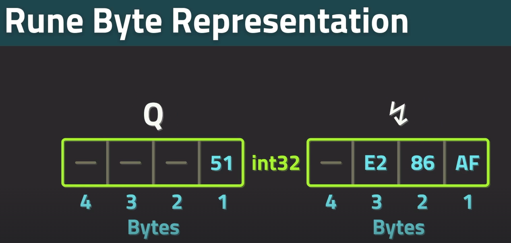

# ZTM GO 

- [Project Resources](https://github.com/jayson-lennon/ztm-golang)


<br/><br/>

- in-demand, simple and easy to understand by design
- build-in dependency management -- package registry
- Familiar c-style syntax

<br/><br/>

- first-class concurrency primitives --- perfect for backend programming
- type safety enforced by compiler
- memory-safe --- no use-after-free bugs; garbage collected; no need to manage memory
- compiles to machine code for very fast speeds
  

<br/><br/>

- packages are go's way of organizing code
- programs are written as one or more packages
- can be imported from go package registry
- packages should be focused and perform a single thing
  - argument parsing
  - drawing graphics
  - handling http requests  
- `import "package_name"`
- ```go
  import (
    "name"
    "namespace/packageName"
    . "name" # imports everything from package 
    pk "namespace/packagename" # aliasing package name
  )
  ```


<br/><br/>

- modules are collection of packages
- created by having go.mod file in the root directory of the project
- can be managed by go CLI
- contains information about project
- dependencies, go version, package info. ...
- all go projects have go.mod file
- ```go
  module example_namespace.com/practice

  go 1.17

  require (
    github.com/alexflint/go-arg v1.4.2 # package along with version
  )
  ```


<br/><br/>

- all data in programs consists of binary numbers
- data type is a way for the program to interpret the binary numbers
- go is a statically typed language -- data types must be provided by the programmer -- checked at compile time
- go uses type inference to determine what type of data is working with
  - data types only need to be provided in specific circumstances
  - can always specify type; compiler error if wrong type is used
- all primitive data types in go are numeric
- type indicated in code is a convention
  - it is possible that the data is invalid for the given type
    - only applies when working with user input or manually manipulating the binary data


<br/><br/>

- signed integer types 
  - int8 | -128 | 127
  - int16
  - int --- 32 bit
  - int32
  - int64
- unsigned integer types
  - uint8 | 0 | 255
  - byte | 0 | 255
  - uint16
  - uint  --- 32 bit
  - uint32
  - uint64
  - uintptr | 0 | pointer size --- 32 bits on 32bit system and 64 on 64 bits system
-  other
   -  float32
   -  float64
   -  complex64 --- 32 bit floating point real and imaginary
   -  complex128 --- 64 bit floating point real and imaginary
   -  bool   
-  type aliases
   -  just a different name; useful for providing indication of what kind of data is being utilized
   -  type UserId int
   -  type Direction byte
   -  type Speed float64
   -  type Velocity Speed   
-  type conversions
   -  type UserId int
   -  type Speed float64
   -  UserId(5)
   -  Speed(88.3)
   -  converting between types requires paranthesis


<br/><br/>

- Text Encoding
  - Textual data in Go uses UTF-8 encoding
  - encoding is a way to represent thousands of different symbols using code pages
  - code pages are tables which use the first few bytes of data to determine which page to use
  - each symbol in the code page is called a code point
- Runes
  - Text is represented using the rune type
    - Similar to char
  - Rune is an alias for int32
    - always a number; will print number unless proper formatting is specified
  - A rune can represent any symbol
  - Each letter can take more than one bytes
  - 
- Strings
  - string is a data type for storing multiple runes
  - strings are just an array of bytes and a string length; there is no null termination in a go string
  - when iterating over string, iteration occurs over bytes; bytes are not symbols; special iteration requirede to retrieve runes/symbols


# 