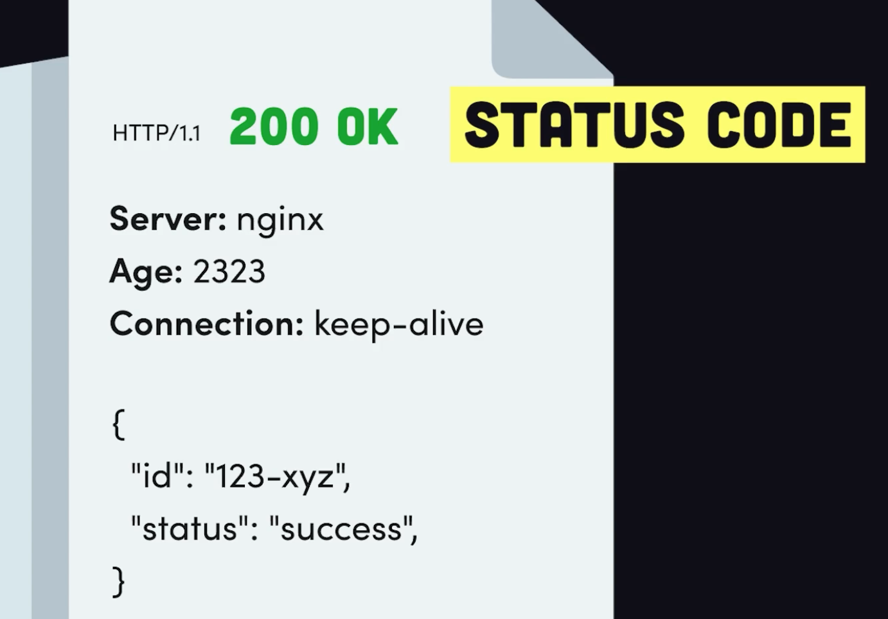

# Modern JavaScript : fireship.io

- [Source Code](https://github.com/fireship-io/javascript-course)
- nodejs installation through nvm 
- javascript 
  - highlevel
  - single threaded
  - interpreted | just in time compiled
  - garbage collected 
  - prototype based
  - multi-paradigm
  - dynamic language ; with a non-blocking event loop
- 1995 - Brendan Eich at Netscape
- Originally named Mocha; Renamed to JavaScript
- Web Assembly - WA, JS are natively supported in browser
- Interpreted scripting language but chromium and v8 engine use JIT compilation
- Excellent at handling IO intensive job
- Ecmascript standard
- Mobile - React Native, Ionic
- Desktop - Electron
- Server side -- Nodejs
- JavaScript can be run on servers using tools like nodejs and dino
- `undefined` value for unassigned variables by default. can set to `null` explicitly
- local scope, function scope, block scope
- Object class -- everything else inherits from -- non premitives; created using object literal `{ }`; contains collection of keyy value pairs and properties
- Every object can have exactly one prototype; Prototype chain is a mechansim that allows objects to inherit properties and methods from other objects
- ```javascript
  const animal = {
    dna: 'ATCG',
  };

  const dog = {
    face: '🐺',
  }

  Object.setPrototypeOf(dog, animal);

  Object.getPrototypeOf(dog) === animal; // true

  Object.getPrototypeOf(animal) === Object.prototype; // true

  Object.getPrototypeOf(Object.prototype) === null; // true
  ```
- Destructuring
  ```javascript
  // Object destructuring
  const person = {
    name: 'John',
    age: 32,
    city: 'New York',
    country: 'USA'
  };
  
  // const name = person.name; const age = person.age;
  const { name, age } = person;

  // Object destructuring with alias

  // const firstName = person.name; const years = person.age;
  const { name: firstName, age: years } = person;

  // Array destructuring
  const fruits = ['apple', 'banana', 'orange'];
  const [first, , third] = fruits;
  ```

- spread operator `...` is introduced in ES2018; provides a concise way to combine objects and arrays
  ```javascript
  const obj = { 
      foo: 1, 
      bar: 2, 
      baz: 3 
  };
  const newObj = {
      // ...obj foo value in obj will be overwritten from newObj
      foo: 4
      ...obj, // foo will be overwritten with value from obj
  }; 
  console.log(newObj); // { foo: 1, bar: 2, baz: 3 }


  const arr1 = [1, 2, 3];
  const arr2 = [4, 5, 6];
  const arr3 = [...arr1, ...arr2];
  ``` 

- optional chaining `?` introduced in ES2020; allows you to call object properties safely without throwing an error. When calling without this operator, you may crash your application with the error `Cannot read property 'foo' of undefined`
  ```javascript
  const person = { };

  const dude = person.name;
  console.log(foo); // Uncaught TypeError: Cannot read property 'bar' of undefined

  const dude = person?.name; // undefined
  ```

- Nullish coalescing `??` introduced in ES2020; similar to logical or operator `||` but it only returns the right-hand side if left-hand side is `null` or `undefined`; everything else is truthy for `??`
  ```javascript
  const foo = null ?? 'bar';
  console.log(foo); // 'bar'

  const foo = 0 ?? 'bar';
  console.log(foo); // 0
  ```

- Higher order function -- function that takes a function as an argument or returns a function. 
  ```javascript
  // A function that takes a function as an argument
  function add(x, y) {
    return x + y;
  }
  function subtract(x, y) {
    return x - y;
  }
  function math(x, y, operator) {
    return operator(x, y);
  }

  math(5, 2, add); // 7
  ```

- Closures -- A closure is a function that has access to the parent scope, even after the parent function has closed. JS will automatically store the state of a closure in the heap memory, even after the parent function has returned. This behavior makes them useful for encapsulating private variables.
  ```javascript
  function encapsulatedState(x) {
    let state = 10; // since the state variable is accessed inside the below function, this is stored in the heap memory -- which is long lived. can access the state variable even when the parent function encapsulatedState is ended.
    return function() {
      state += x;
      return state;
    }
  }
  ```

- Array Tricks 
  ```javascript
  const range = Array(100).fill(0).map((_, i) => i + 1);
  // OR
  const range = [...Array(100).keys()]; 
  // Array(100).keys() returns an iterator to indices. 

  const unique = [...new Set(arr)];

  const random = arr[Math.floor(Math.random() * arr.length)]; 
  // Math.random() returns a random number between 0 and 1

  for(const [i, val] of arr.entries()) { // arr.entries() returns iterator to [index, arr_value] pairs
      console.log(i, val);
  }
  
  arr.forEach(callback(currentValue [, index [, array]])[, thisArg]); // now way to stop this iteration except having exception thrown; expects a synchronous function.

  // callback: Function to execute on each element. It can take three arguments: currentValue (the current element being processed), index (the index of the current element), and array (the array forEach was called upon).
  
  // thisArg (Optional): Value to use as this when executing callback.

  const numbers = [1, 2, 3, 4];

  numbers.forEach((num, index) => {
    console.log(`Element at index ${index} is ${num}`);
  });

  const newArray = arr.map(callback(currentValue [, index [, array]])[, thisArg]);

  const numbers = [1, 2, 3, 4];
  const doubled = numbers.map(num => num * 2);

  console.log(doubled); // Output: [2, 4, 6, 8]

  const newArray = arr.filter(callback(element[, index [, array]])[, thisArg]); // creates a shallow copy of the array

  const array = [-3, -2, -1, 0, 1, 2, 3, 4, 5, 6, 7, 8, 9, 10, 11, 12, 13];

  function isPrime(num) {
    for (let i = 2; num > i; i++) {
      if (num % i === 0) {
        return false;
      }
    }
    return num > 1;
  }

  console.log(array.filter(isPrime)); // [2, 3, 5, 7, 11, 13]

  const result = arr.find(callback(element[, index [, array]])[, thisArg]);
  // find() returns the first element in the array that satisfies the provided testing function. Otherwise it returns undefined.

  const inventory = [
    { name: "apples", quantity: 2 },
    { name: "bananas", quantity: 0 },
    { name: "cherries", quantity: 5 },
  ];

  const result = inventory.find(({ name }) => name === "cherries");

  console.log(result); // { name: 'cherries', quantity: 5 }

  const index = arr.findIndex(callback(element[, index [, array]])[, thisArg]);
  // The findIndex() method of Array instances returns the index of the first element in an array that satisfies the provided testing function. If no elements satisfy the testing function, -1 is returned.

  const numbers = [3, -1, 1, 4, 1, 5, 9, 2, 6];
  const firstTrough = numbers
    .filter((num) => num > 0)
    .findIndex((num, idx, arr) => {
      // Without the arr argument, there's no way to easily access the
      // intermediate array without saving it to a variable.
      if (idx > 0 && num >= arr[idx - 1]) return false;
      if (idx < arr.length - 1 && num >= arr[idx + 1]) return false;
      return true;
    });
  console.log(firstTrough); // 1

  console.log([1, , 3].findIndex((x) => x === undefined)); // 1

  const result = arr.reduce(callback(accumulator, currentValue [, index [, array]])[, initialValue]);
  // The first time that the callback is run there is no "return value of the previous calculation". If supplied, an initial value may be used in its place. Otherwise the array element at index 0 is used as the initial value and iteration starts from the next element (index 1 instead of index 0).

  // A value to which accumulator is initialized the first time the callback is called. If initialValue is specified, callbackFn starts executing with the first value in the array as currentValue. If initialValue is not specified, accumulator is initialized to the first value in the array, and callbackFn starts executing with the second value in the array as currentValue. In this case, if the array is empty (so that there's no first value to return as accumulator), an error is thrown.

  const getMax = (a, b) => Math.max(a, b);

  // callback is invoked for each element in the array starting at index 0
  [1, 100].reduce(getMax, 50); // 100
  [50].reduce(getMax, 10); // 50

  // callback is invoked once for element at index 1
  [1, 100].reduce(getMax); // 100

  // callback is not invoked
  [50].reduce(getMax); // 50
  [].reduce(getMax, 1); // 1

  [].reduce(getMax); // TypeError


  const array = [15, 16, 17, 18, 19];

  function reducer(accumulator, currentValue, index) {
    const returns = accumulator + currentValue;
    console.log(
      `accumulator: ${accumulator}, currentValue: ${currentValue}, index: ${index}, returns: ${returns}`,
    );
    return returns;
  }

  array.reduce(reducer);
  ```

 - arr.forEach(), arr.map(), arr.filter(), arr.reduce() -- callbackFn is invoked only for array indexes which have assigned values. It is not invoked for empty slots in sparse arrays.
 - arr.find(), arr.findIndex() -- callbackFn is invoked for all values 

- [Javascript History](https://dev.to/codediodeio/the-weird-history-of-javascript-2bnb)
  - 1990 Tim BernersLee - First Web Browser --> Next Computer System
  - 1991 High Performance Computing Act Bill -- Gore Bill
  - 1993 Mosaic Browser
  - 1993 Netscape
  - Sun Microsystems -- Java
  - 1995 Brendan Eich -- Mocha 
  - Self -- Sun Microsystems
  - Mocha renamed to LiveScript
  - LiveScript renamed to JavaScript
  - 1996 Internet Explorer -- JScript
  - 1997 ECMA European Computer Manufacturing Association Script
  - ES3 
  - 1999 --- Y2K
  - 2000 -- Techbubble burst
  - Netscape acquired by AOL America Online
  - AJAX -- asynchronous JavaScript
  - Douglas Crockford -- JSON 
  - ActionScript -- Adobe -- supported by Flash -- ES4
  - jQuery 
  - 2008 -- Google Chrome and V8 Engine
  - 2009 Ryan Dahl -- NodeJS
  - 2009 -- ES5
  - 2010 -- Single Page Applications -- Backbone - imperative, AngularJS -- Jeremy Ashkenas -- created CoffeeScript
  - 2015 -- ES6
  - Bable 
  - TypeScript
  - 2015 - ReactJS
  - Vue 
  - Svelt
  - RollUp and WebPack; TypeScript, Flow; ImmutableJS, RxJS
  - WebAssembly

- Cumulative Sum 
  ```javascript
  // Solution 1
  function cumSum(arr) {
      return arr.reduce((acc, cur) => acc + cur, 0);
  }

  // Solution 2
  export function cumSum(arr) {
    let total = 0;
  
    for(let i = 0; i < arr.length; i++) {
      total += arr[i];
    } 
  
    return total;
  }

  console.log('sum: ', cumSum([1,3,5,7]));
  ```

- Binary Search 
  ```javascript
  function search(arr, target, start=0, end=arr.length-1) {

      console.log(start, end)

      if (start > end) {
          console.log('Not found!');
          return -1;
      } 

      const middle = Math.floor( (start + end) / 2 );

      if (arr[middle] === target) {
          console.log(`${target} Found at index ${middle}`);
          return middle;
      } 

      if(arr[middle] > target) {
          return search(arr, target, start, middle-1);
      }

      if(arr[middle] < target) {
          return search(arr, target, middle+1, end);
      }

  }
  ```

- Least Recently Used Cache -- LRU
  ```javascript
  export class LRU {  // syntactic sugar for prototype functions and properties
    constructor(capacity) {
      this.capacity = capacity;
      this.cache = new Map(); // keeps track of order keyvalue pairs are inserted
    }

    getItem(key) {
      const item = this.cache.get(key); 

      // Map keeps track of insertion order, this will refresh the item
      if (item) {
        this.cache.delete(key);
        this.cache.set(key, item);
      }
      return item;
    }

    putItem(key, val) {
      // delete to refresh the insertion order
      if (this.cache.has(key)) {
        this.cache.delete(key);
      }
      // evict the oldest item in the cache
      else if (this.cache.size == this.capacity) {
        this.cache.delete(this.oldestItem);
      }

      this.cache.set(key, val);
    }

    get oldestItem() { // get allows you to call this as a property instead of function
      return this.cache.keys().next().value; // next will grab the first oldest item
    }
  }

  const cache = new LRU(5);
  cache.putItem('a', 1);
  cache.getItem('a');
  ```

- TDD with Vitest ;  -- Unitesting
- `npm init -y` -- create a package.json file
- `npm install -D vitest`; Update package.json with a test script
  ```json
  "scripts": {
    "test": "vitest"
  },
  ```

  ```javascript
  import { expect, test } from 'vitest';

  import { cumSum } from './sum';
  test('cumulative sum of an array', () => {
    expect(cumSum([1, 3, 5, 7])).toBe(16);
    expect(cumSum([-2, -4, -8])).toBe(-14);
  });
  ```

<br/>
<hr/>
<br/>

- Vite -- fast and lightweight development server that uses native ES modules to serve your code
- `npm init vite@latest project_name` --- select vanilla javascript
- `cd project_name` and `npm install` -- install dependencies
- `npm run dev` -- to serve the app locally
- API -- Application Programming Interface -- way to two computers to talk to each other
- RESTful --- follow set of rules and constraints called Representational State Transfer -- coined by Roy Fieldings in 2000 
  - organizes data resources into unique URIs -- Uniform Resource Identifers
  - GET -- read; POST -- create; PATCH -- update; DELETE -- destroy
  - PUT; HEAD; CONNECT; OPTIOND; TRACE
  -  
  ```
  http_verb(specifies your intent with uri) uri(points resource)
  headers(metadata about the request)
  accept_header(tell server that you want data in specific format)
  authorization_header(tell server that you are authorized to make the request)
  connection_header

  body(custom payload of data)
  ```

  ```
  status_code (2** -- good; 4** -- you messed up; 5** -- server failed)
  response_headers(information about the server)
  ```

  - This architecture is Stateless:  Two parties don't need to store information about each other. Every request-response cycle is independent from all other communication

- cors -- cross origin resource sharing
  - Access Control Allow Origin

- `touch server.js`
  - ```javascript
    import * as dotenv from 'dotenv';
    dotenv.config();

    import { Configuration, OpenAIApi } from 'openai';

    const configuration = new Configuration({
      apiKey: process.env.OPENAI,
    });

    const openai = new OpenAIApi(configuration);

    import express from 'express';
    import cors from 'cors';

    const app = express();
    app.use(cors());
    app.use(express.json());

    app.post('/dream', async (req, res) => {
        const prompt = req.body.prompt;

        const aiResponse = await openai.createImage({
          prompt,
          n: 1,
          size: '1024x1024',
        });

        const image = aiResponse.data.data[0].url;
        res.send({ image });
    });

    app.listen(8080, () => console.log('make art on http://localhost:8080/dream'));
    ```
  
  - `npm i dotnet express cors openai` 
  - `node server.js`
  - ThunderClient; Postman; Insomnia -- RESTClient

<br/>
<hr/>
<br/>


- `var` -- Original way `let` `const`
- 


<br/>
<br/>


1. browser
2. html
3. high-level
4. ecmascript
5. web assembly
6. runtime
7. scripting language
8. dev tools
9. interpreted
10. js engine
11. JIT compilation
12. script tag
13. src attribute
14. console.log
15. let
16. camelcase
17. dynamically typed
18. primitive
19. undefined
20. null
21. string
22. object
23. semicolons -- optional
24. const
25. var
26. lexical environment -- determines where variables work and where they don't
27. global 
28. function
29. local scopes
30. block scope
31. hoisting -- var is local to function scope; so if used in a block, will hoist it to functional scope
32. function definition
33. input params
34. return value
35. function expresssion
36. higher-order function
37. closure -- function inside function. the inner function has access to outer function variables as the variables are stored on heap
38. call stack -- browser short term memory
39. heap -- persists between function calls
40. This -- references window when called from global scope; when attached to object refers object
41. Window or Global
42. Bind -- can bind a function 
43. Arrow Functions -- don't have their own this value
44. Anonymous
45. Passed by Value -- primitive
46. Passed by Reference -- objects
47. Object Literal -- using braces {}
48. Object constructor -- using new Object() -- collection of key value pairs or properties and values
49. Property
50. Prototype Chain
51. Inheritance
52. OOP
53. Classes
54. Constructor
55. Get/Set
56. Instance Method
57. Static Method
58. Array
59. Set
60. Map
61. Garbage Collection
62. WeakMap & WeakSet
63. Event Loop
64. Synchronous
65. Asynchronous
66. Thread Pool
67. Single Threaded
68. SetTimeout
69. Callback
70. Callback hell
71. Promise -- wrapper for a value that is unknown now but will resolve to a value in the future -- if something goes wrong the promise can rejec to raise error;
72. Resolve
73. Reject
74. Then/Catch
75. Async
76. Await
77. Try/Catch
78. ES Modules -- defualt private to the file or module
79. Default Import/Export
80. Named Import/Export
81. NPM
82. NodeModules
83. Package.json
84. DOM -- Document Object Model -- UI is represented as a tree of html elements or nodes
85. Document -- allows us to grab individual html element using querySelector
86. QuerySelector
87. Selector
88. QuerySelectorAll
89. Element
90. Event
91. Imperative -- UI is mutated directly
92. Declarative -- UI is a function of its input data
93. Components
94. Data Binding
95. Module Bundling -- tool like veet or web pack
96. Network Waterfall
97. Dynamic Imports
98. Node.js
99. Electron
100. TypeScrip


<br/>
<br/>

