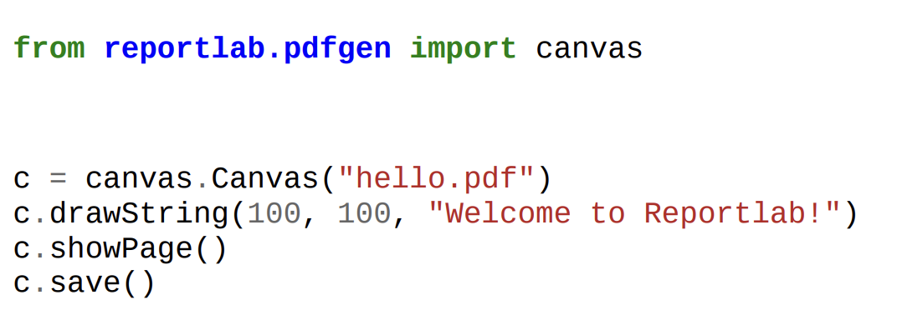

# Reportlab

- pdfgen -- low level package; using this we draw on canvas mentioning x y coordinates
  - contains canvas object
  - 
- x and y are in points 
- `from reportlab.lib.pagesizes import letter`
  - (612, 792)
- `from reportlab.lib.units import inch, mm`
  - inch = 72
  - mm = 2.8346
- `from reportlab.pdfgen import canvas`

<br/>
<br/>

- 
  - showPage() saves and ends the current page

```python
def __init__(
    self,filename, 
    pagesize=None, # tuple width and height
    bottomup = 1, # 0 => origin at top left otherwise at bottom left
    pageCompression=None, # compress each page or not
    invariant = None,
    verbosity=0, # logging levels, 0 => allows other applications to capture pdf from standard output; 1 => confirmation message will be pritned out everytime pdf is generated
    encrypt=None, # reportlab.lib.pdfencrypt.StandardEncryption
    cropMarks=None, # true (page will be 3mm larger than what you set the page size), false, object (borderWidth, markColor, markWidth and markLength.)
    pdfVersion=None, # supports 1-4 versions
    enforceColorSpace=None, # cmyk, rgb, sep, sep_black, sep_cmyk --- _PDFColorSetter will do the color enforcement
    ):
```