# SQL

## ZTM Complete SQL Database
<details open>
    <summary> SQL </summary>

## Contents 

1. History of Data
2. DB + SQL Fundamentals
3. Environment Setup
4. SQL Deep Dive
5. Advanced SQL
6. Database Management
7. Database Design
8. Solving the Mystery
9. Database Landscape
10. Data Engineering
11. Redis
12. Extra bits


## History of Data
- Database: a collection of data, a method for accessing and manipulating that data
- Digital Universe : estimated to be 44 Zeta Bytes 
- Drum Memory -- cylindrical in shape 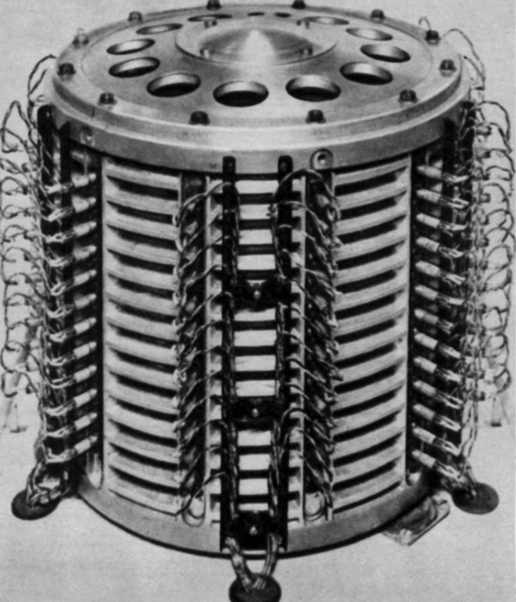
- Databases
    1. MariaDB
    2. Microsoft SQL Server
    3. elasticsearch
    4. mongoDB
    5. MySQL
    6. cassandra
    7. Oracle Database
    8. SQLite
    9. redis
    10. PostgreSQL
    11. IBM DB2
    12. Microsoft Access
- Project Managers, Marketers, Web Developer, Data Analysts, Data Scienctists, Data Engineers, Database Administrators
- Put Data, User/Update/Learn from Data, Remove Data
- DBMS -- DataBase Management System -- a program that is used to manage database. Receives instructions from, say us, and then applies to the database / data
- RDBMS -- Relational DBMS -- 
- SQL -- Structured Query Language -- 
- CRUD -- Create, Read, Update, Delete
- Five Data Models 
  - Relational Model -- ACID Transactions
  - Document Model -- Scalability
  - Key Value -- Redis, ETCD, DynamoDB
  - Graph Model -- Neo4J, AWS Neptune
  - Wide Columnar Models -- Google BigTable, Apache Cassandra

- Database: HW + SW used to store/organize/manage data
- [db-fiddle](https://www.db-fiddle.com/)
- 


</details>

<br/>
<hr/>
<br/>


- 1970s [Edgar Frank Codd](https://www.britannica.com/biography/Edgar-Frank-Codd) first published paper on Relational Model
- 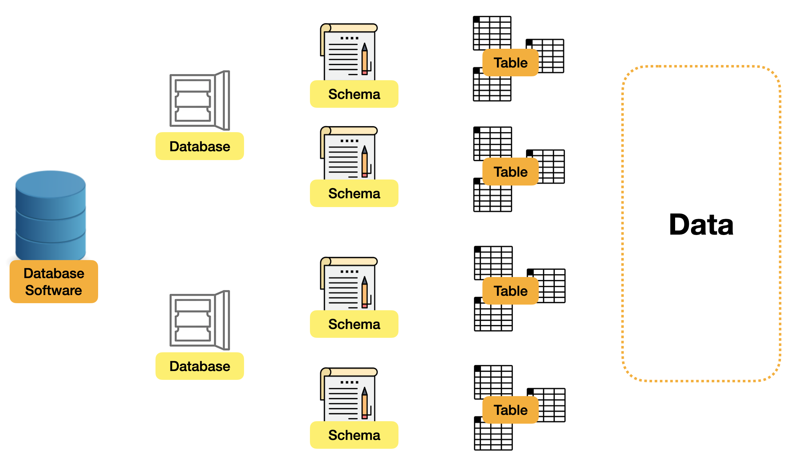
- Database Software
- Database -- can separate data entities
- Schema -- collection of tables, meta settings. In some Database software schema and database are integrated into one. 
- Table -- data entities
- Data 


<br/><br/>

- `CREATE SCHEMA 'new_schema' DEFAULT CHARACTER SET utf8mb4 COLLATE utf8mb4_unicode_ci;`
- COLLATE -- how data is sorted and compared
- [What is UTF-8 Encoding](https://blog.hubspot.com/website/what-is-utf-8)
- ; -- specifies end of statement
- `SELECT * FROM INFORMATION_SCHEMA.SCHEMATA`
  - CATALOG_NAME, SCHEMA_NAME, DEFAULT_CHARACTER_SET_NAME, DEFAULT_COLLATION_NAME, SQL_PATH


<br/><br/>

- Tables
  - Characteristics
    - Record metadata of each col
    - Manage the index
    - Provide relationship definitions with other tables
    - can set the location where thed data is actually stored in computer hard drive
  - ```sql
    CREATE TABLE `new_schema`.`new_table` (
      `id` INT NOT NULL COMMENT 'This is a primary index',
      PRIMARY KEY (`id`)
    );
    ```
  - [Primary Key](https://www.techopedia.com/definition/5547/primary-key) -- cannot be null or repeated
    - can only have one primary key
    - a column or combination of columns that uniquely identify row
    - Natural Primary Keys
      - come from real-world observables and attributes
    - Surrogate Primary Keys
      - arbitrarily assigned to each record


# SQL SERVER

- `SELECT @@VERSION;` `@@SERVER`
- `SELECT * FROM db.schema.table;`
- sql is not case sensitive
- `SELECT DISTINCT col1, col2 ` -- does not ignore null values
- `CASE WHEN col1 > 23 THEN 'value1' ELSE 'value2' END AS custom_col_name`
- `BETWEEN start and end` -- both inclusive
- `SELECT col1, col2 FROM tb1 WHERE col4 > someval`


<br/><br/>

- `=, <>, !=,  >, >=, <, <=`
- `'+ - * / `
- `AND OR NOT IN`
- `+` as concatenation of two strings; output is null if any of the strings is null
- `CONCAT(str1, str2, ...)`
- `CONCAT_WS('sep', str1, str1, ...)`
- `IS NULL`
- `IS NOT NULL`
- `BETWEEN`
- `NOT BETWEEN`
- `CAST(birth_date AS datetime)`
- `CASE(float_var AS INT)`
- `IN`
- `NOT IN`
- `LIKE %WIN%` -- % means zero or more chars; [] is the character class
- `LIKE A[BKL]` -- AB AK AL 
- `[A-Z]` -- character range
- `[^A-D]` -- matches any character not in this range
- `A_` -- _ matches exactly one char
- `%''%` -- escapes single quote
- 
- 

<br/><br/>

- `YEAR(date)` -- extracts year, say 1988


# ZTM SQL

- DDL - Definition Language
  - Create
  - Alter
  - Drop
  - Rename
  - Truncate
  - Comment
- DQL  - Data Query Language
  - Select
- DML  - Data Manipulation Language
  - Insert
  - Update
  - Delete
  - Merge
  - Call
  - Explain Plan
  - Lock Table
- DCL - Data Control Language
  - Grant 
  - Revoke


<br/><br/>

- statement
  - clause
  - identifier
  - keyword
  - expression
  - condition

<br/><br/>

- Databases
- Schemas
- Tables
- Fields

<br/><br/>

- `SELECT * from employees`
- `SELECT column AS new_col_name`
- `CONCAT(col1, 'some separating text', col2)`

<br/><br/>

- Order of operations
  - FROM
  - WHERE
  - SELECT
- Order of precedence
  - Paranthesis
  - Multiplication Division
  - Subtraction Addition
  - Concatenation
  - Comparision
  - IS NULL, LIKE, NOT IN, ...
  - NOT
  - AND 
  - OR

<br/><br/>

- functions
  - aggregate -- produces a summary of a set of records
    - `AVG()`
    - `COUNT()`
    - `MIN()`
    - `MAX()`
    - `SUM()`
  - scalar -- operate on each record independently
-  [PostgreSQL Aggregate Functions](https://www.postgresql.org/docs/12/functions-aggregate.html)

-  Comments
   - `-- or /* *** */` 
   - [How to make comments](https://www.red-gate.com/simple-talk/databases/oracle-databases/how-to-make-comments-the-most-important-code-you-write/)

- In SQL, use single quotes for writing text or strings
- Double quotes are for Table Names or Col Names
  - `SELECT fullname as "full name" FROM "Users";`
- What outcome is driving the query?
- Order of operations in where clause is decided by OR. 
  - cond1 `AND` cond2 `OR` cond3 AND cond4 AND cond5 OR cond6
- `WHERE NOT gender = 'm'`
- Comparision operators  `> >= < <= = != <>`
- Logical operators  `AND OR NOT`

- [SQL Precedence](https://www.postgresql.org/docs/12/sql-syntax-lexical.html#SQL-PRECEDENCE)
  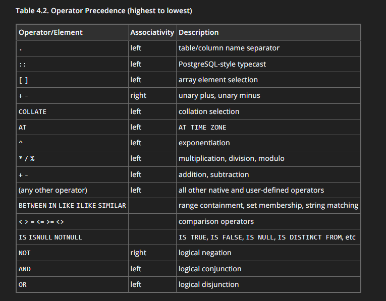
- [Expression Evaluation Rules](https://www.postgresql.org/docs/12/sql-expressions.html#SYNTAX-EXPRESS-EVAL)


<br/><br/>

- NULL -- Missing or nothing ; not whitespaces; its just empty
- make everything not null and change them to nullable as required
- `null = null | null <> null` -- is null
- Guidelines
  - Data -- Optional or Required?
  - Future info? -- optinal info, something that you can get in the future. Say music preferences
  - Rational? -- edge cases when you make something nullable
- `IS NULL`
- `IS NOT NULL`
- `IS` -- null, not null, true, false
  - `WHERE field = '' IS NOT FALSE`
- Null value substitution
  - `COALESCE` -- when null replace with some default
  - `SELECT coalesce(col1, col2, col3, 'Empty') AS col_alias FROM ...` -- returns first not null value from the list of cols specified
- 3 Valued Logic
  - expression can be true, false, or Null
  - each null could be different, null could be anything, nothing equals null, not even null


<br/><br/>

- `BETWEEN AND` -- inclusive
- `IN` -- if valu is in list of values -- `WHERE age IN (10, 20, 30)`
- `LIKE` -- pattern matching.
  - wildcard -- % -- any number of chars; _ -- 1 char
  - POSTGRES LIKE only does text comparision, so we must cast whatever we use to text
  - `CAST(salary AS text) | salary :: text`
  - `name ILIKE 'MO%'` -- case insensitive pattern matching


<br/><br/>

- Dates
- GMT - Greenwich Mean Time -- TimeZone
- UTC - Universal Coordinates Time -- Time Standard
- `SET TIME ZONE 'UTC'` -- only for current session
- `SHOW TIMEZONE`
- `ALTER USER postgres SET timezone = 'UTC'`
- Postgres assumes everything is UTC
- ISO-8601 -- used by Postgres -- formatting standard
  - YYYY-MM-DDTHH:MM:SS
- Timestamp -- date with time and timezone info
- `SELECT NOW()`
- `CREATE TABLE timezones (ts TIMESTAMP WIHTOUT TIME ZONE, tz TIMESTAMP WITH TIME ZONE)`
- Timestamp without time zone -- ignore the time zone and store it as UTC
- Timestamp with time zone -- consider time zone, offset it, and store as UTC
- `SELECT NOW()::date`
- `SELECT CURRENT_DATE`
- `SELECT TO_CHAR(CURRENT_DATE, 'dd/mm'yyyy')`
- Format Modifiers
- `SELECT DATE '1800/01/01'`
- `SELECT AGE(date '1800/01/01')`
- `SELECT AGE(date 'date1', date 'date2')`
- `SELECT EXTRACT(DAY | MONTH | YEAR FROM date 'date1') AS sajdkasj`
- `SELECT DATE_TRUNC('year', date '1992/11/13')`  --- keeps year same and round down month and date to 01
- `SELECT DATE_TRUNC('day', date '...')` -- round down date
- `NOW() - INTERVAL '30 DAYS'` -- years, months, days, hours, minutes, seconds, weeks,...


<br/><br/>

- `DISTINCT` -- unique `SELECT COUNT(DISTINCT birth_date) from employees;`
- `ORDER BY col1, col2 ASC | DESC, LENGTH(name)` 


<br/><br/>

- Joins -- say map primary key to foreign key
- Inner Join
- ```sql
  SELECT a.emp_no, 
         CONCAT(a.first_name, a.last_name) AS "name",
         b.salary
  FROM employees AS a
  INNER JOIN salaries as b ON b.emp_no = a.emp_no; | WHERE a.emp_no = b.emp_no
  ```
- Self Join --- Uses Inner Join to join same tables. Say if you have a primary key and a foreign key referrencing primary key in the same tables. 
- ```sql
  SELECT a.id, a.name as "employee", b.name as "supervisor"
  FROM employee as a, employee as b
  WHERE a.supervisorID = b.id
  ```
- Outer Join -- any values that doesn't match are made NULL
- Left outer join | Left join
- ```sql
  SELECT COUNT(emp.emp_no) FROM employees AS emp
  LEFT JOIN dept_mngr AS dep ON emp.emp_no = dep.emp_no
  WHERE dep.emp_no IS NOT NULL
  ```
- CROSS JOIN -- cartesian product `SELECT * FROM tableA CROSS JOIN tableB`
- FULL JOIN -- `table1 FULL JOIN table2 ON asasdasdas= asjdkasdhas`
- ```sql
  SELECT c.firstName, c.lastName, o.orderId FROM orders AS o
  INNER JOIN customers AS c ON o.custid = c.custid
  WHERE c.state IN ('NY', 'OH', 'OR')
  ORDER BY o.orderId

  SELECT e.fname, dp.dept_name FROM employees AS e
  INNER JOIN dept_emp AS de ON de.emp_no = e.emp_no
  INNER JOIN departments AS dp ON dp.dept_no = de.dept_no
  ```
- USING 
  - `USING(emp_no) | ON a.emp_no = b.emp_no`


<br/><br/>

- GROUP BY -- summarize or aggregate by group `GROUP BY colname`
- Split by group, Apply aggregate functions, Combine results
- Order of operations 
  - From > Where > Group By > Having > Select > Order
- HAVING -- applies filters to groups as a whole and filters on results.    
- Aggregate functions are not allowed in the where clause which applies filters on individual rows. Having clause comes to the rescue


<br/><br/>

- `ORDER BY COUNT(e.count)`
- UNION ALL does not remove duplicate records
- GROUPING SETS -- sub clause of GROUP BY that allows you to define multiple groupings
- ```sql
  SELECT prod_id AS "prod_id", SUM(ol.quantity)
  FROM orderlines AS ol
  GROUP BY
    GROUPING SETS(
      (), -- equivalent to GROUP BY NULL
      (prod_id) -- GROUP BY prod_id
    )
  ORDER BY prod_id DESC


  SELECT EXTRACT (YEAR FROM orderdate) AS "year",
         EXTRACT (MONTH FROM orderdate) AS "month",
         EXTRACT (DAY FROM orderdate) AS "day",
         SUM(ol.quantity)
  FROM orderlines AS ol
  GROUP BY
    GROUPING SETS (
      (EXTRACT (YEAR FROM orderdate)), 

      (
        EXTRACT (YEAR FROM orderdate),
        EXTRACT (MONTH FROM orderdate)
      ), 

      (
        EXTRACT (YEAR FROM orderdate),
        EXTRACT (MONTH FROM orderdate),
        EXTRACT (DAY FROM orderdate)
      ), 

      (
        EXTRACT (MONTH FROM orderdate),
        EXTRACT (DAY FROM orderdate)
      ), 

      (EXTRACT (MONTH FROM orderdate)), 

      (EXTRACT (DAY FROM orderdate))
    )
  ORDER BY 
    EXTRACT (YEAR FROM orderdate),
    EXTRACT (MONTH FROM orderdate),
    EXTRACT (DAY FROM orderdate)


  GROUP BY 
    ROLLUP ( -- takes care of all combinations -- equivalent to above
      EXTRACT (YEAR FROM orderdate),
      EXTRACT (MONTH FROM orderdate),
      EXTRACT (DAY FROM orderdate)
    )
  ```


<br/><br/>

- Window Functions -- create a new column based on functions performed on a subset or window of the data
- Partition by -- divide rows into groups to apply the function against 
- ```sql
  WINDOW_FUNCTION(arg1, arg2, ...) OVER (
    [PARTITION BY partition_expression]
    [ORDER BY sort_expression [ASC | DESC] [NULLS {FIRST | LAST}]]
  )


  SELECT 
    *, 
    MAX(salary) OVER()
  FROM salaries;

  SELECT 
    *, 
    AVG(salary) OVER(
      PARTITION BY d.dept_name
    )
  FROM salaries
  JOIN dept_emp AS de USING (emp_no)
  JOIN departments AS d USING (dept_no)
  ```
- LIMIT is not a true filter
- ORDER BY has a special property called FRAMING. Changes the frame of the window function. Without ORDER BY by default the framing is usually all partition rows. With ORDER BY by default the framing is usually everything before the current row and the current row
  ```sql
  SELECT emp_no, 
         salary, 
         COUNT(salary) OVER (
          ORDER BY emp_no -- kind of like cumilative sum. 1 -- num_of_1s 2 -- num_of_2s+num_of_1s 3 -- num_of_3s+num_of_2s+num_of_1s
         )
  FROM salaries;
  ```
- When using a FRAME clause in a window function we can create a Sub-Range or Frame
  - Key -- Meaning
  - Rows or Range -- whether you want to use a range or rows as a frame
  - Preceding -- rows before the current one
  - Following -- rows after the current one 
  - Unbounded preceding or following -- returns all before or after
  - Current row -- your current row.
- `PARTITION BY category ORDER BY price RANGE BETWEEN UNBOUNDED PRECEDING AND CURRENT ROW`
- ```sql
  SELECT
    DISTINCT emp_no, 
    LAST_VALUE(salary) OVER(
      PARTITION BY s.emp_no
      ORDER BY s.from_date
      RANGE BETWEEN UNBOUNDED PRECEDING AND UNBOUNDED FOLLOWING
    )
  FROM salaries AS s
  JOIN dept_emp AS de USING (emp_no)
  ```
- SUM / MIN / MAX / AVG
  ```sql
  SELECT
    o.orderid, 
    o.customerid,
    o.netamount
    SUM(o.netamount) OVER(
      PARTITION BY o.customerid
      ORDER BY o.orderid
    ) AS "cum sum"
  FROM orders AS o
  ORDER BY o.customerid
  ```

  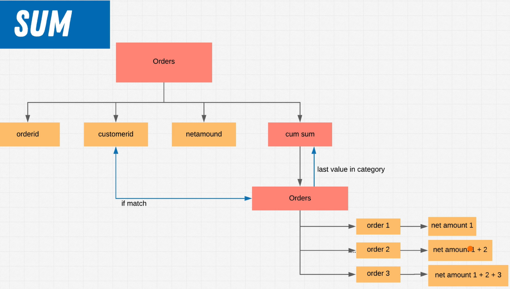
- FIRST_VALUE / LAST_VALUE / NTH_VALUE
  ```sql
  SELECT 
    prod_id, 
    price, 
    category,
    first_value(price) OVER(PARTITION BY category ORDER BY price) AS "cheapest in category"
  FROM products

   SELECT 
    prod_id, 
    price, 
    category,
    last_value(price) OVER(PARTITION BY category ORDER BY price
      RANGE BETWEEN UNBOUNDED PRECEDING AND UNBOUNDED FOLLOWING
    ) AS "most expensive in category"
  FROM products

  ```
- PERCENT_RANK -- Return the relative rank of the current row (rank - 1) / (total rows - 1)
- RANK -- Rank the current row within its partitions with gaps
- ROW_NUMBER -- number the current row within its partition starting from 1 regardless of framing
  ```sql
  SELECT 
    prod_id, 
    price, 
    category,
    row_number() OVER( PARTITION BY category ORDER BY price) AS "position in category by price"
  FROM products
  ```
- LAG / LEAD -- access values from previous or next row
  
<br/><br/>

- Conditionals
- CASE -- each return must be a single output
  ```sql
  SELECT prod_id, title, price, 
      CASE   
        WHEN  price > 20 THEN 'expensive'
        WHEN  price <= 10 THEN  'cheap'
        WHEN  price BETWEEN 10 and 20  THEN 'average'
      END AS "price class"
  FROM products
  ```
- NULLIF
  ```sql
  SELECT prod_id, title, price, NULLIF(special, 0) as "special"
  FROM products

  NULLIF(val1, val2) -- NULL if val1 = val2; otherwise Val1
  ```
<br/><br/>


- Views
  - Materialized views -- stores data physically and periodically updates when the table changes. 
  - Non-materialized views -- is rerun each time view is called. Storing the reference to the query
- `CREATE VIEW view_name AS query` -- views are the output of the query ran. Views act as tables. take very little space. only store definition. 
- `CREATE OR REPLACE view_name AS query`
- `ALTER VIEW view_name RENAME TO view_name`
- `DROP VIEW [IF EXISTS] view_name`
  ```sql
  CREATE VIEW "90-95" AS
  SELECT *
  FROM employees as e
  WHERE EXTRACT (YEAR FROM e.hire_date) BETWEEN 1990 AND 1995
  ORDER BY e.emp_no;
  
  CREATE VIEW "bigbucks" AS
  SELECT e.emp_no, s.salary
  FROM employees as e
  JOIN salaries as s USING(emp_no)
  WHERE s.salary > 80000
  ORDER BY s.salary;
  ```


<br/><br/>

- Indexes -- construct to improve query performance
  - pointer to data in a table
  - say a table of contents to help find where a piece of data is
  - speed up queries
  - slows down data insertions and updates
- types
  - single column
  - multi column
  - unique -- say primary key
  - partial -- part of your data
  - implicit indexes -- 
- `CREATE UNIQUE INDEX idx_name ON table_name (col1, col2, ...)`
- `DROP INDEX idx_name`
- when to index
  - index foreign keys
  - index primary keys and unique columns
  - index on columns that end up in the order by/where clause often
- when not to 
  - don't use indexes on small tables
  - don't use on tables that are updated frequently
  - don't use on nullable columns
  - don't use on cols that have large values -- say comments. 
- Single-Column
  - most frequently used col in a query
  - retrieving data that satisfies single condition
- Multi-Column
  - most frequently used cols in a query
  - retrieving data that satisfies multiple conditions
- Unique
  - for speed and integrity
  - `CREATE UNIQUE INDEX idx_name ON table_name (col1)`  
- Partial 
  - Index over a subset of a table
  - `CREATE INDEX idx_name ON table_name (expression)`
- Implicit
  - created automatically by the database
  - primary key | unique key
- `EXPLAIN ANALYZE query`
  
  ```sql
  EXPLAIN ANALAZE
  SELECT "name", district, FROM city -- say name is the col name but name is also a keyword. 
  ```


<br/><br/>
- [Index-types](https://www.postgresql.org/docs/9.5/indexes-types.html)
- Index algorithms -- set of instructions that tells how to find certain information, how to do a faster lookup
- types
  - B-tree -- default
    - best used for comparisions 
      - <, >, <=, >=
      - BETWEEN
      - IN
      - IS NULL
      - IS NOT NULL
  - Hash
    - can only handle equality checks
  - Gin
    - Generalized Inverted Index
    - Best used when multiple values are in a single field
  - Gist
    - Generalized Search Tree
    - useful in indexing geometric data and full-text search
- `CREATE INDEX idx_name ON table_name USING algo_name (col)`


<br/><br/>

- Subqueries -- construct allows you to build extremely complex queries
- aka Innery query or inner select 
- most often found in where clause
- can also be used in select, from, and having clauses 
  - select --- must return a single value when used in select
  - from 
  - having --- must return a single value when used in having --- compare groupings. 
- `SELECT * FROM table WHERE col cond (query ....)`


<br/><br/>

- Subqueries vs Joins
- Subqueries
  - subqueries are queries that could stand alone
  - can return single result or a row set
  - results are immediately used -- can not reference it in different parts of the query
- Joins
  - Joins combine rows from one or more tables based on a match condition
  - only returns a row set
  - can reference data in different parts of the query --- say table1.col1
- a joined table can be used in the outer query


<br/><br/>

- Guidelines
  - Subquery must be enclosed in parentheses
  - must be placed on the right side of the operation
  - cannot manipulate their results internally (ordery by inside subquery is ignored)
  - use single-row operators with single-row subqueries
  - subqueries that return null may not return results


<br/><br/>

- Subquery types
  - Single row
    - compare against single returned row; returns zero or one row
  - Multiple row
    - returns one or more rows 
  - Multiple column
    - returns multiple columns 
  - Correlated
    - subquery reference one or more columns in the outer statement -- runs subquery against each row in outer query
    - subquery relatede to the parent
    - subquery can reference outside data
    - outside query can not reference subquery data --- check
    - 
  - Nested
    - subquery in a subquery
  ```sql
  select
    emp_no,
    salary as "most recent salary", 
    from_date
  from salaries as s
  where from_date = (
    select max(from_date)
    from salaries as sp
    where sp.emp_no = s.emp_no
  )
  order by emp_no asc 

  -- this query would have been more efficient if we used joins

  -- this query would have been more efficient if we used subqueries as joins 

  select
    emp_no,
    salary as "most recent salary",
    from_date
  from salaries as s
  join (
    select emp_no, max(from_date) as "max"
    from salaries as sp
    group by emp_no
  ) as ls using (emp_no)
  where ls.max = from_date
  order by emp_no asc
  ```

<br/><br/>

- Subquery operators -- used in where clause
- EXISTS -- check if the subquery returns any rows 
  ```sql
  SELECT firstname, lastname, income 
  FROM customers as C
  WHERE EXISTS (
    SELECT * FROM orders as o
    WHERE c.customerid = o.customerid AND totalamt > 400
  ) AND income > 909000
  ```
- IN -- check if value is equal to any of the rows in the return (null yields null)
  ```sql
  SELECT prod_id
  FROM products
  WHERE category IN (
    SELECT category FROM categories
    WHERE categoryname IN ('Comedy', 'Family', 'Classics')
  )
  ```

- NOT IN -- check if value is not equal to any of the rows in the return
- ANY / SOME -- check each row against the operator and if any comparision matches return true
  ```sql
  SELECT prod_id 
  FROM products
  WHERE category = ANY(
    SELECT category FROM categories
    WHERE categoryname IN ('Comedy', 'Family', 'Classics')
  )
  ``` 
- ALL -- check each row against the operator and if all comparisions match return true
  ```sql
  SELECT prod_id, title, sales
  FROM products
  JOIN inventory as i USING (prod_id)
  WHERE i.sales > ALL (
    SELECT AVG(sales) FROM inventory JOIN products AS p1 USING (prod_id)
    GROUP BY p1.category  
  )
  ```
- Single value comparision -- subquery must return a single row and check comparator agains row
<br/><br/>


- Queries
  ```sql
  SELECT firstname, income, age from customers
  WHERE income > 50000 AND (age < 30 OR age >= 50)
  and (country = 'Japan' OR country = 'Australia')
  ```

  ```sql
  SELECT SUM(totalamount) from orders
  WHERE (orderdate >= '2004-06-01' AND orderdate <= '2004-06-30') 
  AND totalamount > 100
  ```

  ```sql
  SELECT sum(coalesce(age, 20)) FROM "Student"
  
  SELECT emp_no, first_name, EXTRACT (YEAR FROM AGE(birth_date)) as "age" FROM employees
  WHERE first_name ILIKE 'M%';

  SELECT count(customerid) FROM customers
  WHERE zip::text LIKE '%2%';

  SELECT coalesce(state, 'No State') as "State" FROM customers
  WHERE phone::text LIKE '302%';
  ```


  ```sql
  SELECT AGE(birth_date), * FROM employees
  WHERE (
     EXTRACT (YEAR FROM AGE(birth_date))
  ) > 60 ;

  SELECT count(birth_date) FROM employees
  WHERE birth_date < now() - interval '61 years'

  SELECT count(emp_no) FROM employees
  where EXTRACT (MONTH FROM hire_date) = 2;

  SELECT MAX(AGE(birth_date)) FROM employees;

  SELECT COUNT(orderid)
  FROM orders
  WHERE DATE_TRUNC('month', orderdate) = date '2004-01-01';
  ```


  ```sql
  SELECT hire_date, COUNT(emp_no) as "amount"
  FROM employees
  GROUP BY hire_date
  ORDER BY "amount" DESC;

  SELECT e.emp_no, count(t.title) as "amount of titles"
  FROM employees as e
  JOIN titles as t USING(emp_no)
  WHERE EXTRACT (YEAR FROM e.hire_date) > 1991
  GROUP BY e.emp_no
  ORDER BY e.emp_no;

  SELECT e.emp_no, de.from_date, de.to_date
  FROM employees as e
  JOIN dept_emp AS de USING(emp_no)
  WHERE de.dept_no = 'd005'
  GROUP BY e.emp_no, de.from_date, de.to_date
  ORDER BY e.emp_no, de.to_date;
  ```

  ```sql
  SELECT e.emp_no, count(t.title) as "amount of titles"
  FROM employees as e
  JOIN titles as t USING(emp_no)
  WHERE EXTRACT (YEAR FROM e.hire_date) > 1991
  GROUP BY e.emp_no
  HAVING count(t.title) > 2
  ORDER BY e.emp_no;  
  ```
  ```sql
  SELECT
    DISTINCT continent,
    SUM(population) OVER w1 as"continent population"
  FROM country 
  WINDOW w1 AS( PARTITION BY continent );

  SELECT
    DISTINCT continent,
    SUM(population) OVER w1 as"continent population",
    CONCAT( 
        ROUND( 
            ( 
              SUM( population::float4 ) OVER w1 / 
              SUM( population::float4 ) OVER() 
            ) * 100    
        ),'%' ) as "percentage of population"
  FROM country 
  WINDOW w1 AS( PARTITION BY continent );

  SELECT 
  DISTINCT r.id, 
  r."name", 
  COUNT(t.id) OVER (
      PARTITION BY r.id
      ORDER BY r."name"
  ) AS "# of towns"
  FROM regions AS r
  JOIN departments AS d ON r.code = d.region 
  JOIN towns AS t ON d.code = t.department
  ORDER BY r.id;
  ```

  ```sql
  select emp_no, salary, from_date, 
      (select title from titles as t 
       where t.emp_no=s.emp_no and 
      (t.from_date = s.from_date + interval '2 days' or t.from_date=s.from_date))
  from salaries as s
  order by emp_no;
  ```


  ```sql
  SELECT c.firstname, c.lastname, o.orderid 
  FROM orders AS o, (
      SELECT customerid, state, firstname, lastname
      FROM customers
  ) AS c
  WHERE  o.customerid = c.customerid AND 
  c.state IN ('NY', 'OH', 'OR')
  ORDER BY o.orderid;

  SELECT emp_no, first_name, last_name
  FROM employees
  WHERE emp_no IN (
      SELECT emp_no
      FROM dept_emp
      WHERE dept_no = (
          SELECT dept_no 
          FROM dept_manager
          WHERE emp_no = 110183
      )
  )
  ORDER BY emp_no

  SELECT e.emp_no, first_name, last_name
  FROM employees as e
  JOIN dept_emp as de USING (emp_no)
  JOIN dept_manager as dm USING (dept_no)
  WHERE dm.emp_no = 110183

  ```


<hr>


## Database Management

- The avenue of data creation and management is one that often crosses the realm of architecture and administrator. You see on the one hand you have the definition and creation of databases and the relationships between different tables and on the other hand, you have the management of roles, permissions, backups, and so forth.
- DDL -- create, modify, delete different structures
- DML -- adding, deleting, modifying data

<br/><br/>

- Types of databases
  - regular -- built off of template 
  - template -- blueprint, structure, configurable
- Default PostgreSQL database
  - when you setup your postgres, 3 databases were created
    - postgres
      - default database that is created when you setup postgres (initdb)
      - so the first time you initialize postgres you can connect to the postgres database to setup your first database
      - `psql -U <user> <database> | psql -U postgres` -- postgres assumes a conenction to a database with the same name as the user if no database is specified
      - `\conninfo` -- shows current connection information
    - template0
      - this is the template that is used to create template1 -- never change it; in essence a backup template
    - template1
      - is used to create new databases
      - changes made to this template are automatically applied to all new databases
      - this is what is used when you create a new database
      - because template1 is the default template -- if it is being accessed or connected to, no new databases can be created until the connection is closed --- "ERROR: Source database "template1" is being accessed by other users. DETAIL: There is 1 other session using the database"
      - `psql -U postgres template1` ; `psql -U postgres Employees `
      - `CREATE DATABASE db_name WITH TEMPLATE template0`
      - You can create your own template database to create other databases with   
        ```sql
        CREATE DATABASE template_db_name; -- Template database is a database

        CREATE TABLE table_1;

        CREATE DATABASE database_1 WITH TEMPLATE template_db_name;
        -- database_1 also has table_1 because tempate_db_name was used as a blueprint
        ```

- Database
  ```sql
  CREATE DATABASE name
    [ WITH OWNER = user_name -- current user    
         TEMPLATE = template -- template01
         ENCODING = encoding -- UTF8
         LC_COLLATE = lc_collate 
         TABLESPACE = tablespace
         CONNECTION LIMIT = connlimit ]-- default 100
  ```   
- Database Organization
  - databases have tables, views, ...
  - Postgres Schemas -- a construct offering the conecpt of "Schemas", say a box in which you can organize tables, views, indexes, etc...
    - By default each database gets a public schema
    - unless you specify a schema the default is always assumed to be public
    - `CREATE SCHEMA schema_name`
    - Why? allow many users to use the same database; to organize database objects into logical groups; third party applications can be put into separate schemas so they do not collide with the names of the otehr objects
- `\dn` -- command that shows all the schemas and their owners
- `\dt` -- command that lists all the relations (schema, name, type, owner)
- `\du` -- command that lists roles and associated attributes
- `\d table_name` -- command that gives the table details (column, type, collation, nullable, default)
- Roles -- determine what is allowed
  - can be a user or a group
  - have the ability to grant membership to another role
  
  - By default only the creator of the database or superuser has access to its objects
  - attributes -- in part defines privilege; say superuser. 
    - CREATEDB | NOCREATEDB
    - CREATEROLE | NOCREATEROLE
    - LOGIN | NOLOGIN
    - SUPERUSER | NOSUPERUSER
    - common
      - LOGIN PRIVILEGE
      - SUPERUSER STATUS
      - DATABASE CREATION
      - ROLE CREATION
      - PASSWORD
    - `CREATE ROLE readonly WITH LOGIN ENCRYPTED PASSWORD 'readonly'` -- always encrypt when storing a role that can log in   
  - privileges -- linked to attributes, and can be given independently; say read access
    ```sql
    GRANT / REVOKE ALL PRIVILEGES ON <table> TO <user> 

    GRANT ALL ON ALL TABLES [IN SCHEMA <schema>] TO <user>

    GRANT [SELECT, INSERT, UPDATE...] ON <table> [IN SCHEMA <schema>] TO <user>

    GRANT ALL ON ALL TABLES IN SCHEMA PUBLIC TO <user> -- you always need to specify schema if you are granting all on all tables

    GRANT role_name TO user_name
    ```

- Users -- same as role, but assumes login by default
  - `CREATE USER test_user WITH ENCRYPTED PASSWORD 'test_user'` 
  - `CREATEUSER -- interactive`
  - `ALTER USER test_interactive WITH ENCRYPTED PASSWORD 'test_user'`
- `show hba_file` -- tells us the path of the hba file. specifies how you connect
  -  by defualt, every connection is trusted (METHOD). scram-sha-256 -- used for external connections. 
-  `show config_file`
   -  by default, password encryption is turned off -- even if you pass ENCRYPTED PASSWORD, it is not actually encrypted
   -  `password_encryption = scram-sha-256`    


<br/><br/>

- Best Practices
- Principle of least privilege -- no privileges at all. you grant as you need
- don't use admin/superuser by default 
- control is key   


<br/><br/>

- data types -- constraint on field to only allow certain type of data
- data types postgres 
  - Numeric Types
    - Integers
      - Not a fraction. Whole Number
        - SMALLINT --- -32768 to 32767
        - INT --- 2 million something
        - BIGINT --- 922 billion something
    - Floating Point
      - precision -- say 6 digits precision, we have 6 precise digits and may have 1 approximated or rounded digit. 
      - FLOAT4/FLOAT8 -- single or double precision; 6 or 15 digits precision. Digits after decimal; 
      - DECIMAL/NUMERIC -- 131072 before decimal point, 16383 digits after decimal point
  - Arrays
    - group of elements of same type
    - every data type has array equivalent
    - `CREATE TABLE test_text ( four char(2)[], eight text[], big float4[] )`
    - `INSERT INTO test_text VALUES ( ARRAY ['vin', 'vin'], ARRAY [ 'vin', 'vin'], ARRAY [ 5.12, 5.390000000012])` 
  - Character Types
    - CHAR(N) -- fixed length with space padding
    - VARCHAR(N) -- variable length with no padding
    - TEXT -- unilimited length text
  - Date/Time Types
  - Boolean Types
    - True  1 yes y t | False 0 no f | NULL
  - UUID Type -- unique identifier
  - XML
  - JSON


<br/><br/>

- Database Models
- usually we create a model before creating a database
- Model -- a design used to visualize what we are going to build
- Entity Relationship Diagram -- use this to create a model 
- Entity -- a thing.
- Diagramsa and Archtectures
- Crow's feet Notation
  - tells us how the relationship is formed between entities
- Table names must be singular
- Columns must be lowercase with underscores
- Columns with mixed case are acceptable
- Columns with upper case are unacceptable


<br/><br/>

- `\conninfo`
- [create table](https://www.postgresql.org/docs/12/sql-createtable.html)
- by default, create table creates table in public schema unless otherwise specified
- temporary tables -- you cannot specify schema as these are defined in a special schema
- column constraints
  - validation methods against data that will be inserted
  - defined as part of the column definition
  - `NOT NULL` 
  - `PRIMARY KEY`
  - `UNIQUE` -- NULL is unique
  - `CHECK` -- apply a special condition check against the values in the col
  - `REFERENCES` -- constraints the values of the column to only be values that exist in the col of another table (Foreign key)
- table constraints
  - encompass more than one col
  - `UNIQUE(col_list)`
  - `PRIMARY KEY(col_list)`
  - `CHECK(condition)`
  - `REFERENCES`
- regex
  - [Regex for regular folks](https://refrf.shreyasminocha.me/)
  - [Regex crossword](https://regexcrossword.com/)
  - [Regex Search](https://ihateregex.io/)
  - [Regex tester](https://regex101.com/)
- UUID 
  - Universally Unique Identifier
  - `create extension if not exists "uuid-ossp"` -- has uuid_generate_v4()
  - generates unique identifier for primary keys 
  - extensions -- allow you to expand what postgres can do or expand how certain processes are run
  - `select * from pg_available_extensions`
  - Pros
    - Unique 
    - easier to shard 
    - easier to merge or replicate
  - Cons
    - larger values
    - can have performance impact
    - more difficult to debug
- akdksd
  - `CREATE TEMPORARY TABLE name (cols)`
  - dropped at the end of the session
  - only visible to the creater
  - postgres applies less rules (logging, transaction locking, etc)
  ```sql
  CREATE TABLE <name> (
    <col1> TYPE [CONSTRAINT],
    table_constraint [CONSTRAINT]
  ) [INHERITS <existing_table>];

  CREATE TABLE student (
    student_id UUID PRIMARY KEY DEFAULT uuid_generate_v4(),
    first_name VARCHAR(255) NOT NULL,
    last_name VARCHAR(255) NOT NULL, 
    email VARCHAR(255) NOT NULL,
    date_of_birth DATE NOT NULL
  );

  CREATE TABLE student (
    student_id UUID DEFAULT uuid_generate_v4(),
    first_name VARCHAR(255) NOT NULL,
    last_name VARCHAR(255) NOT NULL, 
    email VARCHAR(255) NOT NULL,
    date_of_birth DATE NOT NULL, 
    CONSTRAINT pk_student_id PRIMARY KEY (student_id) -- table level constraint
  );

  CREATE TABLE col_constraints (
    cc_id SMALLINT PRIMARY KEY,
    something TEXT NOT NULL, 
    email TEXT CHECK (email ~* 'reg_exp'), 
    cat_id SMALLINT REFERENCES category_table(cat_id_col)
  );
  ```


<br/><br/>

- Custom Data Type
  ```sql
  CREATE DOMAIN Rating SMALLINT CHECK (VALUE > 0 AND VALUE <= 5)

  CREATE TYPE Feedback AS (
    student_id UUID, 
    rating Rating, 
    feedback TEXT
  )

  ALTER TABLE student ADD COLUMN email TEXT;

  CREATE TABLE course(
    course_id UUID PRIMARY KEY DEFAULT uuid_generate_v4(), 
    "name" TEXT NOT NULL,
    description TEXT,
    subject_id UUID REFERENCES subject(subject_id),
    teacher_id UUID REFERENCES teacher(teacher_id),
    feedback feedback[]
  )


  INSERT INTO student(
    first_name, 
    last_name, 
    email, 
    date_of_birth
  ) VALUES (
    'Win',
    'Vinny',
    'vin@gmail.com',
    '2015-12-31':: DATE
  )

  INSERT INTO subject(
    subject, 
    description
  ) VALUES (
    'SQL',
    'DBMS lang'
  )

  ALTER TABLE course ALTER COLUMN subject_id SET NOT NULL

  UPDATE TABLE course SET subject_id = "dskjjfaafds" WHERE subject_id IS NULL

  UPDATE course 
  SET feedback = array_append(
    feedback, 
    ROW(
      'djasadalfsafdas',
      4,
      'Ok okay'
    )::feedback
  ) WHERE course_id = 'ksdajfkdajfasljfsas'

  CREATE TABLE feedback (
    student_id UUID NOT NULL REFERENCES student(student_id),
    course_id UUID NOT NULL REFERENCES course(course_id),
    feedback TEXT,
    rating rating,
    CONSTRAINT pk_feedback PRIMARY KEY (student_id, course_id)
  )
  ```
  - [Alter Table](https://www.postgresql.org/docs/current/sql-altertable.html)
  - custom data types do not allow you to do checks, foreign key and all the good stuff


  ```sql
  select * from customers where city like "[!acf]%" -- city does not start with a/c/f

  select * from customers where country in ('a'. 'b')

  ALTER TABLE Persons DROP COLUMN Birthday
  ```

- backups
  - backup plan, disastor recovery plan, test your plans
  - hardware failures, viruses, power outages, hackers, human error
  - determine what needs to be backed up, 
  - full backup, incremental -- everything that changd since last incremental, differential -- everything that changed since last full backup, transaction log -- backup of the database transactions (can happen hourly, daily, ...)  | less often, often, often, a lot. 
  - what's the appropriate way to back up?
    - OS, HardDrives, Database, ...  Hardware level, Software level... 
  - How frequently are you going to backup?
  - where are you going to store your data?
  - what is the retention policy for the backup?
  - SQL Dump -- txt file generated from database 
    - `pg_dump dbname > outfile`
  - pgBackRest -- reliable postgres backup and restore tool; not shipped by default
- executing dump script in command line `\i ~/Documents/sql_dump.sql`


<br/><br/>

- transactions
- A database is a shared resource, many concurrent accesses or connections
- A transaction is a unit of instructions (query for instance)
  - goal is to keep things consistent
- the dbms has a mechanism in place to manage transactions; lifecycle
  - Begin
  - Active
    - Partially Committed
    - Failed
      - Aborted 
    - Committed 
    - End
- `BEGIN;` -- initiates a transaction; lock 
  - a series of query executions
  - at this point, the changes are not yet committed
  - `ROLLBACK`
  - `COMMIT` | `END`
- To maintain the integrity of the database, all transactions must obey ACID prinicples
  - Atomicity -- execute entirely or not at all
  - Consistency -- should leave the database in a consistent state (commit or rollback)
  - Isolation -- should be executed in isolation from other transactions
    - Say. database in state0. Transactions t1 and t2 now access same state0 but can effect each other depending on which transaction first took place
  - Durability -- changes in database should persist

- Install database DBLINK [dblink](https://www.postgresql.org/docs/9.3/dblink.html)
- `create extension dblink`
- `SELECT * FROM dblink('host=localhost user=postgres password=postgres dbname=Employees', 'SELECT <column> FROM employees;') AS t1(<column> NAME)`
- 


  ```sql
  SELECT * FROM vehicle_location_histories AS vlh
  WHERE 
    city = 'NY' AND 
    long BETWEEN 1 AND 39 AND 
    lat BETWEEN -1 AND -39 AND 
    vlh.timestamp::date = '1998-08-30'::date
  ORDER BY long

  CREATE VIEW suspect_rider_names AS 
    SELECT DISTINCT
      split_part(u.name, ' ', 1) AS "first_name", 
      split_part(u.name, ' ', 2) AS "last_name"
    FROM suspected_rdies AS vlh
    JOIN rides AS r on r.id = vlh.ride_id
    JOIN users AS u ON u.id = r.rider_id

    SELECT 
      CONCAT(t1.first_name, ' ', t1.last_name) AS "employee", 
      CONCAT(u.first_name, ' ', u.last_name) AS "rider"
    FROM dblink('host=localhost user=postgres password=postgres dbname=Employees', 'SELECT first_name, last_name FROM employees;')
    AS ext_emp_table(first_name NAME, last_name NAME)
    JOIN suspect_rider_names AS u ON t1.last_name = u.last_name 
    ORDER BY "rdier"

  ```


## Database Design

- Software Development Life Cycle -- SDLC
  - System Planning and Selection -- what you want
    - getting the information on what needs to be done, scope, requirement analysis
  - System Analysis -- what is needed, databases, mobile applications
    - analyzing if it can be done on time and on budget
  - System Design -- more concrete diagrams and requirements. 
    - design the system architecture for all related components.... databases, apps, ...
    - is all about creating structure that can be understood and communicated 
    - think upfront, think abstract, go from chaos to structure
    - high level technical diagrams out of the business stakeholders requirements  
  - System Implementation and Operation 
    - build the software
  - Testing  -- early, often
  - Maintenance
- Goal is to design robust systems
  - low coupling 
  - high cohesion -- everything works together properly
  - independent enough and not coupled to all the pieces. 
- the process can be implemented in different ways: Agile, Waterfall, V-Model, ....
- different models cycle through the steps at different paces
- Common Goal is to enable business. 


<br/><br/>

- Database Design Techniques
- Top-down
  - you start from zero.
  - all requirements are gathered up-front
  - optimal choice when creating a new database
  - you create the universe / data model based on the requirements 
- Bottom-up
  - there's an existing system or specific data in place
  - you want to shape a new system around the existing data -- say migration
- In system design we might have the right answers, but how do you get there is holistically up to you. 


<br/><br/>

- top-down
  - high level requirements -- has implicit and explicit 
  - user interviews
  - data collection
  - deep understanding of the business alongside technical skills
  - entity relationship model or diagram
    -  diagram that functions as a way to structure high level requirements -- formulating shape of the world/universe
  - step 1: Entities
    - determine what entities are in the system; what is an entity
      - a person/place or thing
      - has a singular name
      - has an identifier -- able to uniquely identify data
      - should contain more than one instance of data
    - Free UML Unified Modeling Language tools
      - UMLet, UMLetino, Lucidchartff
  - step 2: Attributes
    - give entities the information they will store : columns
      - must be a property of the entity
      - must be atomic -- narrowing it down to the most small amount of information that is needed to be stored for the field
      - single/multivalued (phone number)
      - keys


<br/><br/>


- steps
  - determining entities
  - attributes
  - relationships
  - solving many to many


<br/><br/>


- relation schema
  - refers to the table schema
  - representation of the data that is going into the table
    - table_name : list of col names
- relation instance
  - the set of data that refers to relation schema
- 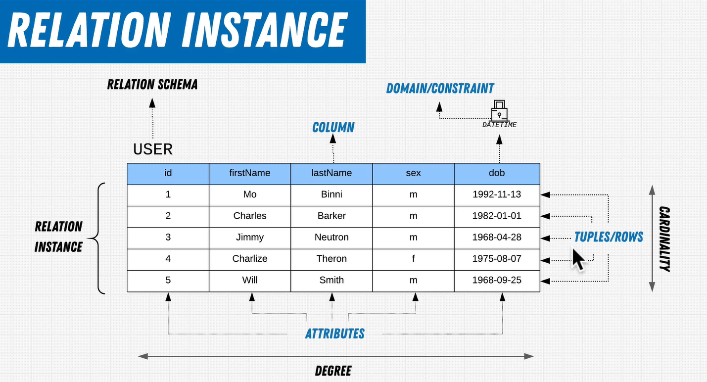

- relation key -- uniquely identify each row of data and relationship | data is unsorted
  - super key
    - any combination of attributes that could uniquely identify a row
  - candidate key
    - the minimum amount of attributes that could uniquely identify a row
  - primary key
    - the choosen candidate key that uniquely identifies a row
  - foreign key
    - a reference to the primary key of another table
    - this enforces a constraint, where, you can only fill details available in another table
  - compound key
    - use of multiple columns to uniquely identify a row. You use one or more foreign keys in the combination. 
  - composite key
    - use of multiple columns to uniquely identify a row. You do not use any foreign keys in the combination
  - surrogate key
    - primary key that has nothing to do with the records data. say user assigned auto incrementing id number
  - alternate keys
    - keys which are not the primary key; compound, composite


<br/><br/>

- attributes
  - school
    - school_id
    - street_name
    - street_nr
    - postal_code
    - state
    - city
  - teacher
    - teacher_id
    - first_name
    - last_name
    - dob
    - hiring_date
  - student
    - student_id
    - first_name
    - last_name
    - dob
    - enrollment_date
  - exam
    - student_id
    - teacher_id
    - date_taken
    - passed
    - lesson_id
  - lesson
    - lesson_id
    - date_of_enrollment
    - package
    - student_id
- name it the way client calls it. understand business terminology and use the same


<br/><br/>

- relationships
  - between entities or tables
  -  types
     -  1 to 1
     -  1 to many
     -  many to many
  -  crowsfeet
     -  first -- relationship
        -  many
        -  one 
     -  second -- constraint
        -  zero or more
        -  one or more
        -  one and only one
        -  one or zero
     -  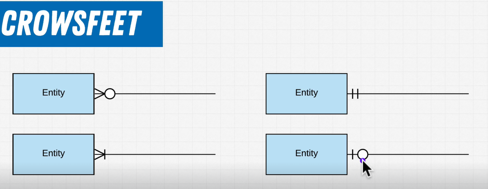
  -  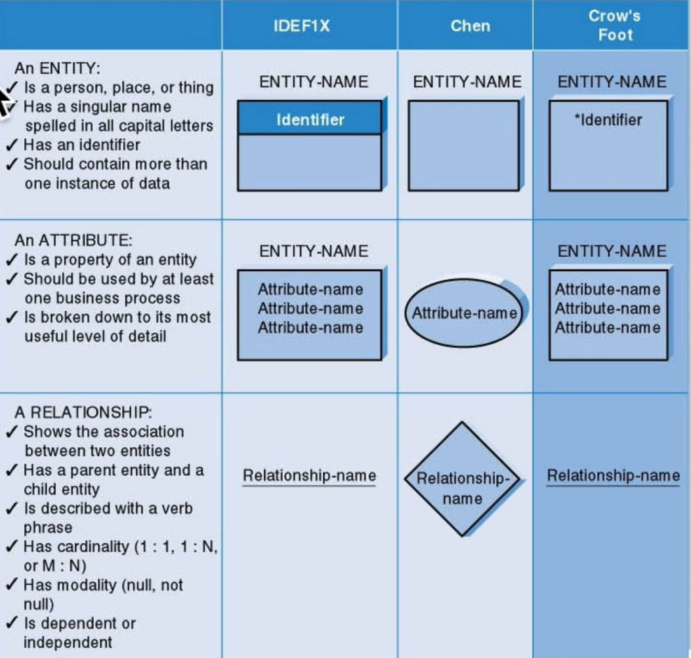
  -   


# Educative : Become a DB Professional With SQL

## Database Design Fundamentals for Software Engineers

### Fundamental Concepts
- File Based System -- permanent files
- Disadvantages of file based system
  1. Data Redundancy
  2. Data Inconsistency -- multiple copies of same data do not match with each other
  3. Difficult Data Access
  4. Security Problems
  5. Difficult Concurrent Access -- multiple users cannot access same data at the same time

- Database: shared collection of related data (known facts);
- Database Properties
  1. represents some aspect of real-world called mini-world or universoe of discourse (UoD)
  2. logical coherent collection of data with some inherent meaning
  3. designed, built, and populated with data for a specific purpose 
- Database has some degree of interaction with the events in the real world and an audience that is actively interested in its contents.
- DBMS primary goal is to provide an environment that is both convenient and efficient for the users to store and retrieve information
- DBMS Facilities
  1. Defining a database - data types, structures, constraints
  2. Constructing a database - storing
  3. Manipulating a database -- updating, retrieving
  4. Sharing a database -- multiple users and programs access data

- database + dbms = Database system
- application programs -- send queries for data to dbms; query causes data to be retrieved 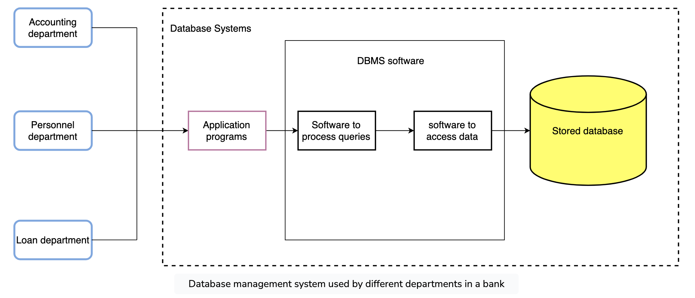
- Tabular form -- easy to understand. A table is a collection of related data held in a table format within a database. It consists of columns and rows.
- Each row in a relational database represents one instance of the type of object described in that table. A row is also called a record. While the columns in a table are the set of facts that we keep track of regarding that type of object. A column is also called an attribute.
- To properly define the database, we must specify the structure of the rows of each table by specifying the different types of data elements to be stored in each row.
  
  Grade Table
  ```
  ID	Course_ID	Grade
  2001	CS200	A-
  2220	EE100	C
  2343	PHY220	B
  ```
  Student Table
  ```
  ID	First_Name	Last_Name	Class	Major
  2001	Adam	Smith	Junior	CS
  2342	Jonathan	Joestar	Sophomore	Economics
  2343	Lucas	Klein	Senior	Physics
  ```
  Course Table
  ```
  Course_ID	Course_Name	Course_credits
  CS200	Intro to programming	4
  MATH100	Calculus-I	3
  CS300	Advanced Programming	3
  ```
  Department Table
  ```
  Department_Code	Department_Name
  1	Computer Science
  2	Electrical Engineering
  3	Physics
  4	Biology
  ```
  Instructor Table
  ```
  Instructor_ID	Instructor_fname	Department_Code
  12	Sam	1
  22	Tom	2
  04	David	3
  ```  

- Characteristics of a database
  1. self describing nature of the database; contains metadata which defines and describes the data and relationships between tables in database; separation of data and information about the data; 
  
      Columns 
      ```
      Attributes	Datatype	Belongs_to
      ID	Integer (4)	Student
      First_Name	Character (50)	Student
      Last_Name	Character (50)	Student
      Course_name	Character (50)	Course
      Course_Section	Integer (4)	Course
      Department_Name	Character (50)	Department
      ```

  2. Insulation between program and data : program-data independence. data structure is stored in system catalog and one change is all we need to change the structure of the file
  3. support for multiple views of data : A view is a subset of the database which is defined and dedicated for particular users of the system to present relevant information rather than the whole database
  4. sharing data and multiuser system: concurrency control strategies; ensures data integrity 
   
- Benefits of database approach
  1. Control of data redundancy : Data normalization - ideally each data item is stored in only one place in the database. ensures consistency and saves storage space
  2. Data Sharing
  3. Enforcement of integrity constraints : A database constraint is a restriction or rule that dictates what can be entered or edited in a table, such as adding a valid course name in the Course_Name column in the COURSE table. <br><br> There are many types of database constraints. One of them is data type, which determines the sort of data that can be entered. For example, integers only. Another restraint is data uniqueness, which specifies that data item values must be unique, such as every record in the STUDENT table must have a unique value for ID.
  4. Restriction of unauthorized access: a security subsystem to create and control different types of user accounts and restrict unauthorized access.
  5. Backup and Recovery facilities: If a computer system fails in the middle of a complex update process, the recovery subsystem is responsible for making sure that the database is restored to its original state.

### Data Modeling 

- data abstraction: hide irrelevant details from the user
- we use data models to achieve this abstraction
- A data model is a collection of concepts or notations for describing data, data relationships, data semantics, and data constraints.
- Types of Data Models
  1. High Level Conceptual Data Models
     1. similar to how people perceive data ( say entity-relationship model) -- use entities, relationships, and attributes
     2. entity -- real world object
     3. attributes -- properties of entity
     4. realtionship -- association among entities 
  2. Record Based Logical Data Models : provide concepts users can understand but are still similar to the way data is stored on computer
     1. Hierarchical -- tree like structure. each child has only one parent but each parent can have multiple children. 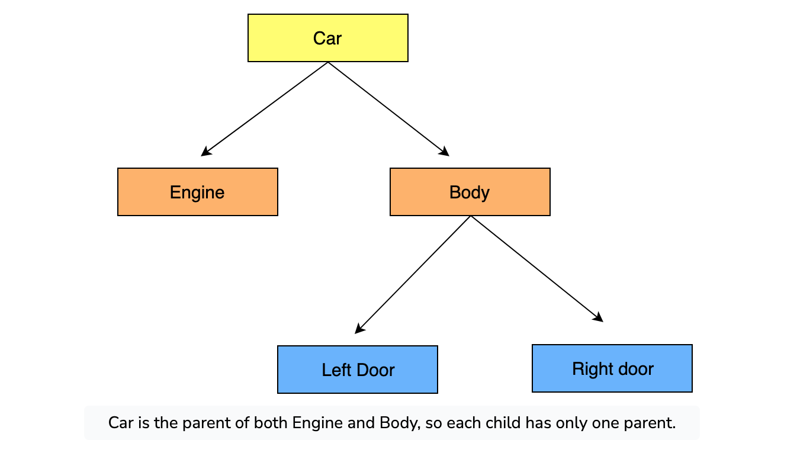
     2. Network - each record can have multiple children or multiple parents. 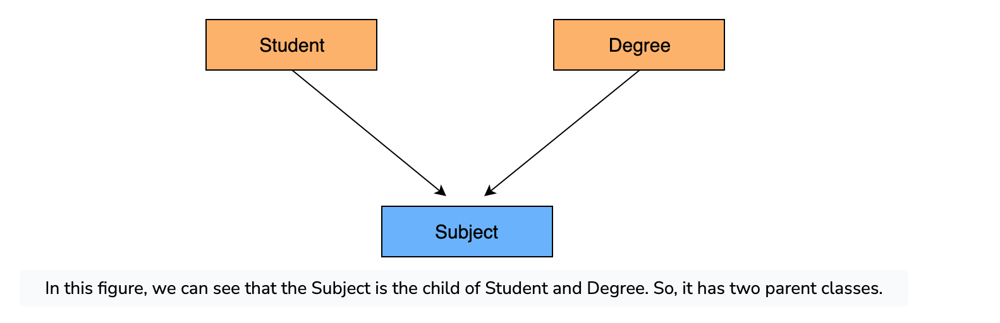
     3. Relational: data as relations or tables
  3. Physical Data Models: The physical data model represents how data is stored in computer memory, how it is scattered and ordered in the memory, and how it would be retrieved from memory. Basically physical data model represents each table, its columns, and specifications, etc. It also highlights how tables are built and related to each other in the database. 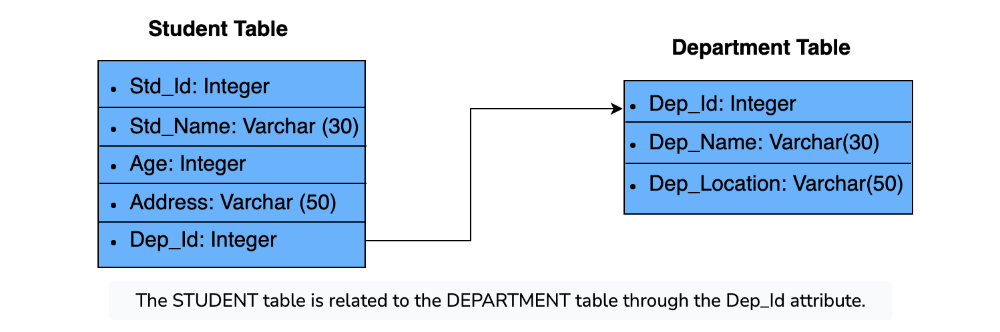

- Database Schema: A schema is the blueprint of a database. The names of tables, columns of each table, datatype, functions, and other objects are included in the schema. We use the schema diagram to display the schema of a database. Schema modification or alteration is known as schema evolution. Schema is not changed frequently.

- Database Instance: An instance is the information collected in a database at some specific moment in time, also known as the database state. It is a snapshot of the current state or occurrence of a database. Changes each time we add/update/remove infromation 
- Three-Schema Architectures: goal is to separate user applications from physical database 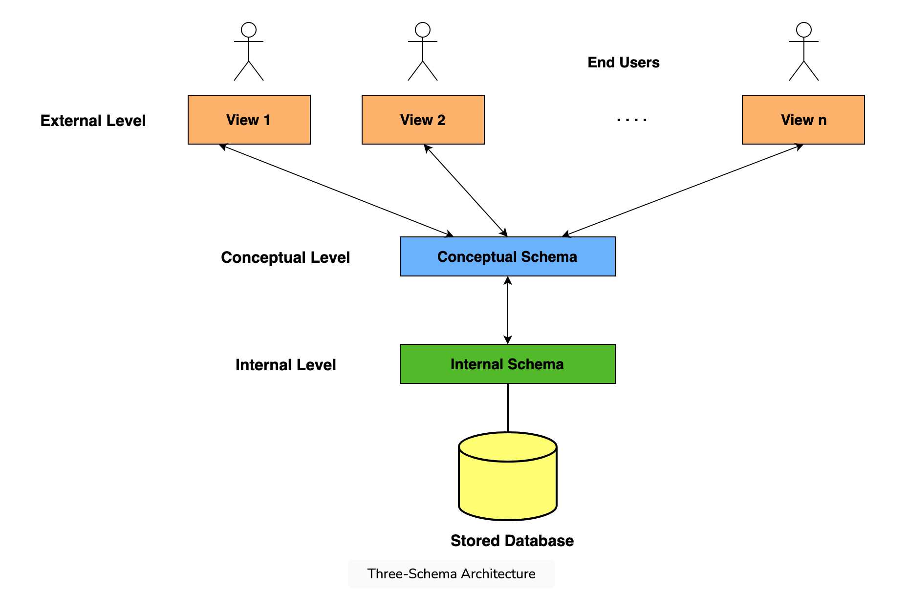
  1. External Schema: An external schema describes the part of the database that a specific user is interested in. It hides the unrelated details of the database from the user like the exact process of retrieving or storing data from the database. There is a different external view for each user of the database. An external view is just the content of the database as it is seen by one particular user.
  2. Conceptual Schema: The conceptual schema describes the database structure of the whole database for the community of users. This schema hides information about the physical storage structures and focuses on describing data types, entities, relationships, etc. Usually, a record-based logical data model is used to describe the conceptual schema when a database system is implemented.
  3. Internal Schema: The internal schema describes how the database is stored on physical storage devices such as hard drives. The internal schema uses a physical data model and describes the complete details of data storage and access paths for the database. 

  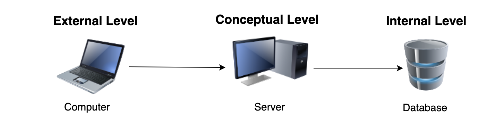

- Data independence is defined as a property of the database management system that helps to change the database schema at one level of a database system without changing the schema at the next highest level.
  1. Logical Data Independence: The ability to change the conceptual schema without changing the external schema or user view is called logical data independence. For example, the addition or removal of new entities, attributes or relationships to this conceptual schema should be possible without having to change existing external schemas or rewriting existing application programs.
  2. Physical Data Independence: Physical data independence helps you to separate the conceptual schema from the internal schema. It allows you to provide a logical description of the database without the need to specify physical structures.
- Generally, physical data independence exists in most databases and file environments where physical details, such as the exact location of data on disk or the type of storage device, are hidden from the user. On the other hand, logical data independence is harder to achieve because it must accommodate changes in the structure of the database without affecting application programs; which is a much stricter requirement.
- DBMS classification based on Data Model
  - Oracle, MS SQL Server, DB2, MySQL support relational data model
  - traditional data models (hierarchical and network data models) are used on mainframes
  - Object oriented data models -- O2, ObjectStore, Jasmine -- information is represented in the form of objects 

- DBMS Classification based on number of users
  1. Single user  
<br/>
<br/>


# 