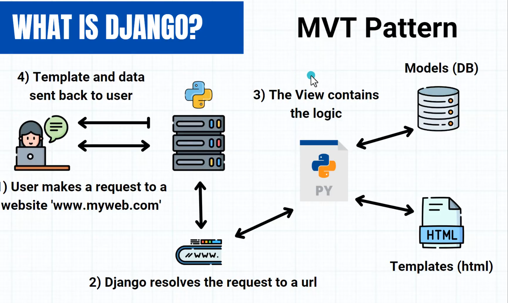
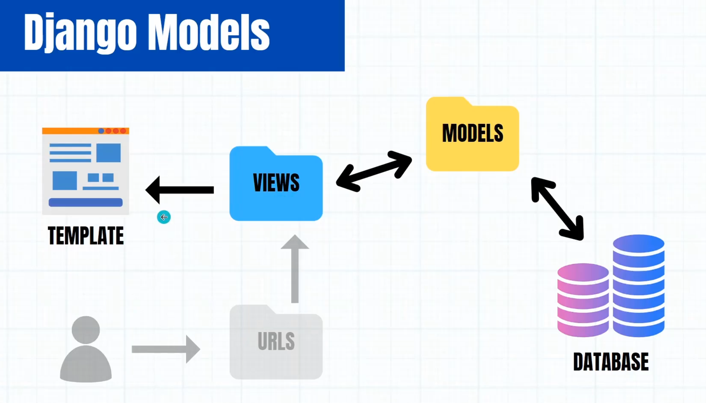

# Django 

## ZTM Django

  
 ZTM Django 

- Web Browser -- Client -- one computer
- Web Server -- Server -- another computer
  - Has IP address -- way to identify server
  - URL -- google.com -- more readable; maps to ip address
- Request
  - Get
  - Post
    - Body
- Response
-  Django -- web framework named after a guitarist 
-  MVT : Model View Template | MTV
-  
   -  Batteries included framework -- lots of functionality and features
   -  ORM (no raw SQL)
   -  Admin Interface
   -  Handles Security
   -  User Auth
-  replit -- for online compiler
-  View -- what -- webpage, data, Baked pizza
-  URLs -- where -- site.com/about ... Reuest Pizza
-  Views and URls work in pairs
-  Dynamic URLs -- calls the same view that knows how to get the current variable blog. Say site.com/blogs/2  lets say you have 100 blogs, creating a separate view for each blog doesn't seem right. So instead, we call the same view that knows how to get the requested blog 
-  Django templates are html blueprints; Django w ill do a little preprocessing before these html files are sent to the user to turn them into a pure html file
-  Django Template Language
  -  variables -- `{{ blog_title }}`
    - everything is implemented with dot notation `list.0` `obj.attr` `dict.key`
  -  tags / logic -- `{ % if has_titles % }`
  -  filters -- `{{ blog_title | title }}`
    -  They don't change data in database but just how they are rendered
  - Django looks within app_directories for template files. It has expected folder structure `app_name/templates/app/index.html`
- Template Inheritane -- allows you to build base skeleton template that contains all common elements of site and defines block that child templates can override
  - DRY : Do not Repeat Yourself
- Models -- pythonic way to query database 
  - Each model is a python class
  - Each model represents a database table; attribute represents field
- Models -- so everytime you change the models, you run two commands
  - `python manage.py makemigrations` -- to tell django how db has changed
  - `python manage.py migrate` -- to apply the changes
  - model manager -> objects -- enables us to do CRUD using python
  - `JobPosting.objects.all()` -- get all objects
  - `JobPosting.objects.get(id=1)`
  - `JobPosting.objects.filter(title = 'Job titile')`
  - Django comes with a shell `python manage.py shell`
- `path('', home, name = 'home')` -- you can refer to this path using the variable `name` so you can make changes at only one place. 
- settings.py -- `ALLOWED_HOSTS = ["*"]` accept all host connections
- CSRF -- Cross Site Request Forgery protection
- `` -- This is how django knows that the the form is submitted by you and is safe. Without this in the form that uses POST method throws CSRF error.
- Django Rest Framework -- library built on top of Django to create web/REST API's
  - Instead of sending html file, we can get the data to the client, and the client can worry about how to display the data (typically JSON formatted data) -- WEB API | REST API
  - JavaScript Object Notation -- structured format for representing data
- Serialization: process of changing data types into other data types

 

 

- `pip install venv`
- `python -m venv env_name`
- `source ./env/bin/activate`
- `pip install django`
- `django-admin startproject project_name .` // doesn not create two folders.
- `python manage.py runserver`
- `python manage.py startapp app_name`
- ` [content goes in here....]`
- `{% extends 'movies/_base.html'}` -- import it at the top of the `index.html` file
- `{ %if %}` `` `` ``  `` ``
- `pip install gunicorn` -- used by server to run and serve our project
- `pip freeze > requirements.txt` -- generate requirements.txt file for dependencies
- `pip install whitenoise` -- helps django serve the static files. 
- `admin.site.register(ModelClassName)`
- `python manage.py createsuperuser`
- `pip install crispy-tailwind`
- `pip install djangorestframework`
- settings.py
  - `INSTALLED_APPS`
  - `MIDDLEWARE`
  - `ROOT_URLCONF`
  - `TEMPLATES`
  - `DATABASES`
  - `STATIC_URL`
- urls.py 
  - `urlpatterns`
- views.py
  - renderign functions
- app_name/static/app_name/static_files*
- app_name/templates/app_name/template_files*

 

 

