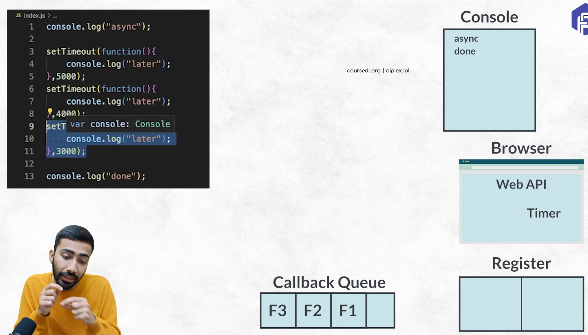
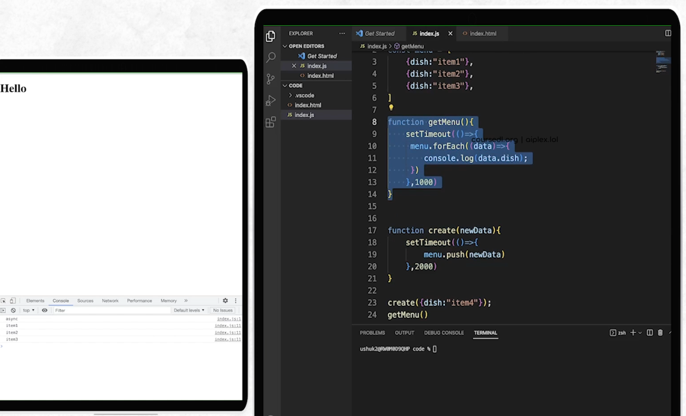
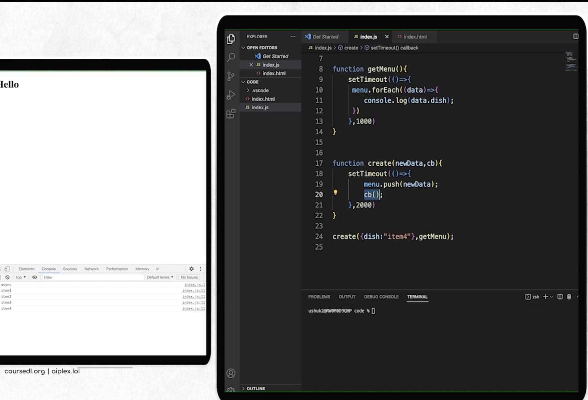

# Programming Pathshala

## Intro 

- HTTP Request
- TCP IP Protocol
- Client
- Server
- Domain Name Server
  - Key Value pairs; domain name --> ip address ipv4/ipv6
- HTML -- Hyper Text Markup Language
- CSS -- Cascading Style Sheets
  - Bootstrap -- framework -- ancient
  - Tailwind CSS -- framework -- modern
- JS -- JavaScript
  - React
    - Next JS -- framework based on a framework 
    - Material UI
  - Angular
  - Vue
- Libraries/Frameworks : you don't need to write from scratch; can directly plugin components (say styled buttons, forms)
  - React


## HTML

- Markup Language : HTML, XML, XAML, YAML -- cannot write logic (say loops)
- Emmet -- built-in in VSCode 
  - `!` will generate boilerplate html code
  - `lorem 10` will generate specified number of words
  - `meta:desc..`
  - `div.test1` => div with classname as test1
- Extensions 
  - Go Live
  - Tailwind CSS Intellisense
- Tags -- case insensitive
  - Containerised Tags -- contain content
  - Non-containerised Tags -- self closing tags -- do not contain any content
- body -- content visible to user; head -- content not visible to user
- Block elements : take up entire width of the document
  - headings -- h1 ... h6
  - p
- Inline elements : 
  - span
- head
  - title
  - meta (author, description, keywords/hashtags : SEO Search Engine Optimizattion) -- give metadata about the website
- Doctype : set of rules followed while writing html `<!DOCTYPE html>`
- whitespaces are not considerede in HTML

<br/>
<br/>

- tables
  - row/col spanning -- taking up multiple rows/cols
  - table
    - caption -- table name
    - th -- table header; can have something like  `rowspan="x" | colspan="y")`
    - tr -- table row
    - td -- table data

- images
  - `img src="..." alt = "..."`

- links
  - `<a href="url" target="_blank"> Link text </a>`
  - `<a href="mailto:mail@gmail.com"> Link text </a>`
  - `<a href="tel:123456788"> Link text </a>`

- forms
  - form (has action attribute)
    - label -- inline
      - `<label for = "first_name"> First Name </label>`
    - input -- inline
      - `<input type="text" id = "first_name" placeholder = "First Name" />`
      - input types = text, password, email, number, checkbox, radio, button
    - textarea
      - `<textarea id = "", cols = "50" rows = "10"> this is going to be default text </textarea>`
    - button `<button> button name maybe </button>`
  - structure using html
  - style using css
  - validate using js
  - submit -- http request

- lists
  - ul/ol
    - li

- tags
  - we cannot use block tags inside inline tags
  - div is a block tag
  - hr -- a horizontal line
  - b -- bolds containing text
  - i -- italics
  - u -- underline
  - em -- emphasis

## CSS

- attribute values are always passed as strings
- `<h1 style="font-size: 54px; color: red">` -- inline styling
- internal css
  - `<style> </style>` inside head
  - `h1{color: red; font-size: 54px}`
- external css
  - `<link rel="stylesheet" href="style.css">`
- can have only one h1 tag in a page
- `.className{color: red; font-size:34px; font-family: 'first_pref', fall-back; font-weight: 900; text-shadow: xpx ypx blur_radius_px red}` -- google fonts
- `.className{letter-spacing:1-px; word-spacing:20px; }`
- `*{}` -- universal selector
- attributes
  - `background-image: url(path);`
  - `height: 600px;`
  - `background-size: cover (maintains aspect ration and no gap, image might get chopped off) | contain (might have gaps, maintains aspect ratio, no chopping off of image)` 
  - `background-repeat: no-repeat | repeat-x | repeat-y ;`
  - `background-position: y_axis x_axis` top | center

- box model
  - `border: 5px solid red` width, line type, color --- dashed 
  - `margin:0`
  - `padding: 10px 5px 8px 7px` top right bottom left
  -  margin is outside the border, padding is inside the border
  -  `box-sizing: border-box` -- when this is mentioned, all margin + padding + height = height
- `*{font-family: monospace; margin:0; padding:0; box-sizing: border-box}`

<br/>
<br/>

- responsiveness
  - Units
    - Relative lengths : em, rem
      - rem : relative to root element
        - body.html is the root element
        - `body.html {font-size:16px}  .className{font-size:2rem}` => 2*16 px 
      - em : relative to the parent element
    - Absolute lengths : px
  - `@media screen and (min-width:300px) {specify css}`
  - `@media screen and (max-width:600px) {specify css}` 

<br/>
<br/>

- positions
  - static : defailt
    - `top:20` bottom left right does not work when position is set to static
  - relative 
    - gaps are persistent. say, test1 and test2 are below one another; if you say test1.top = 100; then test2 also moves down
  - absolute -- with respect to parents position
    - no gaps; in the above example, test1 and test2 overlap
  - fixed
    - with respect to the viewport. 
    - even if you scroll page it is shown with respect to the viewport (body visible to us and not the whole document)
  - sticky
    - if you specify, then it stays there
    - otherwise, it vanishes as you scroll.  


## FlexBox

- way to arrange elements in rows and columns
- `.navbar{display: flex; flex-direction:column}` -- column => items are displayed in a column
- display:flex -- creates a flex container; 
- elements inside the flex container are called flex items
- Main axis is always in the direction of flex 
- Cross axis is perpendicular to main axis
- row -- main axis is x; cross axis is y
- column -- main axis is y; cross axis is x
- attributes
  - `justify-content: center | sspace-between | space-around | space-evenly` -- across main axis
  - `align-items: center` -- across cross axis
  - `flex-wrap: wrap | nowrap`
  - `order:3` -- flex item with the largest order number is at the end of the flex container
  - `flex-grow : 0` -- takes only the space that is required
  - `flex-grow : 1; flex-basis: 150px` -- minimum of 150px is required, and takes up if any extra space is available

<br/>
<br/>

- grid
  - `display:grid` 
  - `grid-template-columns: 10px 10px 10px | 1fr 1fr 1fr | repeat(3, 1fr)` -- say if you have 3 cols, each col can take 10px, or 1/3rd fraction of total
  - `gap: 20px`


## JS Intro 

- Nodejs -- open-source JS runtime environment
- `node --version`
- `console.log("Hey ash")`
- `node index.js`
- used for 
  - DOM Manipulation -- changing things on the screen
  - Event Listeners -- reacting to user clicks/events
  - Animations
- API -- Application Programming Interface
  - WebAPI -- apis to interact with browser
  - Third party API -- say google map api
- `<script src = ""></script>`
- Code -> Compiler -> Machine Code -> Computer
- Code -> Interpreter -> Line by line converted -> Computer : Python, JS
- node -- enters into REPL mode (Read Evaluate Print Loop)


## JS

- datatypes
  - variables : containers
  - Boolean - True/False
  - Number - 12, 39.0
  - String 
  - BigInt 
  - Symbol
  - Null
  - Undefined
- `var a = 5` > `typeof(a)`=> 'number'
- dynamically typed language -- runtime check -- javascript
- statically typed language -- compile time check -- c++, java
- TypeScript is JS with static typing
- Expressions are evaluated left to right
  - `'string'+20+10` = string2010
  - `10+20+'string'` = 30string
- empty = Undefined (we did not keep anything); of undefined type
- null = no value (we put no value); of object type
- `undefined + 1` = NaN (not a number)
- `null + 1` = 1 (null is no vlaue => 0)

<br/>
<br/>

- operators
- arithmetic operations
  - `+ - * / %` -- / is float division
- assignment operators
  - `+=`
- comparison operators
  - `5 == "5"` only checks value
  - `5 === "5"` strict checking | checks data types as well
  - null == undefined vs null === undefined
- logical operators
  - && || ! 
- conditional operators
  - `age>18? 'eligible' : 'not eligible' -- ternary operator
- conditional statements
  - if ... else if ... else ...
- switch 
  - `switch(exp){ case "": ... break; case 1: ... break; default: ...}` -- without breaking continues to execute from match
- loops
  - while(expr) {...}
  - do {...} while(expr)
  - for(var i=1; i<=10; i++){...}
  - for(var rows=1; rows<=5; rows++) {for(var stars=1; stars<= rows; stars++) {ans = ans + "* "; } console.log(ans); ans = ""; }

<br/>
<br/>

- Arrays
  - `var names = ["a", "b", "c"]`
  - resizable; can store different types; 0-indexing
- Shallow vs Deep copy 
  - `var names2 = names` -- points to names -- shallow copy -- complex types like arrays and objects
  - primitive types like number, string etc are deep copied
- functions
  - block of code that performs a specific task
  - DRY : Do Not Repeat Yourself 
  - `function nameOfFunction() {...}`
  - `function () {...}`
  - higher order function | first calss function (a function which takes another function as parameter)
  - call back function -- the function that is passed to a function as parameter
- loops on arrays
  - `arr.length`
  - `for (var index in arr) `
  - `for (var value of arr) `
  - `arr.forEach(function(val, idx, arr){ console.log(val)})` -- doesn't modify original array; returns undefined
- searching in array
  - `var index = menu.indexOf(search_key, start_index)` -- returns -1 if not found -- searches left to right
  - `var index = menu.lastIndexOf(search_key, start_index)` -- returns -1 if not found -- searches right to left
  - `menu.includes(search_key)` -- returns boolean value -- left to right
- filtering
  - `menu.find(function(elem){ return elem>4;})` -- returns first element that matches criteria -- left to right; undefined if not found
  - `menu.filter(function(elem){ return elem>4;})` -- returns all elements that matches criteria -- left to right; undefined if not found; doesn't modify original array; empty array if not found
- sorting
  - `int_arr.sort()` -- sorts, but values are not considered as int but strings utf-16 encoding
  - `string_arr.sort()` -- sorts alphabetically inplace
  - `int_arr.sort(function(a, b){ return a-b;})` a-b<0 => a is smaller and sort puts a first; a-b>0 => b is smaller and sort puts b first; a-b = 0 => dont change the order
- crud 
  - `names.push(val)` -- adds at end; returns length after adding; does inplace;
  - `names.unshift(val)` -- adds new element at start; returns length after adding; does inplace
  - `names.push(val1, val2, ...)`
  - `names.pop()` -- removes last element, inplace, returns deleted element
  - `names.shift()` -- removes first element, inplace, returns deleted element
  - `names.splice(start_index, delete_count, what_to_insert)` -- inplace, returns deleted element
- map
  - `numbers.map(function (elem){return elem*2}).filter(function (elem){return elem > 5})` returns new array; doesn't modify original array
- reduce
  - you have multiple values and want to reduce it to one 
  - `numbers.reduce(function (accumulator, elem){return accumulator = accumulator + elem}, initial_value)`

<br/>
<br/>

- string methods
  - `name.slice(1)` -- 1: -- returns a new string
  - `name.slice(1, 3)` -- end is exclusive
  - `name.substring(1, 3)` -- substring doesn't take negative indices but slice does
  - `name.slice(1, -1)`
  - `name.substr(1, num_of_chars)` 
  - `name.replace('a','b')` -- replaces first matching character
  - `name.charAt(0)` 
  - `name[1]`
  - `name.split(' ')`

<br/>
<br/>

- objects
  - `var person = {name : 'John', age : 25, gender : 'male'}` 
  - `person.name`
  - `delete person.gender`
  - `var gtype="gender"; var person = {name : 'John', age : 25, [gender]:gtype}` -- will be stored as gender:gender
    - `person.gender | person[gtype]`

<br/>
<br/>

- `function add(...args) { consol.log(args); }` -- args is an array -- rest operator
- `add(...args)` -- spread operator
- `var game = {name: 'contra', genre: 'action', available: true}`
  - `game = {...game, available: false}`
  - `game = {...game, rating:5}`
  - `var {name, genre} = game` -- object destructuring
  - `var {...others} = game` -- others contains all key value pairs
  - `var (name, ...others) = game` -- others contains all key value pairs except name


## Async JS

- Execution context
  - JS is a synchronous single threaded programming language
  - whenever a function is executed, an execution context is created in JS
    - memory part (variable environment)
    - code part (thread of execution) 
  - step 1: creation phase 
    - global execution context
    - in this phase, all the variables are initialized with undefined while functions names are intitialized with function definition
  - step 2: execution phase
    - updates variables with assigned values accordingly (say var x = 39; in phase 1, x is undefined, and in phase 2, x is updated to 39)
  - JS code is executed line by line
  - Execution context can be thought of as a stack
- SetInterval SetTimeout
  - console is part of browser web API
  - `setTimeout(function() {console.log('Hey there')}, 5000); console.log('I am first!')` -- I am first \n Hey there` -- asynchronous execution
  - `var id = setInterval(function() {console.log('Hey there')}, 5000); clearInterval(id)` -- setInterval sets the loop. The code in call back is executed for every interval. clearInterval is used to stop this loop. For this it needs the id. 
- AsyncJS
  - 
  - from execution context view, the function is already executed as it is handed over to browser api, where it registers the function against a timer. once timer is finished, the function is put in a callback queue
  - Event loop constantly checks the callback queue
    - creates execution context for each function and pushes on to a stack
- ECMAScript
  - JS -- 1996; ECMA registered JavaScript
  - ES5
  - ES6 (2015) -- revolutionary
  - ES7 ES8 ES9
  - ES6
    - let, const -- can not be used before initialization
    - template literals -- use backticks `sum ${10+20}`
    - arrow functions -- `() => { console.log("hello")}` | `() => 39` -- returns 39
- DOM Manipulation
  - BOM - Browser Object Model
  - `window` -- a large global object
  - `document` -- all the html content
    -  parent, sibling, children
    -  class names need not be unique but id should be unique
    -  `document.getElementById('id')`
    -  `document.getElementsByClassName('class_name')` -- returns HTML Collection
    -  `document.querySelector(".className")` -- fetches first match 
    -  `document.querySelectorAll('.className' | '#idName') -- fetches all
    -  `heading = document.getElementById('heading');  heading.addEventListener('mouseenter`, () => console.log('...')`
    -  mouseenter, mouseleave, click, keypress, keyup, mousedown, .... 
-  Callbacks
   - 
   - both functions go to browser api, however, 1st function is pushed on to the callback queue first and hence you don't see the item4
   - 
   - send getMenu as a callback function to counter async behaviours
 - Promises and AsyncWait
   - Promise resolved -- success
   - Promise rejected -- failed
   - ```javascript
      function create(newData, cb){
        return new promise((resolve, reject) => {
          setTimeout(() =>{
            menu.push(newData);
            resolve();
          }, 2000);

          
        })
      } 

      create({dish: 'item4'}).then(getMenu) // if create is resolved, then call getMenu function

      async function done(){ // you are telling that this has functions that use promises
        await create({dish: 'item4'}) // execution will not move forward until this promise is resolved
        getMenu() 
      }

      done() 
     ```


## React JS

- Framework vs Library
  - Framework : say, a kitchen with all samsung appliances; heavy
  - Library : say, different appliances from different brands; light
- AngularJS
  - usecase 
    - huge organization
    - huge codebase
  - Angular is a framework
  - Everthing will be at one place, no need for creativity as the framework provides most solutions
- React
  - usecase
    - want to make specific components
    - want to include other libraries in projects
  - light; micro frontend -- use library which is best suited for the task at hand
  - differnet components can use different libraries
  - lots of creativity
- Vue
  - usecase
    - developers are contract based (coming and leaving)
    - newer company
  - Vue offers simplicity in understanding the codebase

<br/>
<br/>

- Why React
- Single Page Applications
  - request is not sent to server at every click
  - everything is requested at the start
  - huge bundle of code fetched initally
  - initial load time is slower
  - since entire code is in JS, HTML is created by JS at client side, meta tags are not directly available. SEO is low.
  - successive clicks are immediate
- JQuery
  - earlier most sites are static but now it is mostly interactive; there are many different browsers; each one executing JS in its own way
  - jQuery came as a solution
  - you write a few set of instructions and jQuery will generate the browser compatible javascript code
- Google -- Angular 
  - containerized things
  - Facebook started using this
  - Containers became too close and dependent causing breaks for Facebook -- Say timeline, comments, friendslist, post
    - and google was also updating angular frequently
- Facebook 
  - 2011 -- facebook came up with React
    - Component based architecture -- UI Library
      - Reusability and Debugging was improved
    - Open Source
    - Declarative in nature
      - react automatically does changes if you just tell what needs to be changed
    - Learn once and use it for mobile (React Native), web app, AR/VR (360), Softwares (Electron)
- Angular started changing architecture and people migrated to React

- three imp things for react developers
  - break down site into components
  - uni directional data
  - state

<br/>
<br/>

- virtual dom 
- Document Object Model -- tree like structure, view/abstraction of the website
  - was implemented with static sites in mind
  - with JS, DOM manipulations became frequent
  - DOM manipulation is a heavy process because you have to rerender entire thing -- dirty checking -- slow
- React
  - uses observable checking 
  - virtual DOM -- copy of DOM -- written in JS -- light weight and quick
  - virtual DOM is compared to DOM using differing algorithm to identify if DOM is changed
  - Only changes are implemented and re-rendered
  - virtual DOM has state; state change -- results in re-rendering

<br/>
<br/>

- reacjs.org
- NPM -- node package manager
- nodejs -- runtime for java script
- `npx create-react-app app_name`
  - node_modules
  - public
    - index.html
    - manifest.json
  - src
    - index.js
    - App.js
    - index.css
    - App.css
  - package.json
  - package-lock.json
- `npm start` -- port 3000 
- react library remains same for all, but react-dom changes -- web app, mobile app, ...
- svg -- scalable vector graphics

<br/>
<br/>

- JSX 
- JSX -> Babel is a JavaScript Compiler --> JS
- ```jsx
  from ./components import StudentList // path is with respect to source folder; this is export default
  import {heading, sizes} from "./styling"

  const App = () => { // react components follor pascal case
    return <>
        <StudentList/>
      </> // empty wrapper = react fragment; each react component should only return one wrapper.
  }

  export default App  // can only have one export default statement; however, multiple export statements can exist
  ```
- ```jsx
  <div> List of {name} </div> // whenever you are using js inside jsx, use braces

  <h1 style = {{color:red, fontSize:12px}}> // object inside js inside jsx; attributes are now camelCased
  ```
- css from parents is inherited by children


<br/>
<br/>

- props / properties
- ```jsx
  <StudentList color:"red" size:"12px"> some data </StudentList>

  const StudentList = (props, child) => { // can also write ({color, size, child}) => 
  // child holds -- some data
  return 
    <>
      <ul>
        <li style = {color:props.color, fontSize=props.size}> Hell yeah! </li>
        <li style = {color, fontSize=props.size}> Hell yeah! </li> // if key and value are same, then you can simply write property name
      </ul>
    </>
  }
  ````

<br/>
<br/>

- State
- You should not manually change the states. Tell react and it will handle. 
- React has in-built methods called hooks that you can use for this purpose
- usestatehook -- used to update the state
- ```js
  import {useState} from 'react'

  const App = () => {
    const [nameOfVariable, setNameOfVariable] = useState('default value') // setNameOfVariable is the function used to change state of nameOfVariable that has a default value

    const changeName = () => { 
      setNameOfVariable((prev)=> prev === "default value" ? "some value" : "default value")
    }

    return 
      <>
        <h1> A holds {nameOfVariable}</h1>
        <button onClick={changeName}> change name </button>
      </>
  }
  ```

<br/>
<br/>
  
- Maps and Filters
- ```jsx

  import {useState} from 'react'
  const StudentList = () => {
    const [search, setSearch] = useState('')

    const movies = [
      {id:1, name:'batman', cateogry:'dc'}, 
      {id:2, name:'superman', category:'marvel'}
    ]

    const filtered = movies.filter((mov) => {
      return mov.name.includes(search)
    })

    return 
      <>
        <input type = "text" value = {search} onChange = ((e) => setSearch(e.target.value))> // e is event obj that is passed automatically      

        <ul>
          {
            filtered.map((movie)=> {
              return {
                <li key={movie.id}> {movie.name} {movie.category} </li> // key has to be unique, if it is not mentioned, will throw error
              }
            })
          }
        </ul>
      </>
  }
  ```

<br/>
<br/>

- Tailwind CSS
- Utility class library; can say similar to Bootstrap
- install tailwind css, and setup tailwind config.js (and copy paste config.js from tailwind website)
- add tailwind directives to index.css
- `<ht className = 'text-blue-100 sm:text-green-600 text-4xl shadow-lg - bg-green-100 lg:text-green-900'`-- mobile first, small screens (sm) large screens (lg) -- makes it responsive


# 