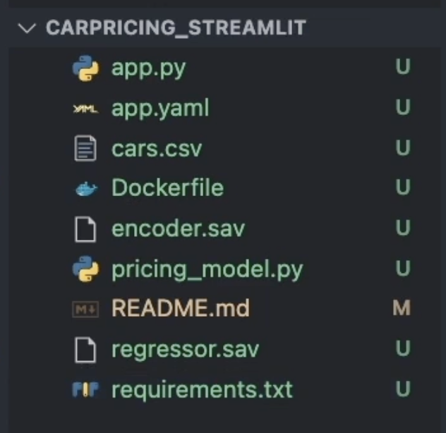

# Streamlit

- Industry workflow 
  - Step 1
    - define the business need
    - use case - what and why
    - data
    - set the metrics list
  - Step 2
    - EDA 
    - Prototype in Sandbox
    - Present and Collect Feedback
    - Update
  - Step 3 
    - Deploy
    - Present to wider audience
    - Collect feedback
    - Update
  - Step 4
    - Integrate into stakeholders workflow
    - Maintain and Upgrade

- 
- 