<details open>
  <summary> 1. QGIS </summary>

- GIS : Geographical Information Systems
- qgis -- open-source
- Map projections -- 3d earth to 2d surface
  - cylindrical
  - conical
  - planar
- Geodetic Datum -- known locations used as a reference to develop and link features to the projected surface
- Coordinate Reference System -- series of meridians (vertical) and parallels (horizontal) creating a grid
  - Geographic
  - Projected CRSs
- Vector Data 
  - table data with geometry
  - points, lines, polygons
  - format : ShapeFile, Geodatabase, Geopackage ; FGDB - File Geo DataBase 
- Raster Data
  - continuous data
  - types : single-band, composite, thematic
  - format : GeoTIFF, JPEG2000
  - Extension : .tif, 
- OpenMaps 


<details open>
  <summary> 1.1 Map Academy : Udemy </summary>

# Map Academy : QGIS : Udemy

## Basics

- Layer : Single map layer in qgis 
- geographic data file format
  - ShapeFile -- atleast 3 files
    - .shp
    - .shx
    - .dbf
    - .prj
  - Geopackage  -- sigle file
  - GeoJSON -- web mapping
  - KML -- google maps
  - GeoTIF -- roster format
- CRS : Coordinate Reference System
- Vector : Any layer made up of points, lines, or polygons
- Raster : Any layer made up of little pixels
- Properties
  - Layer
  - Project
    - CRS : Map Projections
    - General : Fill Color or Line Color
- `.qgz` -- project file extension -- just save the configuration and not the layers
- Settings > Options
- Map Area / Canvas
- Menu bar, Tool bar, Status bar
- View > Toggle Full Screen, Toggle Pannel Visibility, Toggle Map Only
- Identify Features `Ctrl Shift I`
- X - Longitude; Y - Latitude; CRS - EPSG 4236 WSG 84
- Plugins
  - HCMGIS
  - MapTiler
  - QuickMapServices
  - QuickOSM
- OSM WMS 
- Features
  - `F6` -- Attribute table
  - 
  - Filter > Query Buildre
  - Labels 
    - Background
      - Buffer, X 2, Y 2, 
    - Placement
  - View 
    - Decorations
      - Title Label
      - Copyright label
  - Project
    - Import/Export


- Topic
  - Can map lat/long from csv to a map
  - Add data from Browser Pannel
  - Shape File -- .shx .shp .dbf  -- .prj projection file
  - If the maps look weird, it must have to do with Coordinate Reference System / Projections / Bad data
  - Attribute table - F6


</details>

-----

</details>

-----


<details open>
  <summary> 2. ArcGIS </summary>


# 2.1 Real-World GIS

## 2.1.1 Intro

- sources 
  - [census.gov](https://census.gov)
  - [data.census.gov](https://data.census.gov)
  - [nationalmap.gov](https://apps.nationalmap.gov) -- also has REST services
  - [earthexplorer.usgs.gov](https://earthexplorer.usgs.gov)
  - Open Data
- tools 
  - [gdal.org gdal_translate](https://gdal.org/programs/gdal_translate/)

- TIGER : Topologically Integrated Geographic Encoding and Referencing System

<br/>

- Data
  - Vector
    - Points
    - Lines
    - Polygons
  - Raster 
    - Grids of rows and columns
    - Pixels
    - Imagery 
- 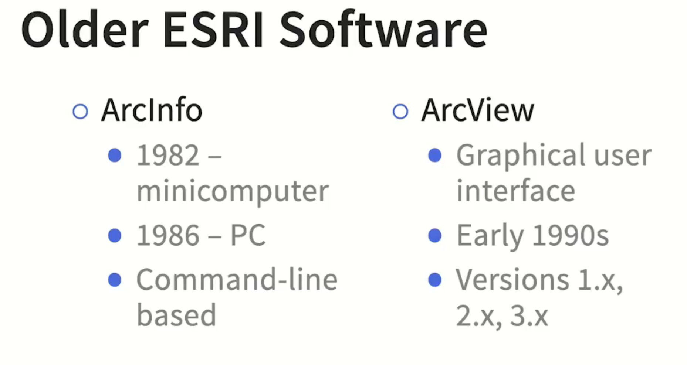
- 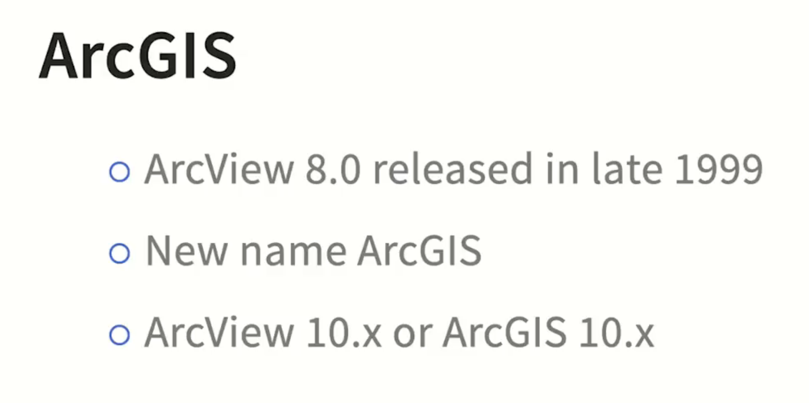
- 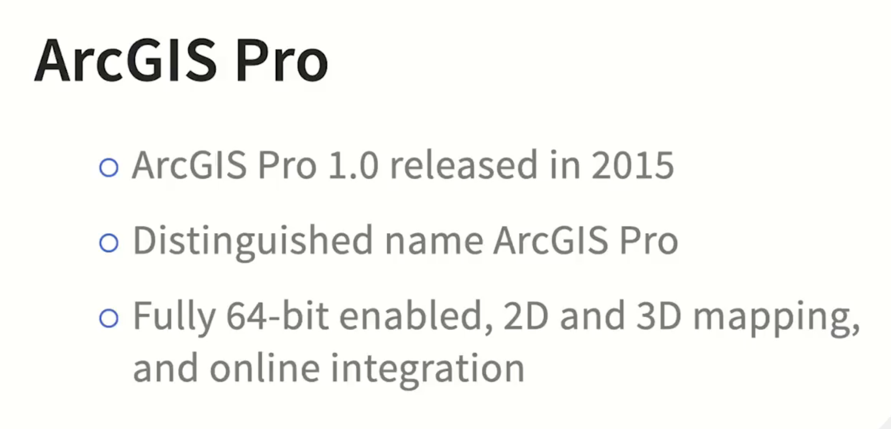

<br/>

- Vector Database File Structure
  - Georelational
    - Separate file system
    - Non-object oriented
      - Coverage file -- .cov 
        - 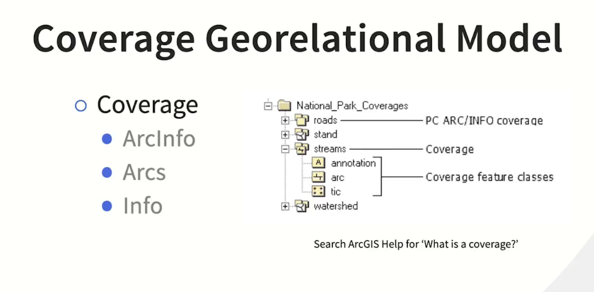
      - Shape file
  - Geodatabase
    - Contained file system
    - Object oriented
      - Geodatabase file
    - Relational DB Structure
    - File geodatabase (or older personal geodatabase) -- has a 2GB limit.  Based on Microsoft Jet DB Engine
    - Mobile Geodatabase - exclusive to ArcGIS Pro
      - built on open source SQLite
      - Viewable by SQL third-party software
      - Globally preferred database engine for mobile apps
    - 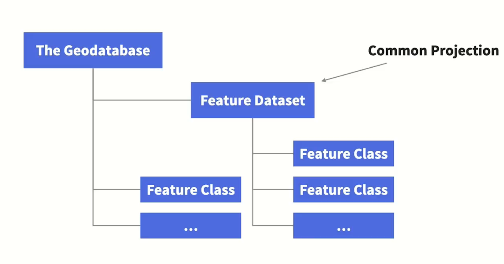

<br/>

- Raster Data Format
- 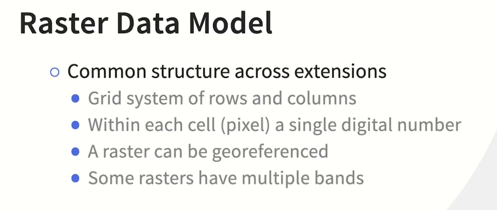
- 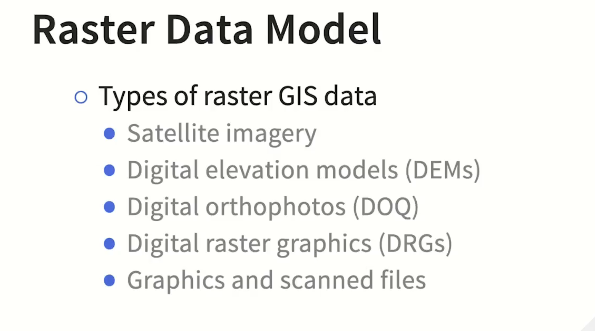


- Layer > Properties > Symbology
- Geoprocessing > Raster to Poly Line
- Rasterization -- vector to raster, Vectorization -- raster to vector
- ArcGIS Help, ArcGIS Pro Help -- supported raster dataset file formats


## 2.1.2 Projections

- Graticules : geographic grid system
- Equator : 0 degrees latitude
- Prime Meridian : 0 degrees longitude
- DMS : Degrees, Minutes, and Seconds : `12°39'12.39''`
- DD : Decimal Degrees 
- 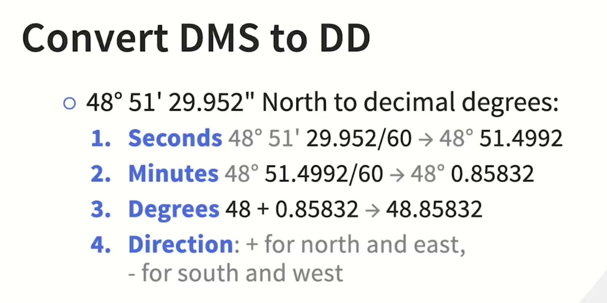

- > Any map projection is the systematic arrangement of Earth's meridians and parallels onto a plane surface -- Dr. Borden Dent, 1999

- Developer surfaces 
  - 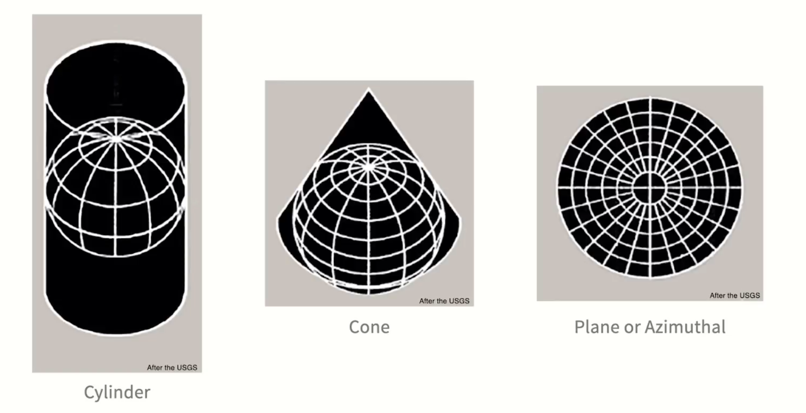
  - 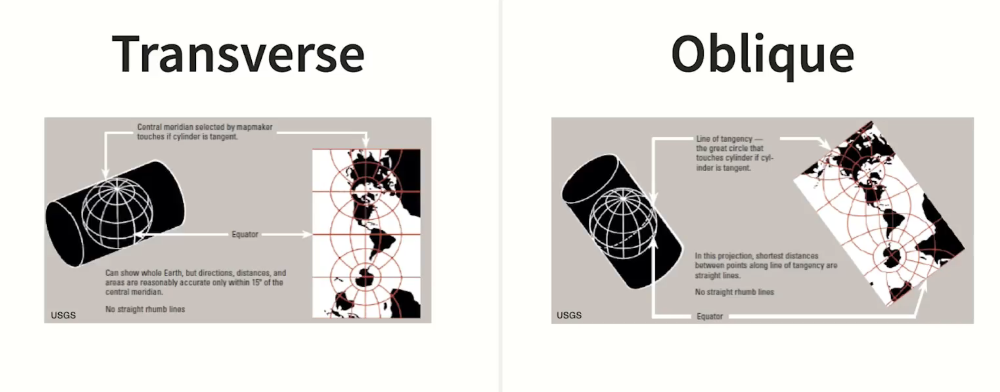
  - 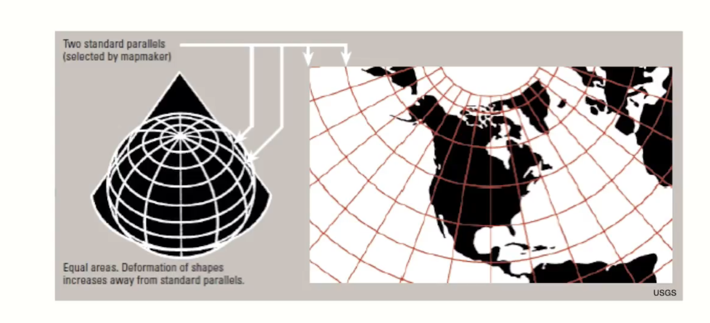
  - where the developer surface touches the globe -- tangent line -- real; rest are all distorted 
- 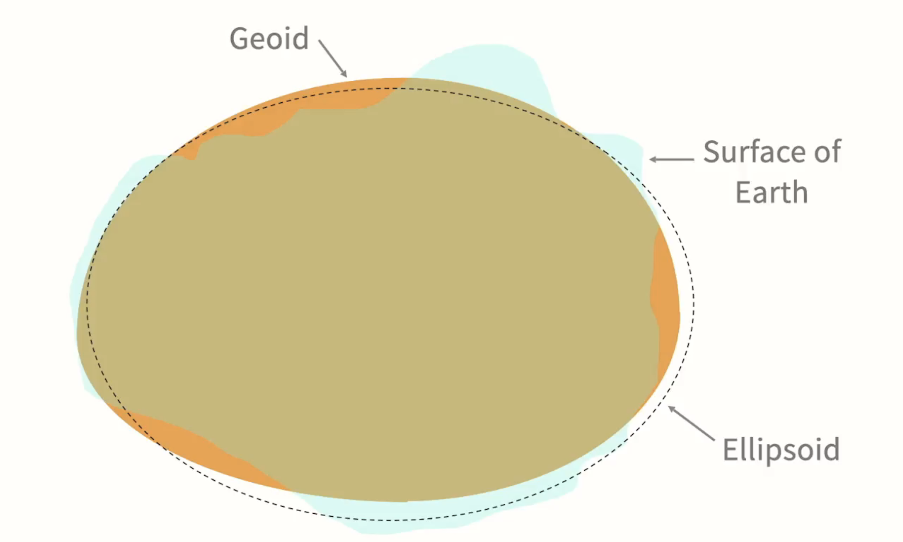
  - Geoids approximate earth surface
  - Ellipsoid approximates Geoids
  - Datum : A reference system of points systematically put onto an ellipsoid
    - 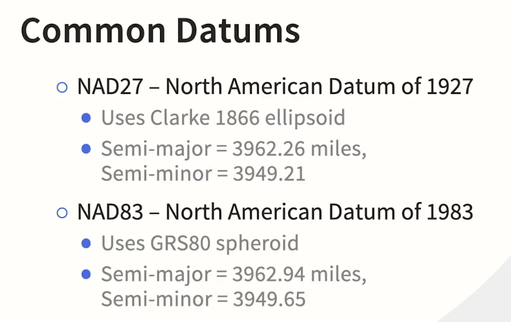
    - WGS84 World Geodetic System of 1984
      - Uses GRS80 Spheroid with minute adjustment 
  - When you adjust semi-major and semi-minor, you get a different model of the earth

<br/>

- Projection Distortions
  - What is not distorted?
    - Equivalent projection preserves areas -- cannot preserve angles
    - Conformal projection preserves angles -- cannot preserve areas
    - Compromise projection minimizes distortion overall
    - 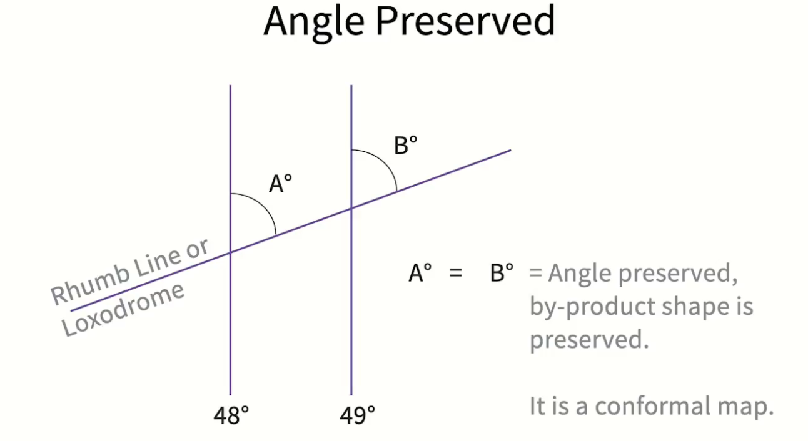
    - 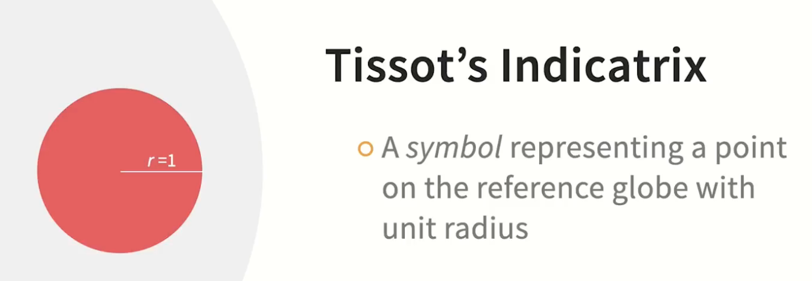
    - 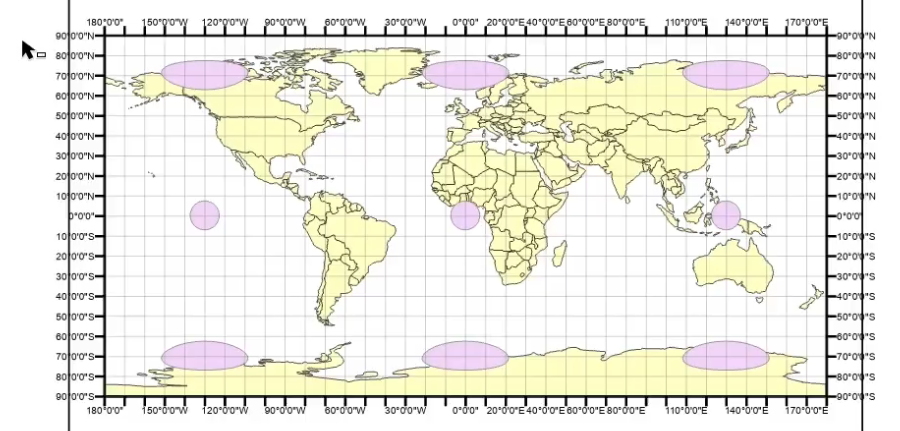
    - 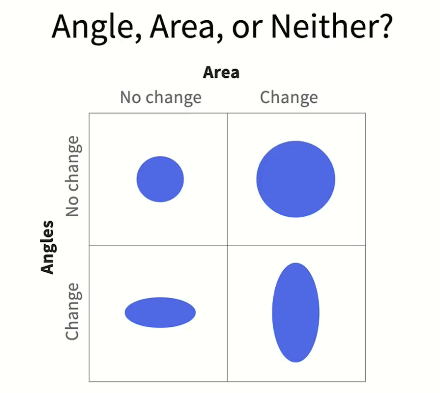
  - Geoprocessing > Projections and Transformations > Project 


## 2.1.3 Collecting GIS Data

- Time 
  - Total amount of collection time
  - Person hours to collect the data
  - Hardware 
  - 15% buffer in time allocation 
- Cost
  - Person hours paid
  - Hardware/Software 
  - Skill cost trade-off
  - 3-5% buffer in cost allocation

<br/>

- Geoprocessing > Converson Tools > Excel > Excel to Table 
- Once you have the table, right click and select Display XY data


# 2.2 ArcGIS Pro Essential Training


# 2.3 Learning QGIS

## 2.3.1 Introduction 

- View > Panels
  - Browser
  - Layers
- Layer Properties
  - Metadata
  - Preview
  - Attributes
- Project
  - New Print Layout
- ecw -- enhanced compressed wavelet
- You can actually edit layers. Toggle edit, select object, move nodes or x marks as needed 


## 2.3.2 Vector Data

- Layer > Add Layer > Add Vector Layer
  - File, Dir, Database, Protocol
- Shape files
  - shp
  - shx -- index 
  - dbf 
  - prj -- keeps track of CRS coordinate reference system
- Data is still still stored where it is stored. Think of projects as configurations. 
- WFS -- Web Feature Services -- vector data-- open geospatial consortium interface -- streams data from a URL 

## 2.3.3 Raster Data

- WMS -- Web Map Services -- Raster data (original data can be vector or anything)
  - NRCan Toporama
- ECW 
  - much smaller than TIF or JPEG
  - ERDAS ECW JPEG 2000 SDK from Hexagon Geospatial 
- gdal.org, safe.com -- translation tools 
- DEM -- Digital Elevation Model -- considered a raster file
- Contour -- a poly line that usually base on an elevation along a particular path
  - Raster > Extraction > Contour
- Vector > Data Management Tools > Merge Vector Layers 

## 2.3.4 3D Maps

- Layer Properties > 3D View > Extrusion > Height of Buildings (attribute in table)
- View > New 3D Map
  - 3D Configuration
    - Terrain
      - Vertical Scale -- to exaggerate the elevations 
  - Animation -- one per one 3D map
  - <u>**<span style="background-color: #f0ff00; color: black;">HandBranke -- open source video transcoder</span>**</u>

## 2.3.5 Styling Data

- Layer Properties > Source > Qury Builder > Filter 
- Symbology 
  - SVG marker
  - Unit -- Map Units -- refers to original lenght or height 
- Polyline
  - you can add as many lines as you want. 
  - Say you have one big simple line that's 10 Map units and black
  - Say you have another simple line that's 1 Map unit and yellow and dashed. 
  - Now it represents the nice road like ...
- Polygon layers
- Thematic Layers
  - Symbology > Categorized > Select category column > Hit classify
  - Symbology > Graduated > Select numeric column

## 2.3.6 Labelling features

- Labels > Single Labels
  - Text
  - Formatting
  - Buffer -- halo
  - Background ...

## 2.3.7 Default Properties

## 2.3.8 Creating Data 

- Create a shape file, add attributes 
- Layer Properties > Attributes > Fields > Widget Type > Value Map
- Vector > Data Management Tools > Join Attributes by Location 
- Creating heatmap for any point data -- go to symbology and select heatmap; color1 to transparent and color 2 to red 
- Vector > Geometry Tools > Centroids 

## 2.3.9 Other 

- Plugins > Manage and Install plugins
  - Street View 
  - Qgis2web

```python
layerList = QgsProject.instance().mapLayersByName('Intersection')
layer = layerList[0]
QgsVectorFileWriter.writeAsVectorFormat(layer, os.environ('USERNAME') + "\Desktop\wkt.csv", "utf-8", layer.crs(), "CSV", 0, layerOptions=['GEOMETRY=  AS_XYZ'])
```


# 2.4 InfraWorks and ArcGIS : AEC Collaboration


# 2.5 QGIS and Python for AEC


</details>

-----

