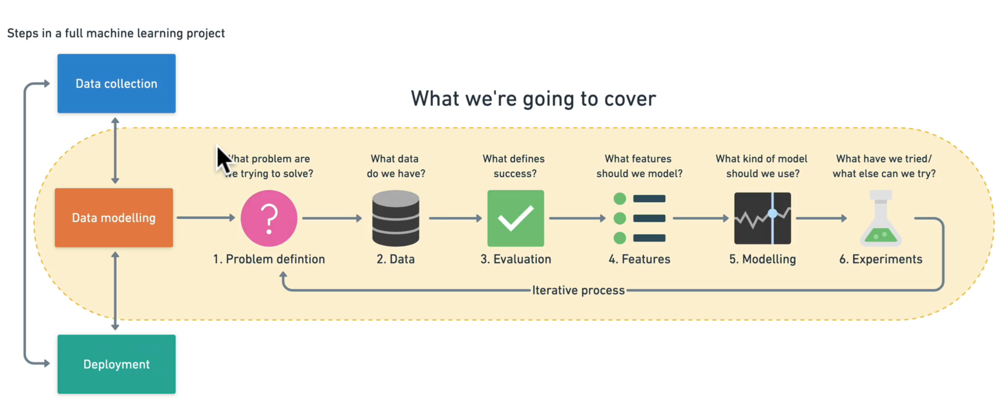
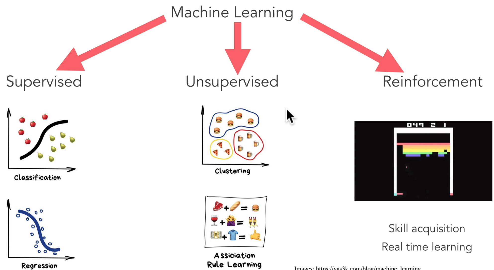
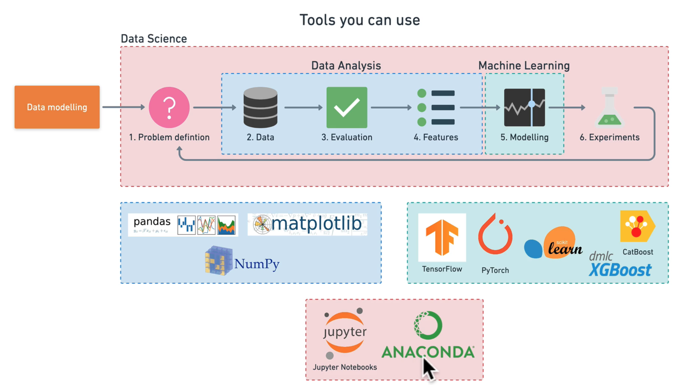

# ZTM Machine Learning and Data Science


<details open>
    <summary> ML & DS </summary>

## Contents
1. Machine Learning 101
2. Python
3. Work Environment
4. Data Analysis Pandas
5. Numpy
6. Data Visualizations : MatplotLib
7. Scikit-learn
8. Supervised learning
9. Regression 
10. Classification
11. Time Series
12. Neural Networks
13. Deep Learning
14. Transfer Learning
15. TensorFlow
16. Keras
17. Data Engineering
18. Hadoop 
19. Spark
20. Storytelling and Communication


## Introduction 

- [Course Resources](https://dev.mrdbourke.com/zero-to-mastery-ml/)
- [Github ](https://github.com/mrdbourke/zero-to-mastery-ml/discussions)

## Machine Learning 101

- computers do tasks for us
- we can specify rules, and it will follow -- calculate
- but how can a computer detect emotions, or persons, or animals, or objects; computers can't do a few things that only humans can
- however, machine learning changes this for good. Atleast most of the times
- AI -- human intelligence exhibited by machines
- narrow AI -- just as good or better than humans at specific tasks 
- general AI
- ML -- subset of AI; try and achieve AI through patterns in a set of data; science of getting machines act without being actually programmed
- DL -- one of the techniques for implementing machine learning
- DS -- Work with data, analyze, derive some sort of action or insights to drive business
- Teachable Machine by Google -- experiment how models or machine learning works. 
- Spreadsheets > Relational DB MySQL > Big Data - NoSQL MongoDB > Machine Learning
- 
- [ml-playground.com](https://ml-playground.com) -- go here and play around with the model
- use machines predit results based on incoming data
- [vas3k blog](https://vas3k.com/index.html)
- 
- Machine learning uses an algorithm or a program (called models )to take data and understand / learn different patterns to be able to take similar data and make future predictions and decisions; differ from normal programs in the learning aspect.
-  Normal Algorithm: Input & Instructions > Output
-  ML Algorithm: Input & Output > Tries to figure out instructions
-  Data Analysis: Look at data and try to understand it by comparing different examples, different features, visualizations, 
-  Data Science: Running experiments on a set of data with the hopes of finding actionable insights within it 

## ML & DS Framework

- Write code, make mistakes, build projects, learn what matters
- 6 steps
  1. problem definition -- what are we dealing with -- supervised, unsupervised, classification, regression?
  2. data -- what kind of data do we have -- structured, unstructured
  3. evaluation -- what success means to us -- say 95% accuracy -- something to aim for, because there is no perfect model 
  4. features -- what do we already know about the data
  5. modeling -- based on our problem and data what ml model should we use
  6. experimentation -- how could we improve, what can be done next 

- When shouldn't we use ML
  - will a simple handcoded instruction based system work?
- Types of Machine Learning
  - Supervised -- data and label; try predicting labels;
    - classification
      - binary classification
      - multi-class classification
    - regression -- predict a number
  - Unsupervised -- you provide labels, they aren't there to begin with
    - clustering
    - recommendation systems often start out as unsupervised
  - Transfer Learning -- leverage what one ML model learned in another ML model
  - Reinforcement Learning -- perform some action within a defined space and rewarding it or punishing it -- goal is to maximize the score 
- Types of Data
  > The more data the better
  - Structured Data
  - Unstructured Data
  - Static Data -- doesn't change over time -- CSV
  - Streaming Data -- constantly changed over time 

  - Static file > Jupyter Notebook > Pandas Data Analysis Matplotlib > scikit-learn Machine Learning
- Types of Evaluation -- what defines success for us
  - metrics
    - classification
      - accuracy
      - precision
      - recall
    - regression
      - mean absolute error
      - mean squared error
      - root mean squared error
    - recommendation
      - precision at k
- Features in Data -- what do we know about data; different forms of data
  - use feature variables to predict target variables
  - Numerical features
  - Categorical features
  - Derived feature -- Feature engineering -- creating new or altering existing features
  - Feature coverage -- process of ensuring all samples have similar information; How many samples have different features; Ideally every sample has the same feature
- Modelling
  - Based on problem and data, what machine learning model should we use
  - Generalization -- Ability of a ML model to perform well on unseen data
  - Data Splitting -- 70-80 10-15 10-15 
    - Training 
    - Validation -- tune
    - Test -- test and compare different models
  - Picking the model 
    - Choosing and training a model -- minimize time between experiments
      - Structured -- XGBoost, CatBoost, RandomForest -- Decision Tree Algorithms
      - Unstructured -- Deep Learning, Neural Networks, Transfer Learning
      - Some models work better than others on different problems
      - Don't be afraid to try things
      - Start small and build up (add complexity) as you need
    - Tuning a model
      - ML models have hyperparameters that you can adjust
      - A models first results aren't its last
      - Tuning can take place on training or validation data sets
    - Model comparision -- how will our model perform in the real world
      - Underfitting
        - Data Mismatch -- when the data your testing on is different from training data
        - fixes 
          - try a more advanced model
          - increase model hyperparameters
          - reduce amount of features
          - train longer
      - Overfitting
        - Data Leakage -- some of test leaks into training data
        - fixes 
          - collect more data
          - try less advance models
  - want to avoid overfitting and underfitting (head towards generality)
  - keep the test separate at all times
  - compare apples to apples
  - one best performance metric does not equal best model
- Experimentation
  - Machine Learning projects become tool matching projects
- Tools
  - Anaconda
  - Jupyter
  - Matplotlib
  - Pandas
  - NumPy
  - Scikit-learn
  - XGBoost
  - Pytorch 
  - TensorFLow
  - CatBoost
  - 

- [Elements of AI](https://www.elementsofai.com/)

## Data Science Environment Setup

- Anaconda - Hardware Store -- Software Distribution
- Miniconda - Workbench -- Software Distribution
- Conda - Personal assistant -- package manager 
- [getting your computer ready with conda](https://www.mrdbourke.com/get-your-computer-ready-for-machine-learning-using-anaconda-miniconda-and-conda/)
- [getting started with conda](https://docs.conda.io/projects/conda/en/latest/user-guide/getting-started.html)
- [conda cheatsheet](https://cdn.fs.teachablecdn.com/wyrLtEMTQ9OsuZzc00Jf)
- Collection of packages -- environment
- `conda create --prefix ./env pandas numpy matplotlib scikit-learn`
- `conda activate /Users/user/Download/temp/test_project1/env`
- `conda env list`
- `jupyter notebook`
- `conda install jupyter`
- `conda deactivate`
- you can now simply share the entire project folder, and ash can now activate the env and continue with work
- or you can export env to a YML file using `conda env export --prefix /Users/user/Desktop/project_1/env > environment.yml`
- `conda env create --file environment.yml --name env_from_file`

<br/>

- [Jupyter for beginners](https://www.dataquest.io/blog/jupyter-notebook-tutorial/)
- A cell can be in edit more or command mode
- ESC -- command mode; Enter -- Edit mode
- While in command mode, y -- code; m -- markdown
- ``


## Pandas Data Analysis

- `conda env list` & `conda activate path_to_env`
- ```python
  import pandas as pd

  series = pd.Series(['Toyota', 'Lexus', 'Nexus'])
  series # 1 dimensional column object

  colors = pd.Series(['Black', 'Grey', 'Matt Black'])

  car_data = pd.DataFrame({"Make":series, "Color": colors})

  car_sales = pd.read_csv('filename.csv')

  car_sales.to_csv('newfile.csv', index = False) # index is set to True by default

  online_data = pd.read_csv('path_to_file.csv')
  ```
- index starts at 0
- axis = 0 --> row
- axis = 1 --> column
- 

</details>

<br/>
<hr/>
<br/>


# 