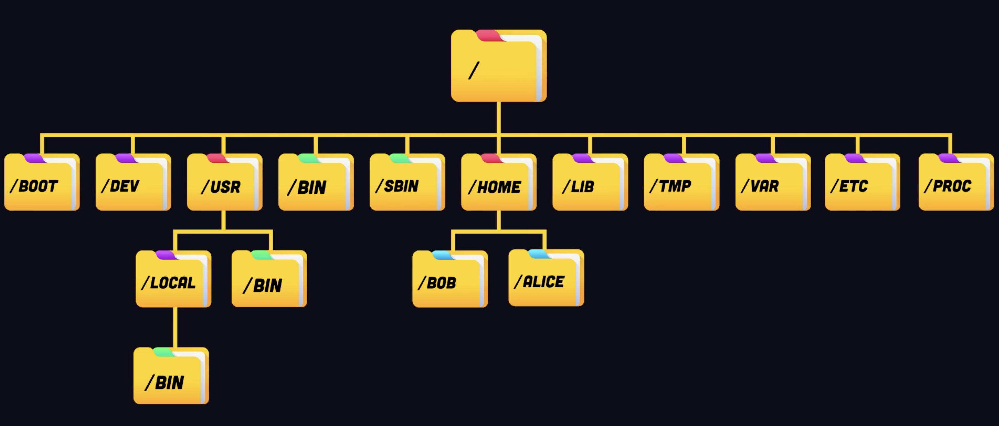
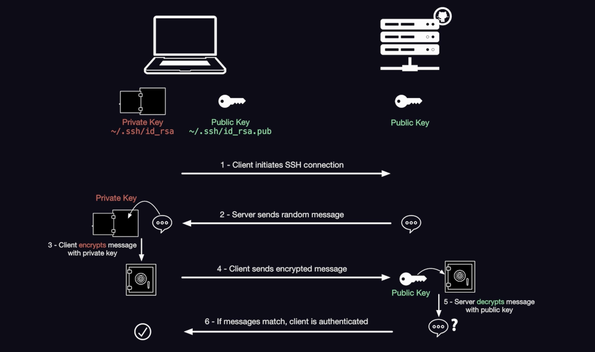
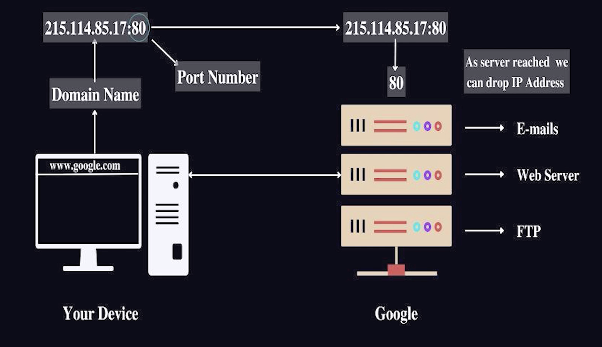

# Fireship Linux

- Linux
  - Live Boot
    - Tails OS -- only runs in memory
  - Dual Boot
    - Asahi Linux -- can dual boot on MAC
  - Raspberry Pi
  - Virtual Box
  - Remote Linux Server
  - WSL Windows Subsystem for Linux

- Linux Distros 
  - Linux Mint 
    - debian and ubuntu based -- everyday use
    - less vendor lock-in, desktop environment
  - Alpine Linux -- servers
    - minimal cloud usage
    - secure
    - often used in docker containers
  - Kali Linux -- hacking
    - debian based
    - Penetration tools included  
  - Ubuntu -- debian based
    - pros
      - versatality
      - adoption
      - security patches
    - cons
      - run by for profict company
      - reliance on canonical servers for distributions
      - snap packagemanager
  - Debian
    - Pros -- Freedeom, Massive Ecosystem
    - Cons -- Ease of use, lots of manual configuration
    - apt package manager
  - Arch
    - rolling releases
    - primarily for end users; NO GUI 
  - Manjaro -- arch based
  - Open SUSE
    - middleground between ubuntu and arch
    - Yet another setup tool -- used to configure
    - desktop and server environments
    - popular amoung SAP
  - RedHat
    - Stability
    - Security
    - Support
  - Fedora -- 2 year support cycle
  - Rocky Linux -- 10 year support cycle
  - Tails OS 
    - only exists in Memory

<br/>
<br/>

- wsl with vscode -- windows subsystem for linux
- `ls -l -h` -l list all; -h human readable
- `command --help`
- `man command`
- `ls -sS` -s size -S sort by size
- `cd folder`
- `cd ..` - move to parent
- `cd -` - goes back to previous directory
- `cd ~` - home
- `pwd`
- `echo $PWD`
- `mkdir junk`
- `mkdir /foo/bar/baz - p` --creates parent directories as well
- `touch filename.txt`
- `rm -i filename` confirms if you want to proceed
- `rm -rf dir` recursively deletes everything
-  `cat info.txt`
-  `cp a.js new.js`
-  `mv new.js ../new.js`
-  `mv a.js b.js c.js ../move_all_3_to_this_dir`

<br/>
<br/>

- File System
- 
- `cd /` root dir
- bin -- all the binaries for executables
- sbin -- system binaries -- executed by root user or system
- lib -- shared binaries by bin and sbin  
- usr -- user system resources 
  - bin -- usr/bin is non-essential for OS
- usr/local/bin -- locally installed libraries
- `$PATH` -- tells linux where the binaries are
- etc -- editable text config -- config files to customize behaviour of other programs
- home -- directories owner by users of the machine. say you and ash use this, each gets their own directory inside this
- boot -- linux kernel and other system files 
- dev -- contains all device related files 
- opt -- optional programs -- say nvidia stuff that is not essential for installation of main OS services
- var -- variable data -- change as OS runs 
- tmp -- temporary -- everytime the system boots, this directory is empty 
- mnt -- mount -- temporary mount point for systems not manually mounted by system admin 
- proc -- virtual file system created by linux containing information about running processes and system information
- sys -- also a virtual file system but provides information about hardware and kernel subsystems

<br/>
<br/>

- **Path variable**
- `$PATH` -- tells linux where the binaries are
- `which command` -- gets the PATH for the binary
- whichever path linux finds first, it executes it
- `export PATH=my_custom_dir/bin:$PATH` -- prepends the PATH variable until you restart the terminal session
- to make it persistent, append above statement to your terminal configuration file like .bashrc, .profile, .zshrc, ...

<br/>
<br/>

- **File Permissions**
- Owner, Group, Other
- RWX - Read, Write, Execute
- `touch some.txt` -- rw- r-- r-- 
- `chmod [u/g/o][+/-/=][r/w/x] file`
- `chmod 664 some.txt` 6 for owner and group, 4 for other 
- [chmod-calculator.com](https://chmod-calculator.com)
- `chmod 777 some.txt` -- all groups, all permissions
- follow principle of least privilege and provide access only when its needed

<br/>
<br/>

- **Sudo**
- Super User Do has elevated privileges or root is a special user account with userid 0 and full admin privileges 
- SUDO privileges can be granted to multiple users

<br/>

- **Bash Shell**
- shell provides an abstraction layer between user and operating system
- BASH : Born Again Shell -- interpreted programming language
- ZSH 
- FISH : Friendly Interactive Shell
- `name='ash' read status echo '$status'`
- .bashrc -- runs on every new shell instance
- .bash_profile -- runs only on login
- PS1 -- Prompt String 1 
- u username; h hostname; w working_dir; 
- ```bash
  #!/bin/bash

  # Define variables
  name="Jeff"

  # Print a message
  echo "Hello, $name!"

  # Read user input for age
  echo "Enter your age:"
  read age

  # Conditional statement
  if [ $age -ge 18 ]; then
      echo "You are an adult."
  else
      echo "You are a minor."
  fi

  # Loop through numbers 1 to 5
  for i in {1..5}; do
      echo "Number: $i"
  done

  # Function to greet a person
  greet() {
      local greeting="Hello, $1!"
      echo $greeting
  }

  # Call the greet function
  greet "Alice"

  # Read user input for favorite color
  echo "Enter your favorite color:"
  read color
  echo "Your favorite color is: $color"

  # Check the exit status of a command
  ls /non/existent/directory
  if [ $? -eq 0 ]; then
      echo "Command succeeded."
  else
      echo "Command failed."
  fi
  ```

<br/>
<br/>

- **NANO / VIM**
- nano is minimal while vim is powerful
- `vimtutor`
- nano
  - `nano hello.txt` opens up a new temporary file with specified name
  - `ctrl s` save
  - `ctrl o` save as -- you need to write a new file name 
  - `ctrl x` exit
  - `ctrl w` search 
  - `ctrl 6` to set a mark
  - `alt 6 ` copy selection
  - `ctrl u` paste selection
  - `alt u` undo last action
  - `ctrl g` brings up the manual 
- 1976 Bill Joy VI
- 1991 Bram Moolenar VIM
- 2014 NeoVim
- Lua -- multiparadigm programming launguage with build in LSP Language Support Protocol
- `~/.config/nvim/init.[vim/lua]`
- nvchad 

<br/>
<br/>

- **grep & sed**
- GREP - global regular expression print
- `grep -r -n "mom" .` search for mom in all files in current dir and return the lines along with line numbers
- `-c` to count times occurred
- `^app` start with app or `baz$` end with baz
- SED -- stream editor; non interactive text editor
- `sed 's/mom/dad' main.js > main1.js` substitute mom for dad in main.js and save as main1.js or use -i to edit inplace
- [Regex](https://regexer.com)
  - validate input
  - search patterns
  - ^ starts with
  - $ ends with
  - {2, 6} specific number of times
  - ? - 0 or 1
  - + - 1 or more
  - * - 0 or more
  - \? - escape
  - (a|b)c 
  - \d \w \D -- digits, words, other

<br/>
<br/>

- **Process Management**
- `ps` list current running processes
- `ps -ef` list all processes
- PID process id
- PPID parent process id 
- UID user id
- C cpu utilization
- TTY terminal associated with the process
- `kill pid` kills the process gracefully by sending signal SIGTERM to the process but doesn't guarantee termination
- `kill -9 pid` forcefully kills by sending SIGKILL 
- `top` displays realtime information
- `htop` displays realtime information with even more details and added capabilities like filtering and sorting 

<br/>
<br/>

- **CRON**
- Time based job scheduler
- Minute, Hour, Day of the Month, Month, Day of Week
- `realpath filename` -- gets the full path
- `sudo service cron start`
- `crontab -e`
- `* * * * * path/to/command/to/execute/every/minute`
- `crontab -l` list registerede jobs
- `sudo grep CRON /var/log/syslog`
- HealthChecks is a tool or a monitoring service to ensure everything is as expected

<br/>
<br/>

- **TAR and GZIP**
- LZ77 - basis for GZIP
- lossless compression
- `gzip movie.txt` movie.txt.gz
- `gzip -d movie.txt.gz` -- decompress | ` gunzip movie.txt.gz`
- TAR -- archive entire directories into one single file (tarball); TAPE ARCHIVE
- `tar -cvf archives.tar ./movies/` -- archives into a single file, however, file size doesn't come down
- `tar -czvf archive.tar.gz ./movies/` 
- c for create, z gzip, v verbose, f filename
- `-J` xz compression
- `-j` bzip2 compression
- `-z` gzip compression
- jpeg -- lossy compression
- gzip
  - Data -> Deflate (LZ77 Encoding, Huffman Encoding) -> Compressed Data
  - Compressed Data -> Deflate (LZ77 Decoding, Huffman Decoding) -> Data
- Brotli -- newer compression algorithm for files on the web

<br/>
<br/>

- **Package managers**
- APT -debian; Advanced Package Tool
- `sudo apt update` gets the latest package metadata
- `sudo apt install sl`
- YUM/RPM -redhat; 
- Pacman -Arch
- `wget https://example.com/sl.deb`
- `dpkg -i ./sl.deb` depackage install; does not resolve dependencies

<br/>
<br/>

- **Virtual Private Server VPS**
- AWS EC2, Google Compute Engine
- Linode
- Digital Ocean
- Hostinger
- Hetzner
- Vultr

<br/>
<br/>

- **SSH**
- Secure Shell
- `ssh user@ip_address`
- `ssh-keygen -t ed25519 -C "your@example.com` -t specifies algorithm
- 
- Pocket Base -- DB + Admin
- NextJS 
- `npm run dev`
- `./pocketbase serve` local 8090
- 
- 80 -http closed by default
- 443 -https closed by default
- 22 -ssh open by default
- Firewall determines which ports are open/closed
- `sudo apt install nginx` also called reverse proxy, directs incoming traffic to appropriate app
- `systemctl start nginx` -- start service in background
- `systemctl enable nginx`
- `systemctl status nginx`
- Uncomplicated firewall utility -- enable http and https requests
- `ufw status` tells us which ports are open
- `sudo ufw app list`
- `sudo ufw allow 'Nginx HTTPS'`
- `scp -r /local_folder user@ip:/dist` secure copy
- `nvm install 20`
- `npm run build` runs a production build
- `npm start`
- `curl http://localhost:3000`

<br/>
<br/>

- **Secure Socket Layer**
- Let's Encrypt -- get a free SSL certificate
- CertBot -- generate a certificate
- CloudFlare -- Free DNS
- `/etc/ssl/cert.pem` 
- `/etc/ssl/key.pem` 
- DNS Domain Name System
  - sub-domain.domain.top-level-domain
  - https:// fireship. io
  - First looks for a dns record in computer, or browser cache
  - Then asks DNS Recursive Resolver
    - Root Server -- top level domain
    - say TLD Server -- returns Authoritative Name Server
    - Authoritative Server -- returns IP Address
  - Registrar (Godaddy, bluehost, google domains) -- ICANN 
  - Registry (Verisign)
  - Zone File -- Configure Domain Settings
    - Start of Authority
    - A Record (Address)
    - CNAME (Canonical Name)
    - MX (Main Exchange)
    - TXT
    - NS (Name Server)

<br/>
<br/>

- **NGINX**
- If hosting a web application, all incoming traffic should ideally go to port 443 (https) and nginx (reverse proxy) looks at their routes, and directs to respective application

```bash
nano /etc/nginx/sites-available/guestbook
ln -s /etc/nginx/sites-available/guestbook /etc/nginx/sites-enabled/

rm /etc/nginx/sites-enabled/default

nginx -t
systemctl reload nginx
```

```bash
server {
    listen 80;
    server_name linux.fireship.app;
    
    # Redirect HTTP to HTTPS
    return 301 https://$server_name$request_uri;
}

server {
    listen 443 ssl;
    server_name linux.fireship.app;

    # SSL configuration using Cloudflare certificates
    ssl_certificate /etc/ssl/cert.pem;
    ssl_certificate_key /etc/ssl/key.pem;

    # SSL settings (recommended for security)
    ssl_protocols TLSv1.2 TLSv1.3;
    ssl_prefer_server_ciphers on;
    ssl_ciphers ECDHE-ECDSA-AES128-GCM-SHA256:ECDHE-RSA-AES128-GCM-SHA256:ECDHE-ECDSA-AES256-GCM-SHA384:ECDHE-RSA-AES256-GCM-SHA384:ECDHE-ECDSA-CHACHA20-POLY1305:ECDHE-RSA-CHACHA20-POLY1305:DHE-RSA-AES128-GCM-SHA256:DHE-RSA-AES256-GCM-SHA384;

    # Next.js application
    location / {
        proxy_pass http://localhost:3000;
        proxy_http_version 1.1;
        proxy_set_header Upgrade $http_upgrade;
        proxy_set_header Connection 'upgrade';
        proxy_set_header Host $host;
        proxy_cache_bypass $http_upgrade;
    }

    # PocketBase API and Admin UI
    location /pb/ {
        rewrite ^/pb(/.*)$ $1 break;
        proxy_pass http://localhost:8090;
        proxy_http_version 1.1;
        proxy_set_header Upgrade $http_upgrade;
        proxy_set_header Connection 'upgrade';
        proxy_set_header Host $host;
        proxy_cache_bypass $http_upgrade;
    }
}
```

<br/>
<br/>

- `export API_KEY="val"` only for current terminal session
- Can add above to .bashrc
- Can add above to /etc/environment -- global, available for all users
- Or can create a .env file in the application directory

<br/>

- **systemd**
- provides a system and service manager that runs as PID 1 and starts rest of the system
- `ls /etc/systemd/system/`
```bash
ls /etc/systemd/system/

nano /etc/systemd/system/pocketbase.service
touch /var/log/pocketbase.log
chmod 644 /var/log/pocketbase.log
```

```bash
[Unit]
Description=PocketBase

[Service]
Type=simple
User=root
Group=root
LimitNOFILE=4096
Restart=always
RestartSec=5s
StandardOutput=append:/var/log/pocketbase.log
StandardError=append:/var/log/pocketbase.log
ExecStart=/root/apps/guestbook/pocketbase serve --http="127.0.0.1:8090"
Environment="NEXT_PUBLIC_POCKETBASE_URL=https://linux.fireship.app/pb"

[Install]
WantedBy=multi-user.target
```

```bash
nano /etc/systemd/system/nextjs.service

[Unit]
Description=Next.js Application
After=network.target

[Service]
Type=simple
User=root
Group=root
Restart=always
RestartSec=5s
WorkingDirectory=/root/apps/guestbook
ExecStart=/bin/bash -c 'source /root/.nvm/nvm.sh && /root/.nvm/versions/node/v20.15.0/bin/npm start'
Environment="NODE_ENV=production"
Environment="NEXT_PUBLIC_POCKETBASE_URL=https://linux.fireship.app/pb"

[Install]
WantedBy=multi-user.target
```

```bash
systemctl daemon-reload

systemctl start pocketbase
systemctl enable pocketbase

systemctl start nextjs
systemctl enable nextjs

systemctl status pocketbase
systemctl status nextjs
```

<br/>
<br/>

- **Mount Storage**
```bash
lsblk # ls block
mkfs.ext4 /dev/vdb # formats any existing data
mkdir -p /mnt/blockstorage/pb_data
mount /dev/vdb /mnt/blockstorage
chmod -R 755 /mnt/blockstorage/pb_data
echo "/dev/vdb /mnt/blockstorage ext4 defaults,nofail 0 0" | sudo tee -a /etc/fstab
nano /etc/systemd/system/pocketbase.service

## Update this line
ExecStart=/root/apps/guestbook/pocketbase serve --http="127.0.0.1:8090" --dir="/mnt/blockstorage/pb_data"

sudo systemctl daemon-reload
sudo systemctl restart pocketbase
sudo systemctl restart nextjs
```

<br/>
<br/>

- Outsourcing DDOS attack protection - say CloudFlare
- Static Performance : Content Delivery Network (CDN) - say CloudFlare
- Dynamic Performance : Caching, Database; Redis - In memory database
- Scaling UP : Vertical Scaling (Increase resources), Horizontal Scaling
- Deploying with Docker and orchestrating using Kubernetes
- Coolify -- conects to github and pushes code to VPS on every change
- Logging/Monitoring, Backups, Disaster Recovery Plan
- Ansible -- records every step, say when you move to different hosting service, ansible takes care of the steps

<br/>
<br/>

- **Docker**
- Race conditions, Memory Leaks, Unhandled errors
- Vertical scaling
- Horizontal Scaling
- Distributed computing
- Microservices
- Virtual Machines : CPU allocation is fixed. Virtualizes hardware
- Hypervisors
- Docker Engine : runs on top of OS, and shares the OS kernel, virtualizes OS. Dynamic resource allocation
- Daemon Process : dockerd
- Docker Desktop
  - Docker file : blueprint, configuration
  - Image : OS, dependencies, code
  - Docker Hub
  - Container : isloated package running code; Stateless; Portable; No-vendor-lockin
- sha-256 hash; .dockerignore
- docker scout
- Elastic Container Service
- Serverless Cloud Run
- Docker Compose : Multi Container Applications
- Orchestration : Kubernetes, K8s
- Google Borg

<br/>
<br/>

- **Ansible**
- OpenSource Automation Tool describing IT infrastructure with declarative code
- Configuration Management Tool
- Declarative Push Based YAML Code
- Automate linux servers
- Control Nodes and Manage nodes
- Playbooks and plays (set of instructions) : Idempotent -- doesn't make any changes unless it has to 
- Ansible Galaxy
- Ansible Vault
- Linode Alkamai Cloud Computing

<br/>
<br/>

- **SST**
- Full stack web applications with AWS
- Open Source Tool
- 


# 