# ZTM Networking

## TOC 

## Networking Basics

- Networking : practice of connecting multiple devices or computers to share information and resources
- Types of Networks
  - PAN : Personal Area Network
    - connects electronic devices within a users immediate area (few cm to a few m)
    - USB, Firewire, Bluetooth, Wifi, IrDA, Zigbee, ...
  - LAN : Local Area Network
    - devices connected in one physical location (m to 2km)
    - client-server LAN
    - peer-to-peer LAN
    - say connects computers, printers, servers, ... which all are given a Local IP address
  - MAN : Metropolitan Area Network
    - connects computers over a geographical distance through a shared communication path over a city, town or a metropolitan area
    - uses FDDI, CDDI, ATM as a technology (5km to 50km)
  - WAN : Wide Area Network
    - not tied to a single location, say network of networks
    - say Internet, global corporate network connecting offices worldwide, telecommunications network spanning a country
  - WLANS : Wireless Local Area Network
  - SAN : Storage Area Network
  - VPN : Virtual Private Network

  

- MAC Address
  - globally unique identifier assigned to a network interface controller (NIC)
    - uniqueness is ensured by Institute of Electrical and Electronics Engineer
      - allocates specific block of mac addresses to different manufacturers 
  - Media Access Control address -- aka hardware/physical address
  - used at data link layer (layer 2) of OSI model
  - unique, non-changing, fixed-format
  - 6 pairs of hexadecimal values, first 3 pairs indicate manufacturer identifier
  - 00:1A:2B:3C:4D:5E
    - 00:1A:2B -- identifies manufacturer
    - 3C:4D:5E -- unique identifer among devices produced by the manufacturer
- IP Address 
  - not always unique

  

- Network Devices
  - Routers
    - act as traffic director of a network, direct data packets between networks
    - one purpose -- routing
    - have routing tables and algorithms to determine best path for data to travel
    - today, routers usually perform functionality of both routers and switches
    - used for network segmentation
    - perform NAT (Network Address Translation)
      - allows multiple devices to share a single public IP address
    - make decisions based on IP address
    - work at layer 3 of OSI model
  - Switches
    - use MAC address of a device to send data only to the port that the destination device is plugged into
    - maintain the MAC address tables to understand which devices are conencted to which ports
    - work at layer 2 of OSI model
    - 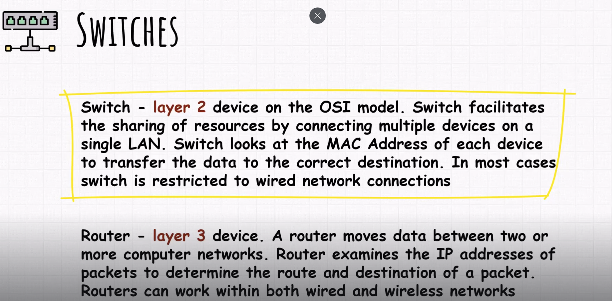
  - Modems
    - a device that physically conencts your network to ISP's infrastructure
    - establishes the initial internet connection by translating digital data from your network into a format that can be transmitted over ISP's network
    - DSL Modems  -- standard copper telephone lines 
    - Cable Modems   
    - Fiber Optic Modems
    - Modems provide link between your network and ISP 
    - Routers manage local network traffic and provide additional features like wi-fi connectivity and security

  

- Client Server vs Peer-to-Peer
  - Client : device that is requesting a remote service or that is using remote service from a server
  - Server : device that is hosting a service to the client
  - client-server is often considered centralized
  - Peer-to-Peer devices in network have equal status. Can act both as clients and servers 
  - Often considered decentralized

  

- Network Topology
  - Star Topology
    - every node connects to a central network device (hub, switch, or a computer)
    - central network device acts as a server while peripheral devices act as clients
    - Central Hub -- typically a switch
    - Nodes -- individual devices connected to Cetnral Hub
    - Advantages
      - Centralized Management
      - Easy to add another device or computer
      - Network functions normally even if one computer on the network fails
    - Disadvantages
      - Higher cost to implement
      - If the central computer/hub/switch fails, the entire network goes down
  - Bus Topology
    - All devices are connected to a signle cable along whcih data travels
    - Each device is equipped with a NIC (network infterface card) that determines if the packets are meant for the device
    - 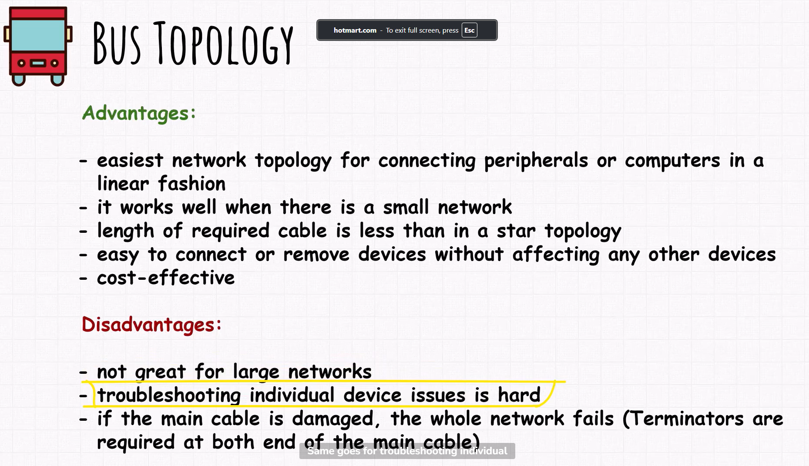
    - 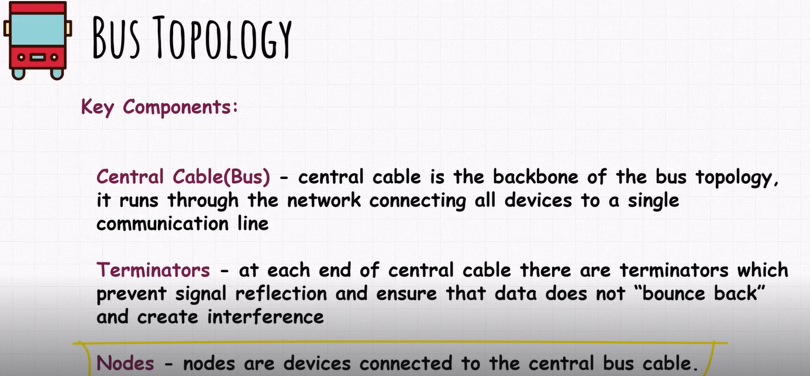
  - Ring Topology
    - All devices are connected to form a ring or circle
    - data can flow uni or bi directionally
    - each device is connected to two other
    - data flows from one device to other until the destination is reached
    - 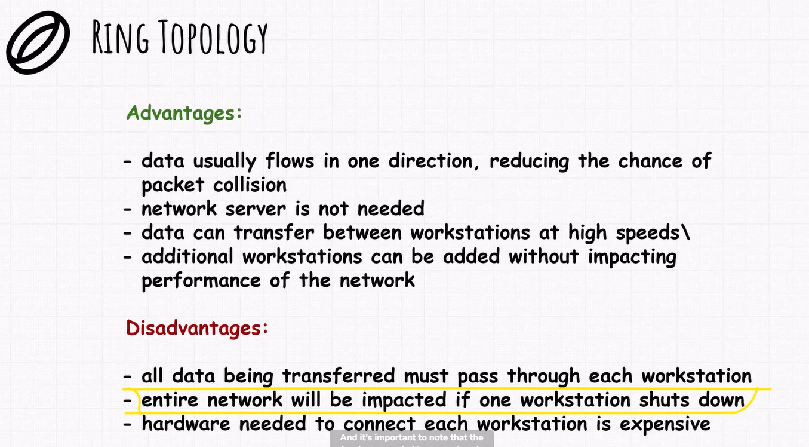
    - 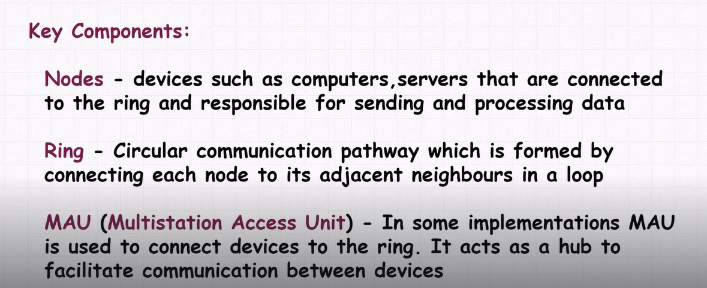
  - Mesh Topology
    - Advantages
      - High Reliability
      - Redundancy
      - Scalability
      - Fault Tolerance
    - Disadvantages
      - Complexity
      - Cost
      - Bandwidth Consumption
    - Nodes
    - Links - physicsal or logical connection between devices such as wired or wireless connections
  - Hybrid Topology
    - Nodes
    - Multiple Topologies
    - Star-Ring, Star-Bus
    - 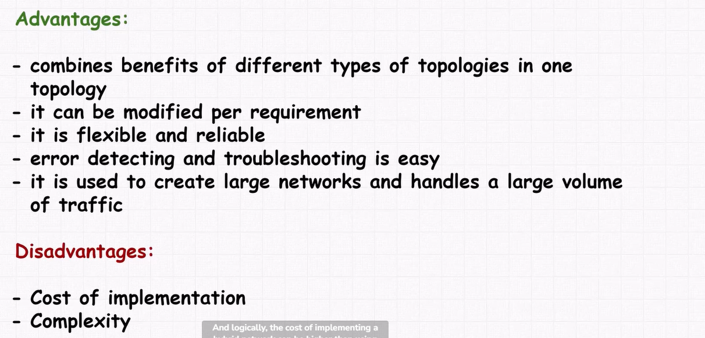

  

- IP Addresses
  - Private IP : devices inside your network have private IP given by DHCP (Dynamic Host Configuration Protocol)
    - Class A : 10.0.0.0 --- 10.255.255.255
    - Class B : 172.16.x.x --- 172.31.x.x
    - Class C : 192.168.0.0. --- 192.168.255.255 
  - Public IP : unique identifier for each device directly connected to the internet, your router can have a Public IP address but also a private IP 
  - `ipconfig -- widnows | ifconfig -- linux or mac`
  - Subnet Mask -- defines a range of ip addresses that can be used within a network
    - 32 bit value
    - two parts, the network address and host address
    - 4 octets each 8 bits
    - Class A : 255.0.0.0
    - Class B : 255.255.0.0
    - Class C : 255.255.255.0 
    - left 24 bits are for network while right 8 bits are for the host
  - All above are IPv4 
  - IPv6
    - hexadecimal format
    - 128 bit addresses
    - way more IPv6 than IPv4
    - first 64 bits are for network and second 64 bit are for host
    - Public IPv6 -- start with 2001, 2002, 2003 -- used externally
    - Link Local IPv6 -- start with fe80
    - Unique Local IPv6 -- start with fc00 or fd00
    - 
    - we can only use `::` once. If we have multiple blocks of 0s we must use `:0:`
  

- Subnetting
  - Subnet : logical subdivision of an IP Network
  - Subnetting : process of dividing a network into two or more networks. Benefits include security, improving network performance.
  - 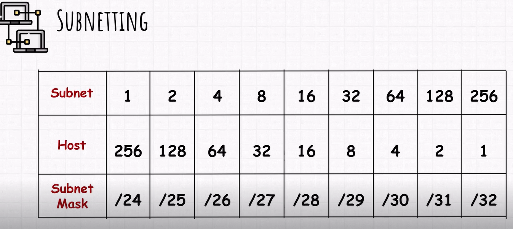
  - say you have 2 subnets, then you get 128 hosts in each subnet (126 usable), and the notation is /25
  - 192.168.1.0/24 ---> create 8 subnets
    - 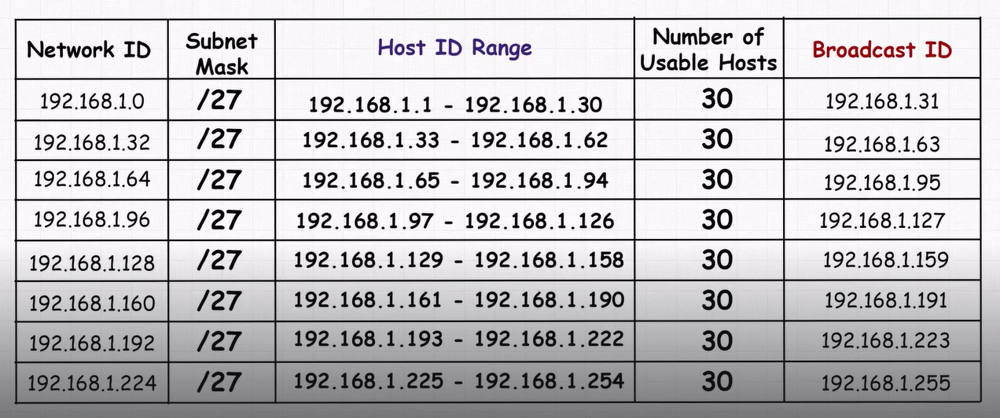

  

- Common Networking Commands
  -  `ping google.com` -- performs 4 ping requests and stops (windows); pings infinitely (linux)
  -  `traceroute google.com (linux) | tracert google.com (windows)` (linux) -- shows the path taken by the packet to reach destination 
  -  `ifconfig (linux) | ipconfig (windows)` 
  -  `arp -n (linux) | arp -a (windows)` -- arp protocol -- used to map ip address to the corresponding mac address on local network
  -  `nslookup facebook.com` -- queries dns for information regarding ipaddress
  -  `netstat -nt (linux | windows)` -- lists all the active connections that the device has
  - `route -n`  -- shows the routing table on the system

  

- OSI Model
  - Open System Interconnection Model
    - Physical Layer - BINARY
      - lowest - data is in binary, Cables, Switches, ...
    - Data Link Layer - FRAMES
      - error detection and correction, organization of data into smaller packets
      - takes data from network layer and forms frames
    - Network Layer - PACKETS
      - deals with addressing and routing, finding route path
    - Transport Layer - 
      - end to end communciation between devices
      - ensure information is delivered reliably and in correct order. 
      - does error checking and flow control, breaks data into packets if necessary
    - Session Layer
      - opening, closing, adn maintaining communication or connection
    - Presentation Layer 
      - converts data into a form understandable by Application Layer
      - deals with data compression and encryption
    - Application Layer
      - provides UI to the network
      - HTTP, SMTP, ...

  

- Protocols
  - Network Protocol
    - is an established set of rules that determine how data is transmitted between different devices in the same network
    - 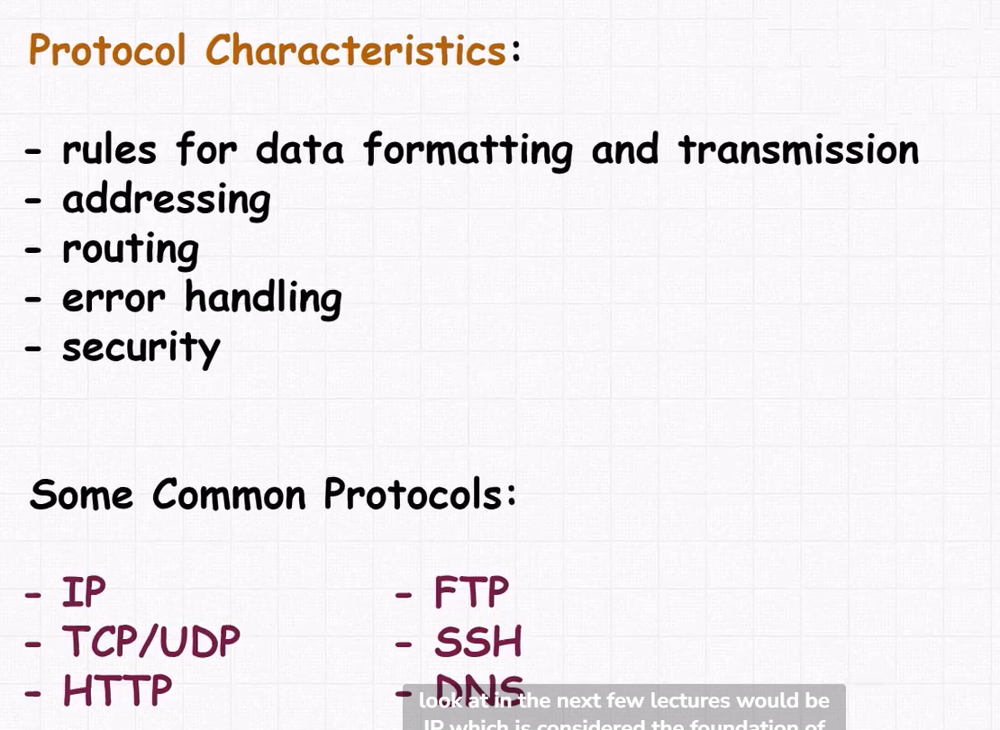
  - TCP/IP
    - Transmission Control Protocol / Internet Protocol   
    - 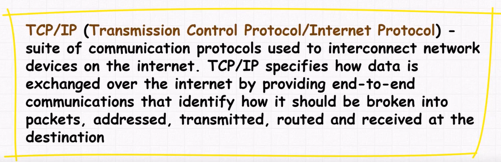
    - requires little central management
      - ability to recover automatically from failure of any device on network
    - 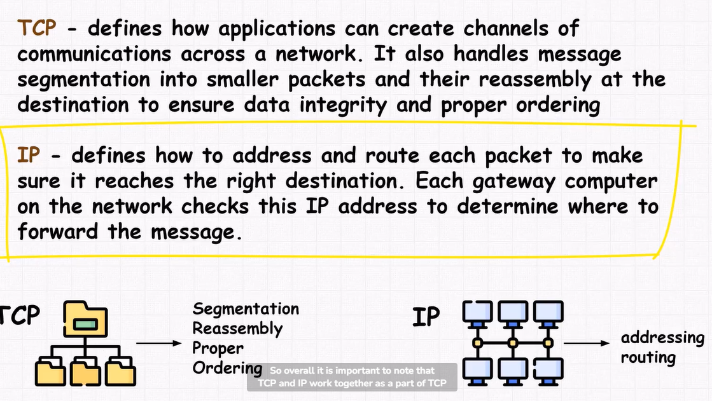
    - TCM manages the communication between applications and ensures data reliability, IP handles the addressing and routing of individual packets
    - 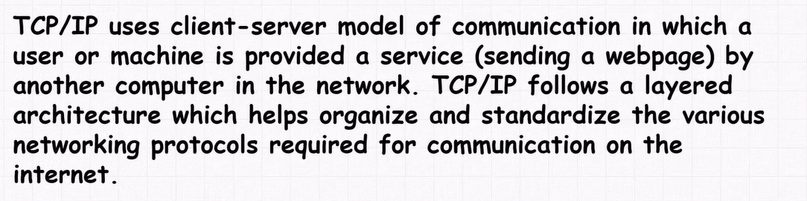
    - 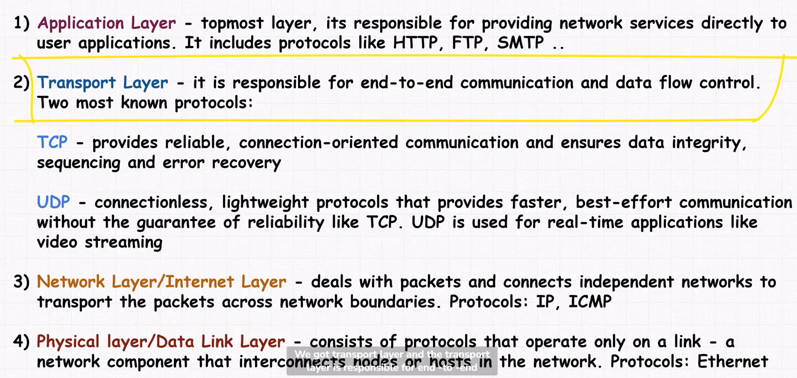
  - HTTP HTTPS
    - HyperText Transfer Protocol
    - Stateless Application Layer Protocol
    - Http Request -- Get requests go to origin server or proxy cashing server, Http Response
    - By default HTTP uses Port 80
      - unencrypted -- operates over plain text
      - stateless -- each request-response pair is independent
      - server doesn't retain any information from past requests from the same client
    - HTTPS 
      - HTTP with encryption and verification
      - uses TLS(SSL) to encrypt normal HTTP requests and responses, and to digitally sign them
      - uses Port 443
  - FTP
    - File Transfer Protocol
    - used for file transfer over TCP based network
    - works by opening two connections
      - one for commands and replies sent between two clients 
      - one for transferring data
    - 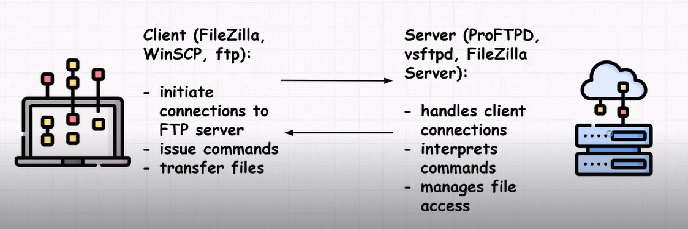
    - Modes
      - Active Mode
        - client initiates the connection for data transfer
        - Server connects back to the client to send or receive data
      - Passive Mode
        - Server initiates the data connection by listening on a specific port
        - Client connects to serves part to send or receive data
    - However FTP uses plain text transfer of data
    - 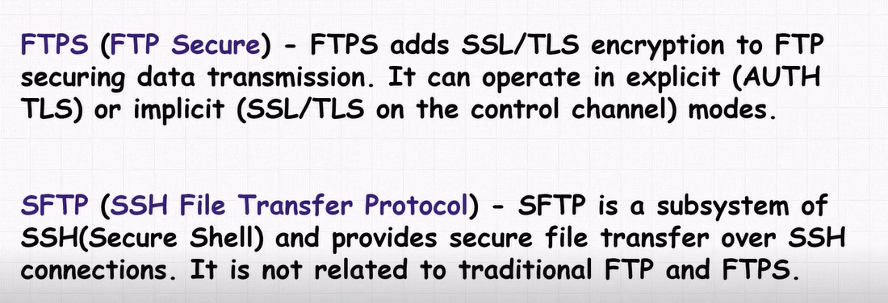
  - DNS
    - Domain Name System
    - Maps domain names to ip addresses
    - 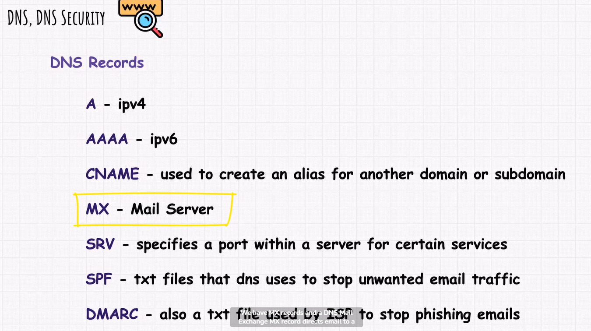
    - DNS Cache 
      - stores recent domains and their ips
    - Hosts File 
      - entries for certain domains
    - If above both are empty, the request is sent to DNS Server. If this doesn't have the information, this will be sent to other DNS servers. RECURSION. 
    - DNS Security
      - DNS Poisoning
  - SSH
  - Other

  

- Network Threats

  

- Windows Firewall

# 