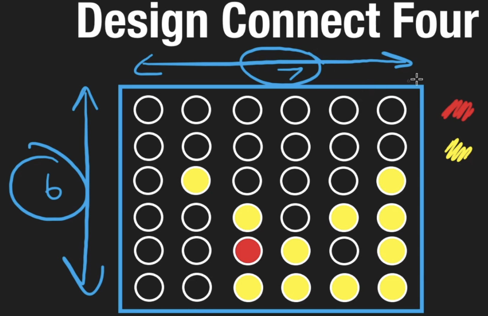

# 
 Object Oriented Design 

# Neetcode : Object Oriented Design Patterns

## Introduction 

- a way to solve commonly occurring problems in software engineering
- reusable, tested solutions to certain software design problems
- built on top of SOLID design principles
- evolved strategies -- tried, tested and hared by developer community
- ensure resilient, scalable and maintainable
- resource drain -- reinventing solutions; leverage design pattern -- wisdom of countless developers who have refined and endorsed it

 
 

- APIE -- pillars of OOP
  - Abstraction -- capturing essense of real-world entities by focusing their characteristics. Manage complexity and help in clean design
  - Polymorphism -- ability of objects to assume various forms and behaviors. flexibility
  - Inheitance -- inherit attributes and behavior from another. reusability
  - Encapsulation -- keep internal details under wrap and ensure controlled interactions

### Creational Pattern

- Factory Method
- Singleton
- Builder
- Prototype

#### Factory Method

- abstracting details of objects being created

# Neetcode : Object Oriented Design Interview

## Design Connect Four

- game 
  - say 7x6 grid and 2 players
  - Two players take turns dropping colored discs into the grid. The first player to get four discs in a row (vertically, horizontally or diagonally) wins.
  - 
- questions
  - are we using the standard 6 x 7 grid?
  - what are the rules of the game?
  - how many players?
  - player vs computer?
  - player vs player?
  - are we keeping track of score?
- requirement
  - n x m grid
  - connect x pieces
  - 2 players
  - track player scores  
  - target score : y

 