# Data Visualization

## Preparing and Data Modeling with Power BI

### Introduction

- 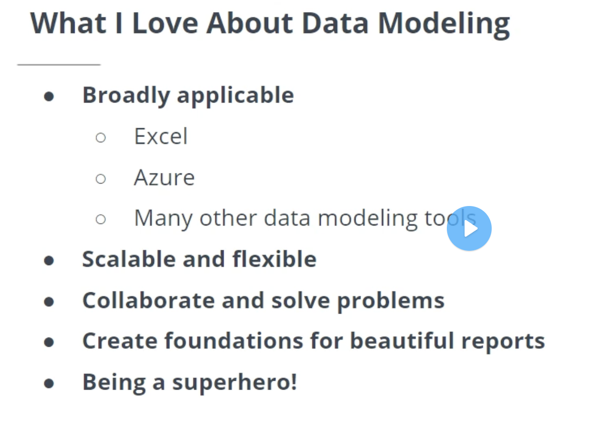
- challenge
  - low level of data analytics maturity
  - multiple sources
    - unless you have a centralized data warehouse
  - cleaning and transforming
- 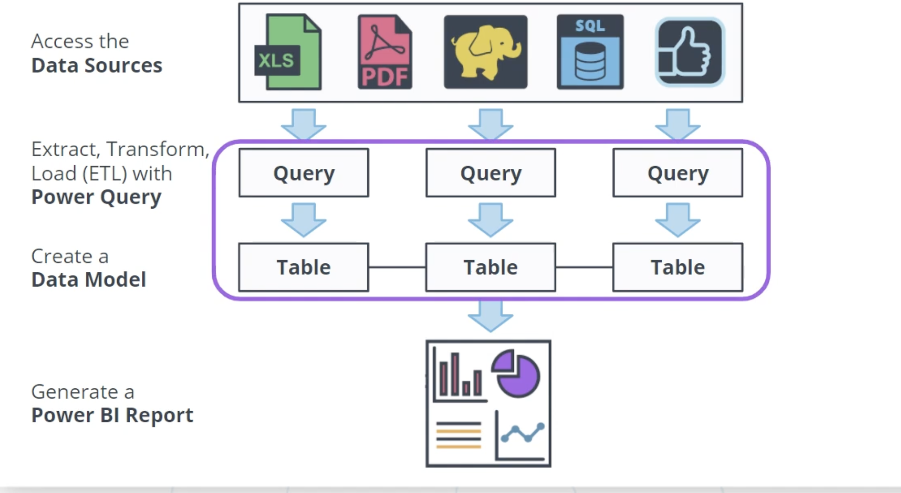
- Access Data Sources > ETL with Power Query > Create a Data Model (enables calculations to flow between tables) > Power BI Report 

> Plan or plan to fail

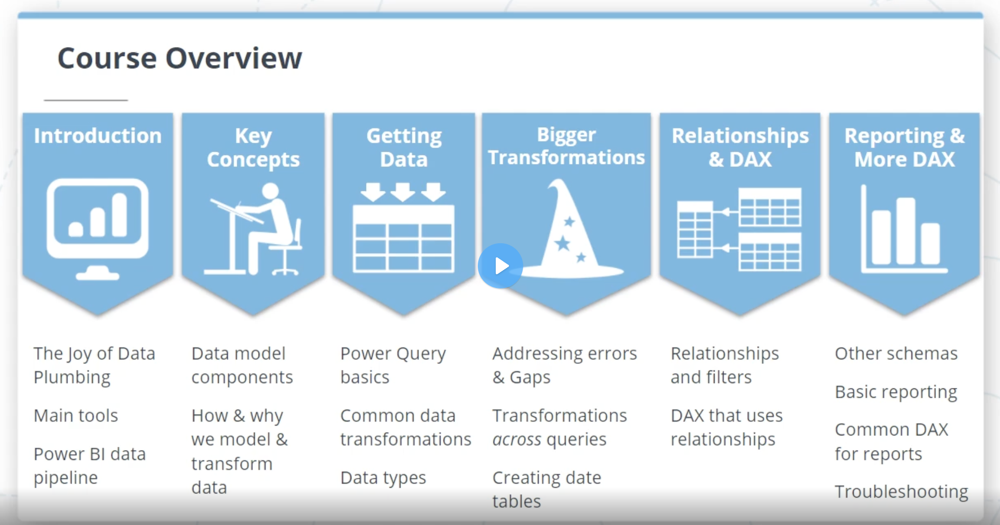

- Stakeholders
  - who provides you the access to the data
  - who consumes the reports
  - who makes the business decisions

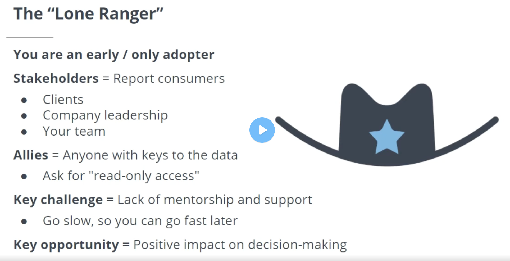
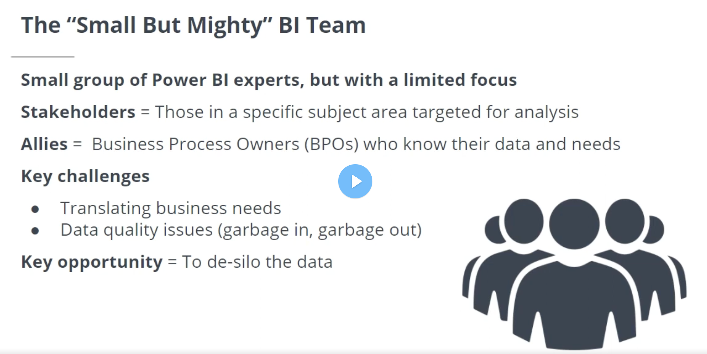
  - clearly define and describe business needs in a way that you can translate into a report (explain logically, step by step)
  - data doesn't exist in a way that will support reporting needs or is impossible to do calculations required
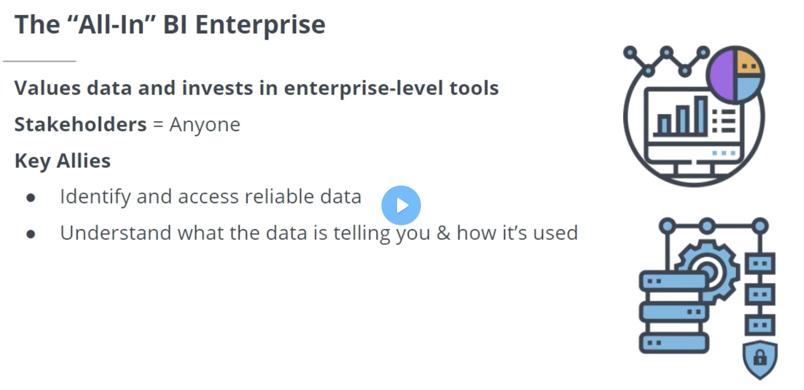
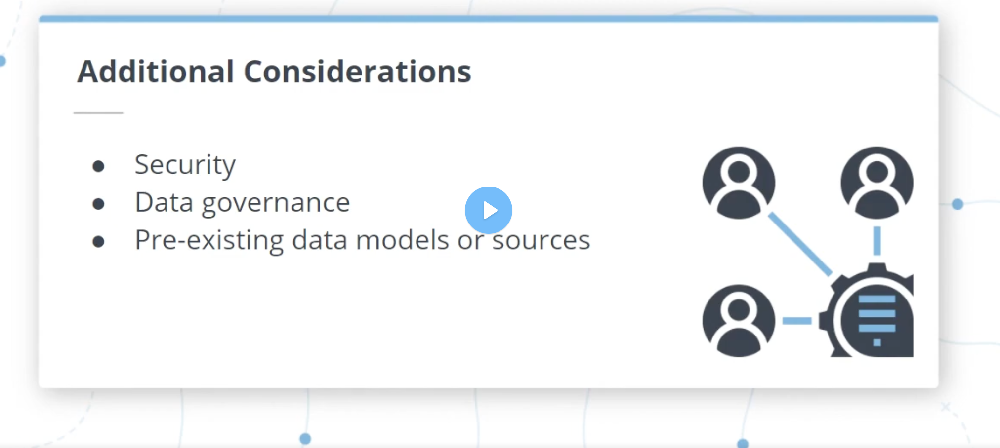
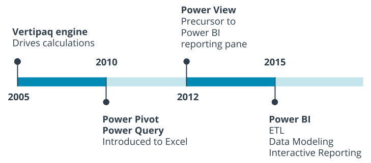
  - 2005: Vertipaq engine that drives power bi calculations was first made as part of MSSQL (functions as sort of ad-hoc in-memory database)
  - 2015: Power Query, Power Pivot, and Power View packaged as Power BI
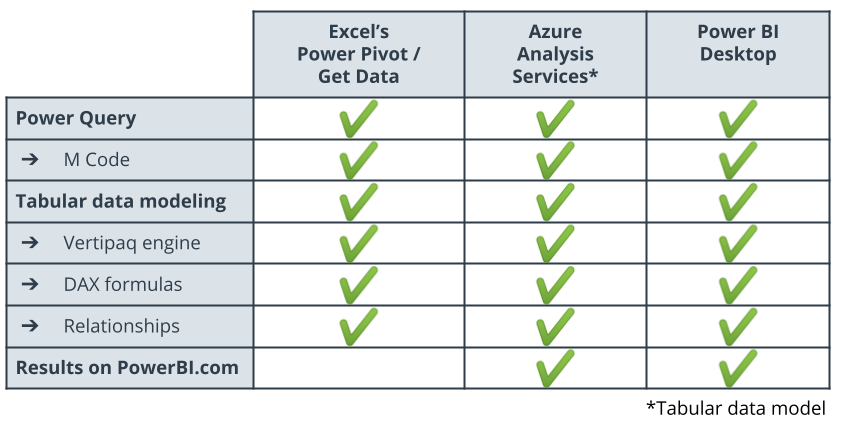

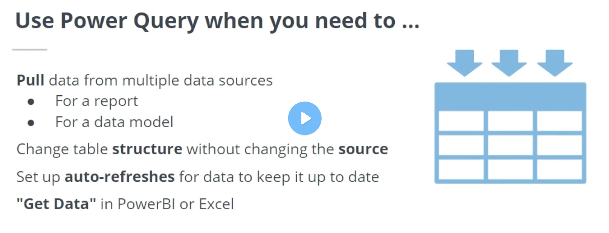
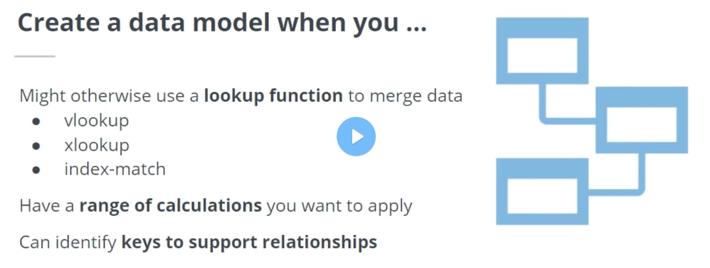
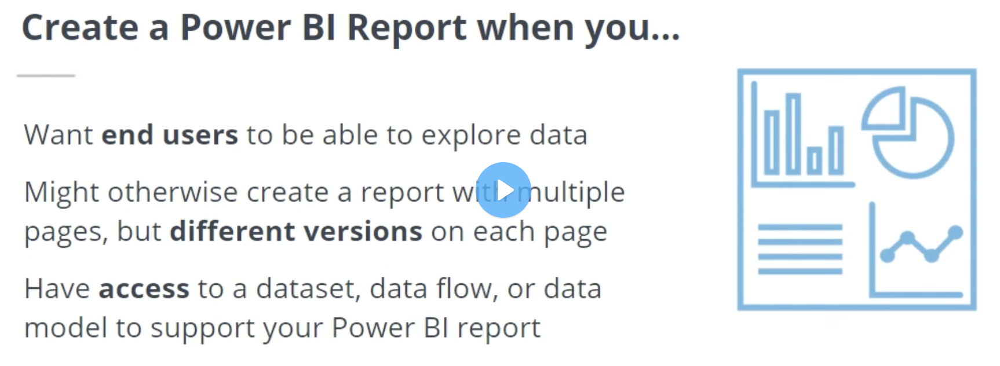

### Key Concepts in Data Modeling

- plan
  - what data do we need?
  - is it available? how to access it?
  - fact gathering stage -- reporting needs and requirements
  - then we sketch (think through data pipeline) -- data and the model

> Begin with an end in mind. Or risk a karmic cycle of query corrections

- dimension tables
  - descriptive data
  - short and fat
  - key
- fact table -- transactional information
  - aggregatable data
  - long and thin
  - key
- relationships -- connect tables
- keys -- enable connections

#### Facts

- Some sort of an event that can be measured or quantified
- Used to answer what or how much
- Kinds
  - Additive - can be logically measured using any connected dimension (quantity, sales amounts, invoice amounts, hours worked)
  - Semi Additive - can be logically measured using some dimensions but not others (inventory counts, bank account balances, accounts receivable balances)-- some sort of cumulative snapshot -- you won't add yesterdays and todays balance -- usually can't be added up over time
  - Non Additive 
    - facts you want to have available, but that it wouldn't make any sense to aggregate
    - ex
      - percentage discount
      - unit price
      - profit margin
    - sometimes better to store these with dimensions even though they're facts
    - you may want these to calculate sales, profit, or KPIs but you wouldn't add them together

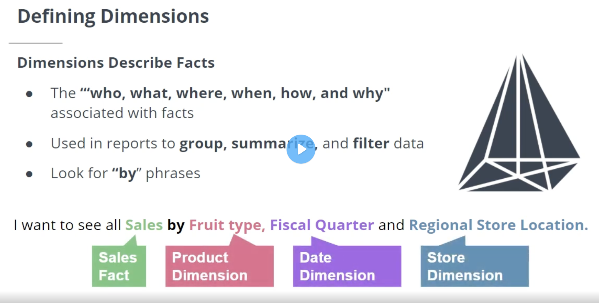

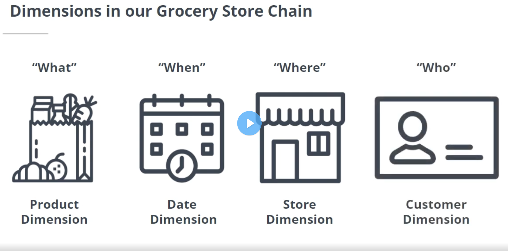

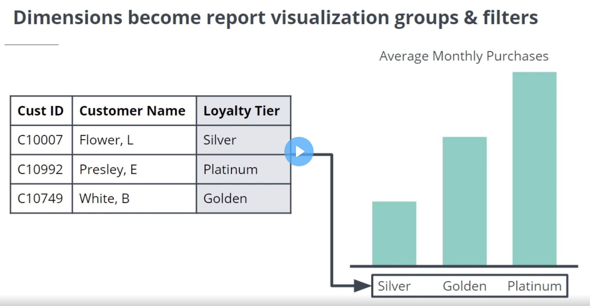

- Dimensions should be in plain english rather than obscure acronyms as they tend to show up on report

#### Defining Key Columns 

- make it possible for dimensions to connect to facts
- should facilitate a 1 to many relationship with relational integrity (every fact key ties exactly with one corresponding dimension key)
- fact table's keys should correctly -- and completely -- align with dimension keys
- if wrong key : report will provide wrong information
- No corresponding key -- Orphaned when summarized by that key
- Fact and Dimension keys should match exactly to facilitate relationships

- Fact Tables
  - Long and Thin
  - 1 row per event
  - consistent granularity (level of detail)
  - one key column per dimension table (repeated values are ok and expected)
  - minimal additional columns (every extra column in a fact table is very expensive)

- Dimension Tables
  - short and fat
  - 1 key column with unique values per dimension
  - additional columns are ok (within reason)
  - use human-friendly column names and values

- every column nas a price : Column size
- the best optimization is : remove what you don't need : file size

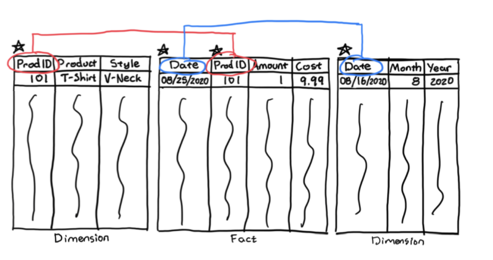
 
- key questions to ask colleagues
  - key data to calculate ( what the facts are)
  - how is the data grouped or filtered (what the dimensions are)
  - where can we access the data (data source)
  - do we need access rights
  - any sensitive data
  - can we rely on the data

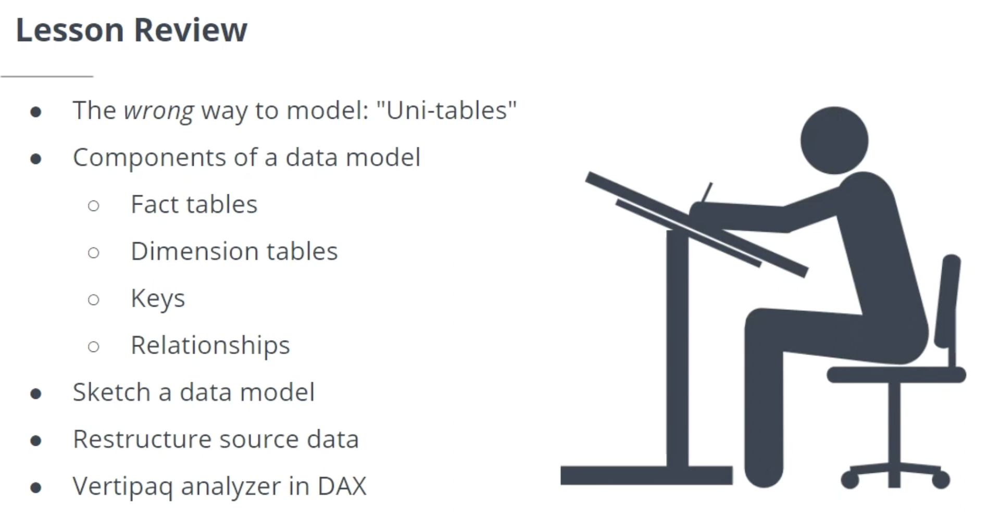

### Getting Your Data and Initial Transformations

- preparation
  - access data sources using Get Data
  - Tidy up data
  - use correct data types
  - use M formula language to make corrections
- get data
  - Databases
  - Social Media
  - Online Services
  - Big Data Software
  - Flat Files and Folders
  - Web APIs
  - ODBC Open Database Connectivity
  - Python or R Scirpts
  - Power Query SDK
- data types and data formats
  - Date/Time
  - Text
  - Number 
    - Whole numbers
    - Fixed decimals
    - Decimal numbers
  - True/False
  - Binary (temporary)
  - Percentage (decimal in disguise)
- m code
  - mashup query language -- filter and combine data
  - functional programming languge
  - power query ui creates m code
  - advanced editor 
    - define the source
    - navigate to source details
    - name and notate each change based on last step
    - repeat unitl done

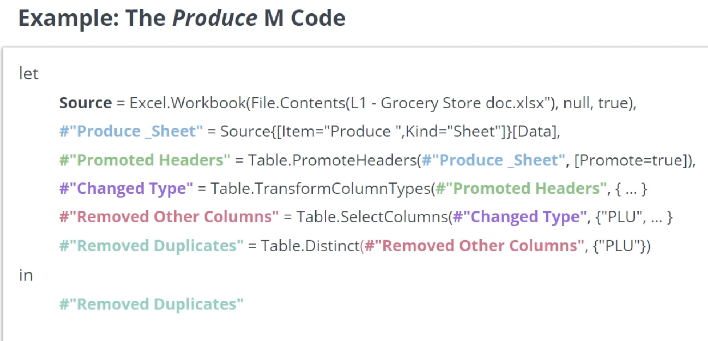
  
### Bigger Transformations and Date Tables

- Dirty data is a common issue
- replace errors/values in a specific column (blank or specific value)
- remove all rows with errors (in any col or specific col)
- remove duplicate rows (true duplicate or is the key col wrong)
- Risk increases with Importance of Report
- vet, document, and preferably footnote any assumptions you’ve made so there is no room for ambiguity regarding those corrections

- don't fix errors that won't impact functionality -- saves time, helps end users identify source errors
- when in doubt, phone a friend --  address errors responsibly and accurately
- many errors? source may not be reliable -- out of date data?
- avoid over correcting the data 

 
 

- pivot
  - involves using a descriptive col and a quantitative col to create a series of new cols using descriptive data
  - 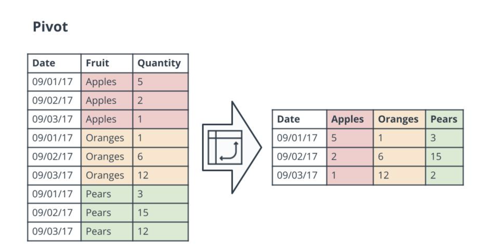
- unpivot
  - involves several cols that we want to merge into two separate cols, where col headers become descriptive values in one col and their related data follows in to the corresponding rows
  - 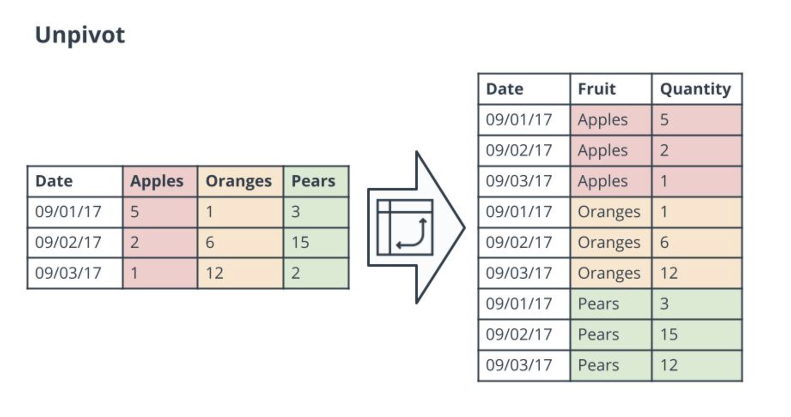
- transpose
  - 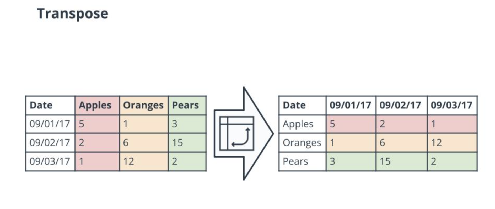

 
 

- merge queries -- combining columns from multiple sources horizontally usign a unique identifier col
- append queries -- combinr rows from multiple sources vertically
- get data > folder -- combine from a folder -- multiple files are merged together vertically
- combine list

 
 

- Duplicate Query - copy of existing query
- Reference Query - maintains relationship between original and your new query. Changes to original are reflected in the new

### Relationships and Relationship-Related DAX

### Reports and DAX for Common Reporting Needs

### Create a Data Model for Seven Sages Brewing Company

## Creating Visualization With Power BI

### Introduction

### Building Compelling Data Visualizations

### Designing User-Friendly Reports

### Creating Interactive Reports for Data Exploration

### Elevating Reports with Advanced Report Features

### Building a PowerBI Report for Waggle

## Advanced Data Analysis with Power BI

### Introduction to Advanced Data Analytics Course

### Advanced Data Analytics

### Power Query Transformations

### DAX Functions

### Advanced Visualizations

### Project : Market Analysis Report for National Clothing Chain

## References 

1. [Microsoft Documentation](https://docs.microsoft.com/en-us/power-bi/fundamentals/power-bi-overview)
2. [The Data Warehouse Toolkit by Ralph Kimball and Margy Ross](https://www.oreilly.com/library/view/the-data-warehouse/9781118530801/)
3. [Take Your Analytics Maturity to the Next Level](https://www.gartner.com/smarterwithgartner/take-your-analytics-maturity-to-the-next-level/)
4. [Power BI Ideas](https://ideas.powerbi.com/ideas/)
5. [Power BI Youtube Channel](https://www.youtube.com/channel/UCy--PYvwBwAeuYaR8JLmrfg)
6. [Power Pivot and Power BI: The Excel User's Guide to DAX, Power Query, Power BI & Power Pivot in Excel 2010-2016.](https://www.amazon.com/Power-Pivot-BI-Excel-2010-2016/dp/1615470395)
7. [Microsoft's instructions on creating a table in Excel](https://support.microsoft.com/en-us/office/create-a-table-in-excel-bf0ce08b-d012-42ec-8ecf-a2259c9faf3f?ui=en-us&rs=en-us&ad=us#:~:text=You%20can%20create%20and%20format%20a%20table,%20to,has%20headers.%206%20Select%20OK%20.%20See%20More)
8. [Microsoft's overview of formulas in Excel](https://support.microsoft.com/en-us/office/overview-of-formulas-in-excel-ecfdc708-9162-49e8-b993-c311f47ca173)
9. [Microsoft's guidance on creating a PivotTable in Excel](https://support.microsoft.com/en-us/office/create-a-pivottable-to-analyze-worksheet-data-a9a84538-bfe9-40a9-a8e9-f99134456576)
10. [DAX Studio](https://daxstudio.org/downloads)
11. [SQLBI - Marco Russo and Alberto Ferrari](https://www.sqlbi.com/)
12. [How do you use VertiPaq Analyzer with Power BI](https://www.youtube.com/watch?v=m34IOHcNPPo)
13. [Web Scraping with Power BI (Spencer Baucke)](https://spencerbaucke.com/2020/04/29/web-scraping-in-power-bi/)
14. [Use R with Get Data in Power Query Editor (Microsoft Documentation)](https://docs.microsoft.com/en-us/power-bi/connect-data/desktop-r-in-query-editor)
15. [Using Python in Power Query (Microsoft Documentation)](https://docs.microsoft.com/en-us/power-bi/connect-data/desktop-python-in-query-editor)
16. [Create Custom Connectors with Power Query SDK (Microsoft Documentation)](https://docs.microsoft.com/en-us/power-query/startingtodevelopcustomconnectors)
17. [Microsoft - Power BI Desktop Data Types](https://docs.microsoft.com/en-us/power-bi/connect-data/desktop-data-types)
18. [SQLBI - Understanding Numeric Data Type Conversions in DAX](https://www.sqlbi.com/articles/understanding-numeric-data-type-conversions-in-dax/)
19. [Microsofts summary of data types](https://docs.microsoft.com/en-us/power-bi/connect-data/desktop-data-types)
20. [Microsoft Documentation on Power Query M formula language](https://docs.microsoft.com/en-us/powerquery-m/)
21. [Radacad post on making conditional columns](https://radacad.com/conditional-column-in-power-bi-using-power-query-you-can-do-anything)
22. [Chris Webb's blog post on pivoting](https://blog.crossjoin.co.uk/2013/11/25/pivoting-data-in-power-query/)
23. 