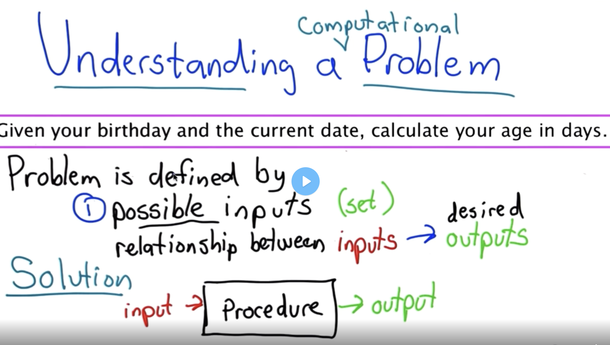
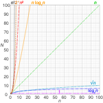

# Data Structures and Algorithms


## Part 01  Introduction 

### Python Refresher

- for, while
- if elif else 
- < > <= >= == !=
- generators (can return and pause, and when you call next, returns and pauses again; return is changed to yield); after yield, everything is freezed and returned. 
- `class Person: def __init__(self, name, age): self.person_name = name self.person_age = age`
- `def birthday(self): self.person_age += 1` -- Mutator
- `def get_name(self):return self.person_name` -- Accessor

```python
## Definition of the generator to produce even numbers.
def all_even():
    n = 0
    while True:
        yield n
        n += 2

my_gen = all_even()

## Generate the first 5 even numbers.
for i in range(5):
    print(next(my_gen))

## Now go and do some other processing.
do_something = 4
do_something += 3
print(do_something)

## Now go back to generating more even numbers.
for i in range(100):
    print(next(my_gen))
```

```python
# generate factorial
def prod(a,b):
    return a*b

def fact_gen():
    i = 1
    n = i
    while True:
        output = prod(n, i)
        yield output
        i += 1
        n = output
```

```python
# Check sudoku
def check_sudoku(square):
    for row in square:
        # Create a list with the integers 1, 2, ..., n.
        # We will check that each number in the row is in the list
        # and remove the numbers from the list once they are verified
        # to ensure that each number only occurs once in the row.
        check_list = list(range(1, len(square[0]) + 1))
        for i in row:
            if i not in check_list:
                return False
            check_list.remove(i)
    for n in range(len(square[0])):
        # We do the same here for each column in the square.
        check_list = list(range(1, len(square[0]) + 1))
        for row in square:
            if row[n] not in check_list:
                return False
            check_list.remove(row[n])
    return True
```

```python
def get_april_birthdays(people):
    april_birthdays = {}
    for person in people:
        if person.birthday_month == 'April':
            person.age += 1
            april_birthdays[person.name] = person.age

    return april_birthdays


def get_most_common_month(people):
    months = {'January':0, 'February':0, 'March':0, 'April':0, 'May':0, 
              'June':0, 'July':0, 'August':0, 'September':0, 'October':0,
              'November':0, 'December':0}

    for person in people:
        months[person.birthday_month] += 1

    max_month = None
    max_value = 0
    for key in months.keys():
        if months[key] > max_value:
            max_value = months[key]
            max_month = key

    return max_month
```

### How to Solve Problems

- define probelm
- make sure you understand the problem
- stub is a dummy implementation of a method. can be used for testing before you code the whole function.
- write small pieces of code that you can test independently


<br/><br/>




<br/><br/>

0. Don't Panic!
1. What are the inputs?
   1. What is the set of valid inputs?
      1. Defensive Programming -- check inputs are valid
   2. How are inputs represented?
2. What are the outputs?
   1. How should we specify the output?
3. Solve the problem
   1. Workout examples -- understand relationship between inputs and outputs
   2. consider systematically how a human solves the problem
4. Simple mechanical solution
5. Develop incrementally and test as we go.
6. Don't optimize prematurely (simple and correct)

```python
def isLeapYear(year):
    if year % 400 == 0: 
        return True
    if year % 100 == 0:
        return False
    if year % 4 == 0:
        return True
    return False

    return year % 400 == 0 or (year % 100 != 0 and year % 4 == 0)

def daysInMonth(year, month):
    if month in (1, 3, 5, 7, 8, 10, 12):
        return 31
    else:
        if month == 2:
            if isLeapYear(year):
                return 29
            else:
                return 28
        else:
            return 30

    return 29 if month == 2 and isLeapYear(year) else 28 if month == 2 else 31 if month in (1, 3, 5, 7, 8, 10, 12) else 30

def nextDay(year, month, day):
    if day < daysInMonth(year, month):
        return year, month, day+1
    else:
        if month < 12:
            return year, month + 1, 1
        else:
            return year + 1, 1, 1


def dateIsBefore(year1, month1, day1, year2, month2, day2):
    if year1 < year2:
        return True
    if year1 == year2:
        if month1 < month2:
            return True
        if month1 == month2:
            return day1 < day2
    return False

def daysBetweenDates(year1, month1, day1, year2, month2, day2):
    assert not dateIsBefore(year2, month2, day2, year1, month1, day1)

    days = 0
    while dateIsBefore(year1, month1, day1, year2, month2, day2):
        year1, month1, day1 = nextDay(year1, month1, day1)
        days += 1
    return days 
```

### Efficiency

- time and space;
- algorithm -- a series of steps for solving a problem; usually takes input and produces output
- rate of increase of an algorithm is also referred to as order of the algorithm
- 
- 