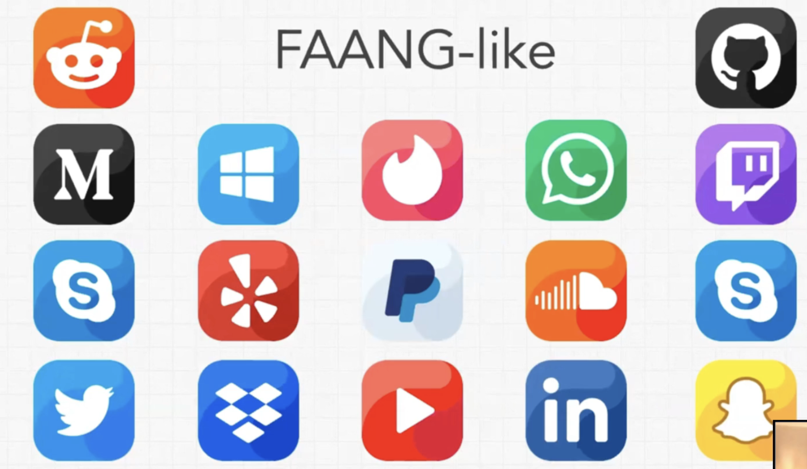

    
 1. FAANG Interview Prep 101 

 

- Meta, Apple, Amazon, Netflix, and Google
- 
- Applying -- referrals
- Gut check interview --- 15-30 min phone call
  - what did you do before
  - why you want to join the company
  - how much time do you spend coding every day
  - don't raise red flags, prove you are what you say you are
- Technical Phone Screen --- 1 hour
  - 1 or 2 technical problems
- Onsite Interview
  - 5 interviews - 1 hour each
  - 4 technical 
    - best practices: readable, solid, dry, modular, scalable, performance, abstraction, functional programming, immutability
    - Scalable
    - Data Structures and Algorithms
    - tips / three keys
      - technical knowledge
        - best practices
        - data structures
        - algorithms
        - space and time complexities
        - coding language specific tools and patterns
      - critical and abstract problem solving
      - communication
        - handle stress
        - think out loud; talk out loud
  - 1 personality or culture fit interview

 
 

- interview prep plan 
  - logistically feasible?
    - 3-6 months
    - 2-6 hours per day
  - plan to improve technical knowledge
    - learning schedule
    - how and where
  - practice on leetcode
  - figure out weakpoints
  - get as many interviews as you can

 
 

### Traits

- googliness
- leadership characteristics
- conflict resolution

### Breakdown 

- Scalable 
  - input size (n), resources allocated (time and space)
  - O(1), O(log n), O(n), O(n log n), O(n ** 2), 
  - O(n ** 2) -- we are touching every element for every element

-----

    
 2. Getting Your First DEV Job! 

 

- tech industry
  - money
    - investments
  - growth
    - revenue
  - companies
    - startups
      - application : solution to a problem
      - market : users
      - investors and scaling
    - enterprise
      - technology isn't the only driver of revenue
    - small agency
    - large tech
      - FAANG, ...
      - tech first billion $ companies ...

 
 

- company journey
  - idea, business plan, application, market: 
  - pre-VC startup : ideation -> development -> market --> feedback : loop 
  - Seed funding
  - Series Funding : A - Z  --> now they start to grow their team
- companies in funding stage typically try to convince people of their proposed solution: if you already understand it well, can be an advantage

 
 

- skills
  - technical knowledge
    - what technology to go with and building features
  - growth driven
    - knowledge in entire business of tech industry
    - ways to grow users
    - you are teachable
  - multiple skillsets
    - not just focused on one thing
- traits
  - willingness and/or ability to learn, wear many hats
  - humble
  - highly intelligent
  - hard working

 
 

- resume 
  - latexresu.me
  - include points that helped the company grow
  - communciation skills with customers, team members, clients, ...
  - skills
  - projects

 
 

- consistently contribute to the github
- custom github readme
- https://github.com/MattCSmith
- github.com/topics/
- github.com/topics/choosen_topic/contribute

 
 

- find the local startup blog -- betakit
- visit the company website. 
  - evaluate what they are doing
  - keep an eye out for anything that's interesting
  - customer testimonials, ... ...
  - about page
    - find person incharge of recruiting -- send a personalized email 
      - linkedin, twitter, ...
- customize reach-out strategy
- prioritize finding opportunities to learn
  - unpaid internships : say a company doesn't respond to you after 1/2/n interviews with you (phone/technical) -- reach out to them to see if you can work for them for free just to gain experience because you understand their business and vision well
    - extreme willingness to be there and try and do what you can
    - outperform people being hired
    - you resonate with their business
    - eager to contribute (writing blogs, fixing bugs, writing unit tests, fixing css, fixing bugs you found on their websites)
    - demonstrate willingness, hunger, drive, ... 

 
 

- create a resume
- find open source projects and contribute
- find one company per day and send a personalized reach out
  

-----
