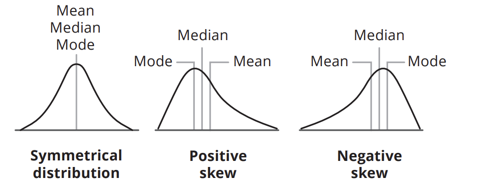
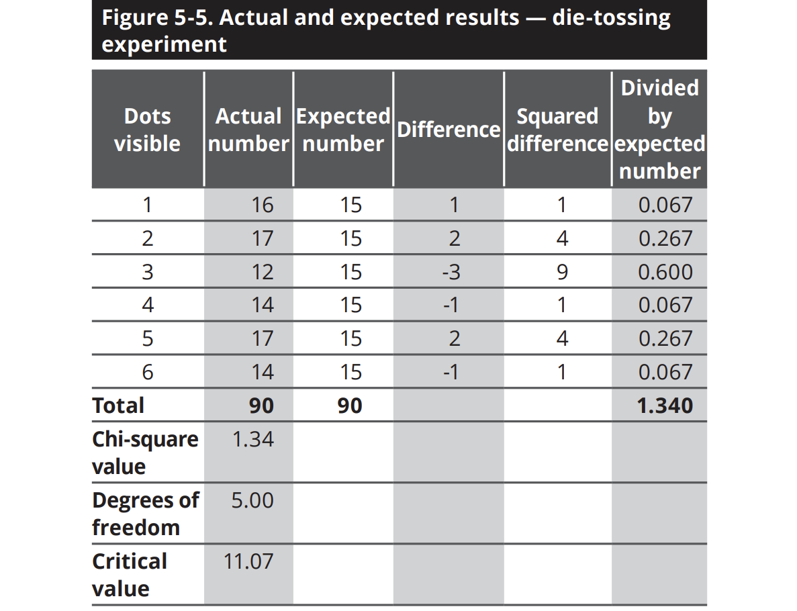
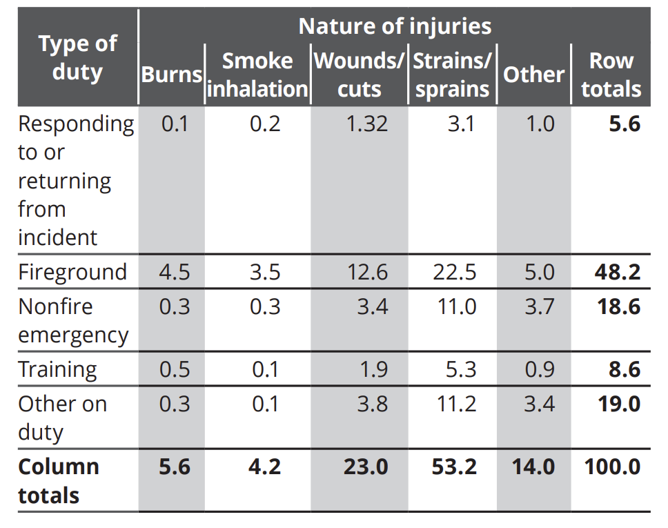
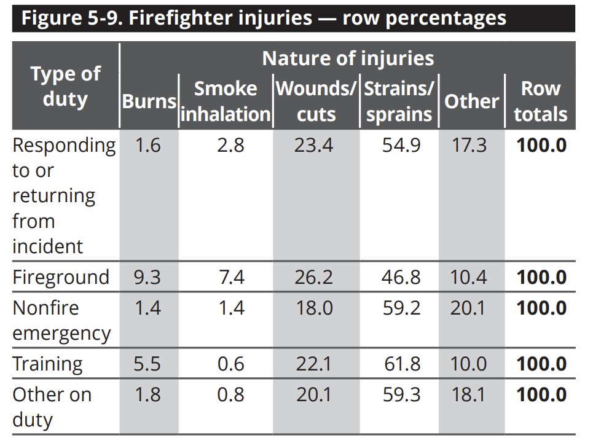
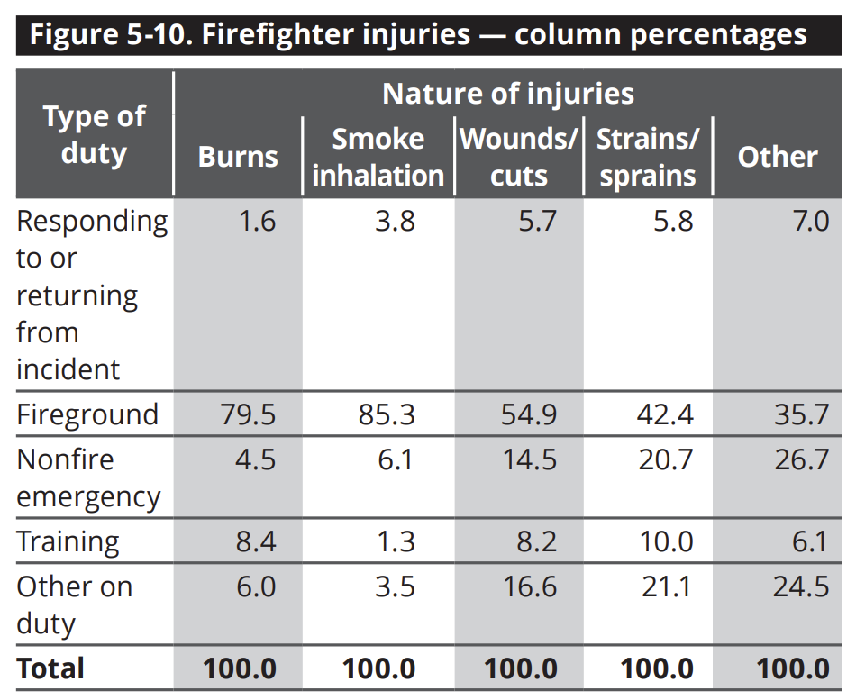
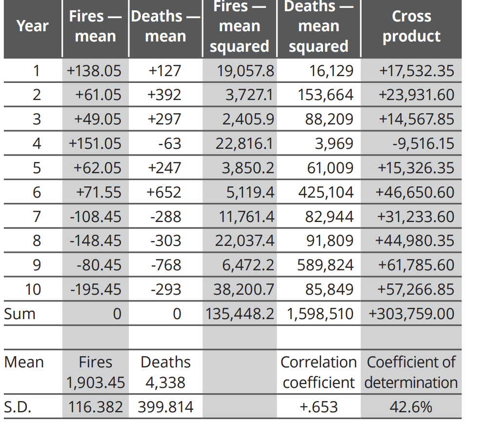
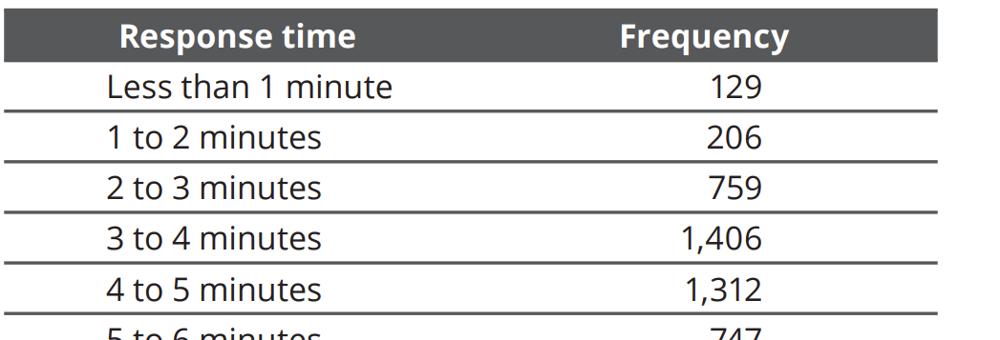
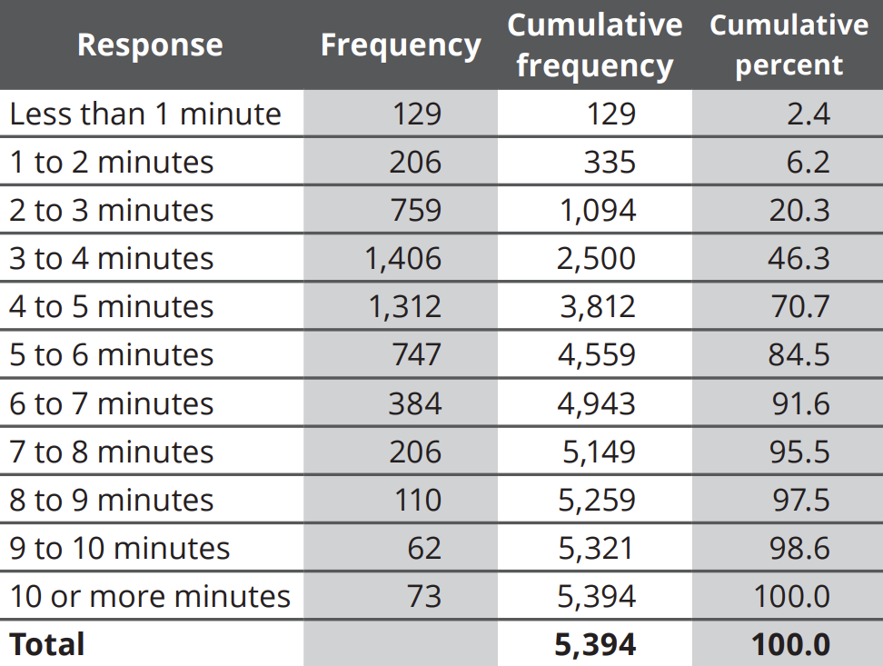
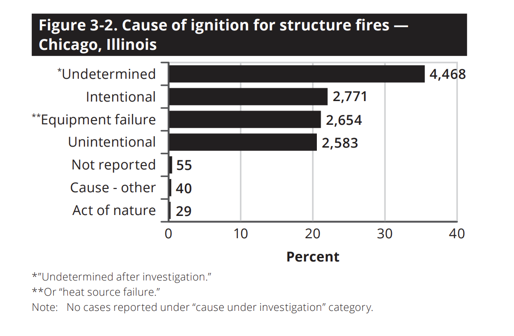
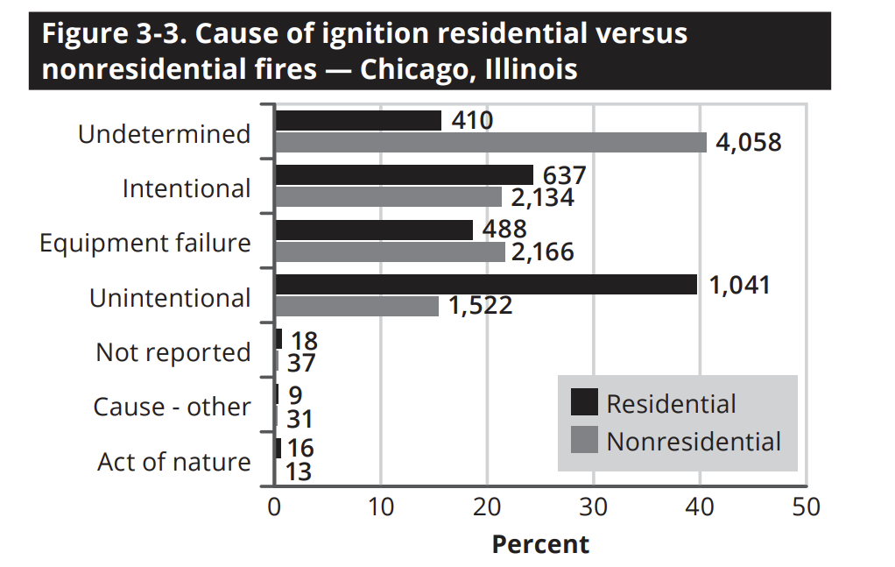

### General Discussion

- time, place, season
- sending multiple units to a incident who has best shot at the incident
- resources --- full time | parttime 
- resource optimization and utilization
- what are the areas where you want to improve
- Metro com -- dispatch center... how many units will respond 
- low medium risk - determine incident intensity or emergency -ness
  - what do we have in the surrounding areas
    - school zone
    - gas station nearby
- clustering
- classification
- fire -- how is it categorised as critical
- how to identify if a incident falls in a 

### Theory

- NFIRS -- National Fire Incident Reporting System 45 years. 1.2M Fire Incidents per year. 24,000 Fire Stations.
- NFPA -- National Fire Protection Assocication
  - NFPA 901, Standard Classifications for Fire and Emergency Services Incident Reporting
  - NFPA 5.0 -- 11 Modules
    - Basic Module
    - Fire Module
    - Structure Fire Module
    - Civilian Casualties
    - Fire Service Casualties
    - EMS
    - Hazardous Materials
    - Wildland Fire
    - Apparatus or Resources 
    - Personnel 
    - Arson
- USFA - US Fire Administration
- NFDC - National Fire Data Center
- data flow :: local -> state -> national |  local -> national

  

### Tools

- USFA web based tool -- data is to be entered manually
- Vendor software
- Data Analysis Software
  - IBM SPSS
  - R
  - Stata
  - SAS
  - NCSS
  - JMP
- 

  

### Data 

- fire
  - qualitative variables -- groups or categories -- nfirs modules
    - type of fire
    - property use
    - cause of ignition
    - extent of flame damage
    - type of duty
    - nature of injuries
  - quantitative variables -- discrete, exact, analog, continuous
  - variable
    - dependent
    - independent

  

- complete, accurate, current data
- gaps in reporting, critical errors in data, outliers in data
- data quality procedures
  - data collection and entry
- data analysis
  - careful data collection
  - attention to detail
  - statistical programs and skills in result interpretation
- data -> information (organize and summarize) -> better understanding of information (based on the problem at hand) -> make decisions

  

- techniques
  - histograms
    - spikes : high and low points
    - peaks and valleys
    - spikes and holes
    - symmetry -- mean ~ median
    - skewness
    - gaps are spaces reflecting low frequencies of data
    - outliers are extreme values isolated from body of data
    - groups having similar frequencies
    - is there anything in histogram that runs counter to your experience?
  - pictograms
    - geographical areas
  - column charts
    - stacked column charts
    - use for data with natural order
  - bar charts
    - clustered bar charts - 2 or more categories 
  - line charts
    - increases, decreases, fluctuations in a time series
    - use for data with natural order
  - pie charts
    - component contribution
  - dot charts | scatter diagrams
    - horizontal scale should reflect independent variable
    - vertical scale should reflect dependent variable
    - generally the variables are continuous

  

- skewed distributions
  - skewed to the right -- long tail on the right side, high values to the left
  - 

  

- Cumulative frequency : is the number of data points that are less than or equal to a given value
- Cumulative percentage frequency : converts the cumulative frequency into percentages = cumulative frequency / total 
- 2 important questions
  - what are the main conclusions from your analysis?
  - what is the best way to display the conclusions?

  

- measures of central tendency
  - mode -- most frequent
    - qualitative data
    - unstable measure of central tendency
    - distribution can have more than 1 mode
  - mean -- total / number of items
    - very sensitive to extremes or outliers
    - stability over samples drawn from a distribution
  - median -- 50th percentile 
    - quantitative data
    - less sensitive than mean to extreme values

  

- measures of dispersion -- variability or spread 
  - range 
    - difference between highest and lowest value
    - of little use beyond the preliminary description of data
  - variance
    - squared sum of deviation values / n - 1 where n is number of observations
    - we subract 1 from n to account for a statistical error that might result when using inferential statistics. If the distibution accounts for all values (universe) then we can use n, but it is safe to use n - 1 for all other samples
    - if variance < mean, it indicates that values are close to the mean
    - responsive to the exact position of each value in a distribution
    - very important in inferential statistics as it is resistant to sampling variation
    - of little use in descriptive statistics becasue it is expressed in squared units
  - standard deviation
    - square root of the variance
  - deviation values
    - differences between the values and mean
    - sums to zero as mean is the balance point of the distribution

  

- normal distribution 
  - aka bell curve
  - mean median mode are all same
  - 68.26 95.44 99.74 values between --- 1 2 3 standard deviations from mean
- standard score
  - makes it possible to compare values from different distributions on an equal basis
  - is a derived score that describes how far out a given value in a distribution is from some reference point typically mean, in terms of standard deviation
  - z-score
    - on calculating z-scores, changes mean = 0, standard deviation = 1
    - shape of the distribution doesn't change
- central limit theorem 
  - makes it possible for us to assume that the distribution is normal even when its not
  - states that the sampling distributions of means increasingly approximates a normal distribution as the sample size increases
  - works reasonably well with sample size > 30

  

- categorical data
  - number of observations in each category and its percentage of total 

  

- chi-square
  - a nonparametric statistical test -- one that makes little or no assumptions about the distribution of data
  - conducted in terms of frequencies but best viewed conceptually as a test about proportions
  - used to determine whether the percentage distribution from a table differs significantly from a distribution of hypothetical or expected percentages
  - null hypothesis -- there is no difference between the 2 being compared; if there is a difference, the null hypothesis is rejected; innocent until proven guilty
  - in statistical terms, significance merely refers to the claim that a result from data generated by testing or experimentation is not likely to occur randomly or by chance but is instead likely to be attributable to a specific cause. results are likely real and not caused by luck or chance
  - degrees of freedom : number of categories - 1
    - rationale for determining degrees of freedom is that each category may be considered as contributing 1 piece of data to the chi-square statistic. These data are free to vary except for the last category, since it is determined already by what is left. Thus, values in all categories except one are free to vary
    - say you were asked to choose 5 random numbers => degrees of freedom = 5
    - say you were asked to choose 5 random numbers such that mean = 4 => degrees of freedom = 4
      - say you choose 1, 2, 3, 4 => you do not have a choice for the last number. it is already determined. 
      - each statistical test of significance has its own built-in degrees of freedom based on the number and type of restrictions it makes 
      - chi-square has 1
  - 
  - larger categories have greater leeway for numerical variations, since it requires more to account for the same amount of actual change than smaller categories with fewer numbers

  

- two way contingency tables
  - chi-square measures existence and strength of statistical association in bivariate frequency distribution
  - 3 ways to calculate percentages
    - joint percentages
      - 
    - row percentages
      - 
    - column percentages
      - 
  - two variables are said to be independent if knowledge about one could not be used to predict outcome of the other
  - null hypothesis of indipendence is equivalent to hypothesizing that in the population, relative frequencies of any row are the same for all rows across categories or vice versa
  - expected values can be calculated as column proportion times row totals | row proportion times column totals
  - degrees of freedom = (number of rows - 1) * (number of columns - 1)
  - sum of (actual - expected) ^ 2 gives chi-square statistic which is compared to critical chi-square value identified from chi-square table based on degrees of freedom
  - significant outcome of the chi-square test is directly applicable only to the data taken as a whole

  

- correlation
  - indicates the degree to which one variable changes with another variable
  - measures the strength of the association between two variables
  - while correlation can be used for prediction, it does not imply causation
  - correlation assumes that the relationships are linear but there are other relationships, like curvilinear
  - correlation coefficient
    - always between -1 and +1
    - 0 indicates no relationship
    - sign indicates direction, positive or negative but not magnitude
    - magnitude is indicated by the size of the number regardless of the sign
    - correlations are not arithmetically related to each other; 0.6 is not twice 0.3 in strength
    - no relationship between correlations and percentages
    - differences in successive correlation coefficient values do not represent equal differences in degree of relationship. (0.5 - 0.4 != 0.9 - 0.8)
  - coefficient of determination
    - correlation coefficients when converted into this form, can be directly compared
    - square of correlation multipled by 100 = percentage of association between 2 variables coefficient of determination
    - correlation of 1 is 4 times strong as 0.5 and not twice (1 => 100%, 0.5 => 25%)
  - Correlation types
    - Pearson correlation
      - we use deviation-score method for calculation of correlation
      - widely used correlation formula -- Pearson product-moment correlation coefficient
      - term moment is borrowed from physics, refers to a function of distance of an object from center of gravity
      - in a frequency distribution, mean is the center of gravity, deviation scores are the moments. 
      - product of paired moments = pearson correlation
      - 
        - cross product = (no of fires - fire-mean) * (no of deaths - death-mean)
        - correlation = (sum of cross products) / (sd_fires * sd_deaths * number of observations)
    - Rank-order correlation
      - aka Spearma rank-order correlation
      - applying pearson's procedure to the ranks
    - Biserial correlation
      - suited for cases where 1 is continuous, and the other is expressed dichotomously (whether or not the number of civilian fire deaths was above or below the median)
    - Point biserial correlation
      - second variable is qualitative and dichotomous and cannot be expressed as continuous and quantitative (male or female)
    - Partial correlation

  

### Questions / Ideas

- Fires by hour of day
- Fires by day of week
- Fires by month
- Average response time to fires (overall)
- How did response times vary by fire station areas
- How much did average time vary by type of fire
- number of fires in a district over a period of time
- response time from alarm to arrival on the scene
- dollar losses of fires
- when are fires most likely to occur?
- what are the primary causes of residential fires? vehicle fires?
- civilian injuries occurred last year by month?
- ages of civilian casualties?
- what percent of the fire incidents have travel times less than 4 minutes?
- how many structure fires resulted in dollar losses greater than $50,000?
- response time vs frequency 
  - 
  - 
- cause of ignition
  - leading cause of ignition in structure fires?
  - how do unintentional causes compare to intentional ?
  - how many causes are never determined?
  - 
  - 
- fire station wise call volume for today, yesterday, last 7 days, last 30 days, last 365 days, last 5 years.

  

- observations
  - on-scene time data, and fire dollar loss data reflect values skewed to the right

#### Fire Questions

- Acting : How many a times a personnel was in an Acting role and what are they?
- Assume Command :
- Chain of Command : For any incident, how did the chain of command evolve. Or what how many ranks do we have and who are they
- Brass : Who are the officers who wear gold uniforms as contrasted with those firefighters who wear silver insignia
- Call Back : Who are all the personnel who are on call back duty
- Cover : What Unit gave cover to what other unit that was out of service, or at fire, or emergency and was not able to meet its assignment
  - Salvage cover -- protect contents of buildings from water damage or to protect an assigned area
- Damage : 
  - what is total loss by fire 
    - indirect
      - business interruptions
      - loss of future production
      - loss of wildlife
  - How many brush fires
  - How many building fires
- Drillmaster : a member of the training division or staff; how many are they
- Emergency Vehicles 
  - how many do we have them?
- Evolution
  - how does a fire evolve?
- Fire Academy 
  - who are employed at fire academy? Do they come under fire department?
- Fire Administration
  - who are employed here?
- Fire / Arson Investigators
  - who are they
- Fire ground commander 
  - who is this for an incident?
- Fire Prevention Division
  - who are employed here?
- Fire Marshal -- chief fire prevention officer -- who? AC / District Chief
- Fire Report
  - date time place 
  - owner/occupant tenant 
  - location 
  - cause 
  - number of people 
  - units employed 
  - personnel employed 
  - extent of damage
- Fire showing : message report by first arriving unit at the scene of an alarm to immediately inform dispatcher and other responding units that actual fire is in progress
- First in  : First unit to arrive
- Fully Involved : access to interior is not possible until some measure of control has been obtained with hose streams
  - how many incidents had fully invovled fires
- Incident report -- texfirs, nfirs, neris
- In-service
  - how many units are in service
  - how many are out of service
- Inspector : member of the fire prevention office
- Kelly Day
  - for a given personnel, how many kelly days are left 
- Light and Air truck
  - how many do we have
- Longevity
  - what is the number of service years : period of time served in fire department for each personnel
- Longevity Pay
  - how does it vary for each rank
- Move Up : movement of fire companies from home stations to cover vacated stations nearer
  - what are the automatic move-ups 
  - what are the requested move-ups by fire alarm dispatcher
- On-the-air : maintaining contact with the dispatcher by radio while out of quarters
- Probationary Training :
  - how many are undergoing it
  - what are their exam performances
- Regular Alarm
  - How many regular alarms?
  - Are their types in alarms?
- Relative Humidity : percentage of moisture in air compared with the maximum amount of moisture that air will hold at a given temperature
- Reserve Units
  - how many
- Front line units
  - how many
- Roll Call : period at the beginning of the shift, when firefighters gather together for inspetion and orders
- Roster : a list of personnel assigned to units with ranks 
  - identify it for a given day
- Second Alarm : call-out of additional engine companies
  - how many second alarms compared to single alarms
- Smoke Ejector : gasoline or electric blower
- Still Alarms : single company resposne 
  - how many
- Stand By 
  - how many units are called for stand by
- Standing by 
  - what are the standing by units
- Through the roof -- fire was through the roof upon arrival
- Training Academy
- Training Officer
- UnderControl -- fire is sufficiently covered, no longer threatens 
- Vacation Schedule
  - what is it
  - does the department choose or the employee chooses
- Working fires
  - how many

#### EMS Questions

- How many calls asked them to take to a particular hospital
- Among hospitals, what types of calls are more

#### Finance Questions

- How much are we using for fuel
- Semester hours -- 1$ per month, max of 71$
  - Associate Degree -- max of 124$ per month
  - Bachelors -- max of 135$ per month
  - Master's -- max of 135$ + 20$ + 16$

#### Operations

- Daily Staffing List
- Daily Eligibility List
- Special Events List
- Special Events Call Back
- Holdover
- Emergency Call Backs
- Call Back Lists
  - Special Events
  - Daily Staffing
  

### Personnel

- State Fire Marshall
- State NFIRS Program Manager

  

### Books 

- Fire Data Analysis Handbook 
  - The Art of Data Science : A guide for anyone who works with data by Roger Peng and Elizabeth Matsui (Skybrude Consulting, 2016)
  - Too Big to Ignore: The Business Case for Big Data (1st Edition) by Phil Simon (John Wiley & Sons, Inc., 2013)
  - Practical Statistics for Data Scientists: 50+ Essential Concepts Using R and Python (1st Edition) by Peter Bruce and Andrew Bruce (O’Reilly Media, Inc., 2017).
  - Storytelling with Data: A Data Visualization Guide for Business Professionals (1st Edition) by Cole Nussbaumer Knaflic (John Wiley & Sons, Inc., 2015)
  - The Data Detective: Ten Easy Rules to Make Sense of Statistics by Tim Harford (Riverhead Books, 2021).
  - Envisioning Information (4th Edition) by Edward R. Tufte (Graphics Press, 1990)
  - Analyzing Tabular Data: Loglinear and Logistic Models for Social Researchers by Nigel Gilbert (UCL Press, 1993).
  - Data Analysis: An Introduction by Michael S. Lewis-Beck (SAGEPublications, Inc., 1995).
  - From Numbers to Words: Reporting Statistical Results for the Social Sciences by Susan E. Morgan, Tom Reichert and Tyler R. Harrison (Allyn and Bacon, 2002).
  - Misused Statistics (2nd Edition) by Herbert F. Spirer, Louise Spirer and A. J. Jaffe (M. Dekker, 1998).
  - Say It With Charts: The Executive’s Guide to Visual Communication(4th Edition) by Gene Zelazny (McGraw-Hill, 2001).
  - Schaum’s Outline of Theory and Problems of Beginning Statisticsby Larry J. Stephens (McGraw-Hill, 1998).
  - Sorting Data: Collection and Analysis by Anthony P. M. Coxon (SAGE Publications, Inc., 1999).
  - Statistics (3rd Edition) by David Freedman, Robert Pisani and Roger Purves (W. W. Norton & Co., Inc., 1997).
  - Statistics: Concepts and Applications by Amir D. Aczel (Irwin, 1995).
  - Statistics and Data Analysis: An Introduction (2nd Edition) by Andrew F. Siegel and Charles J. Morgan (John Wiley & Sons, Inc., 1998).
  - Statistics: The Exploration & Analysis of Data (4th Edition) by Jay L. Devore and Roxy Peck (Brooks/Cole, 2001).
  - Your Statistical Consultant: Answers to Your Data Analysis Questions by Rae R. Newton and Kjell Erik Rudestam (SAGE Publications, Inc., 1999).
  - Beginning Statistics with Data Analysis, a text by Mosteller et al. (1983)

### Tasks

- Budgent Analysis
- Contracts Analysis
- OT Analysis
- Operations Analysis
  - injury vs light duty
- Personnel Demographics
- EMS Calls Analysis
- Geographic calls Analysis